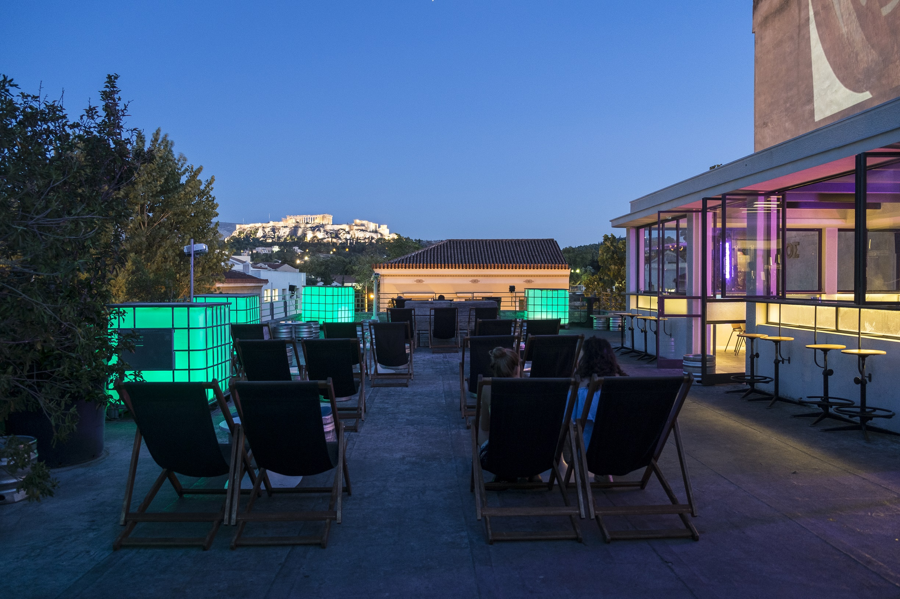
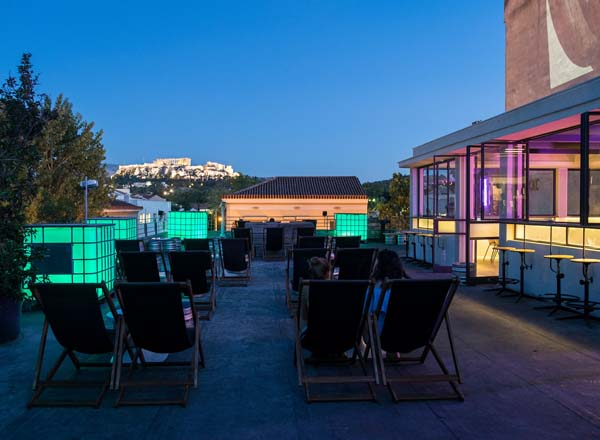
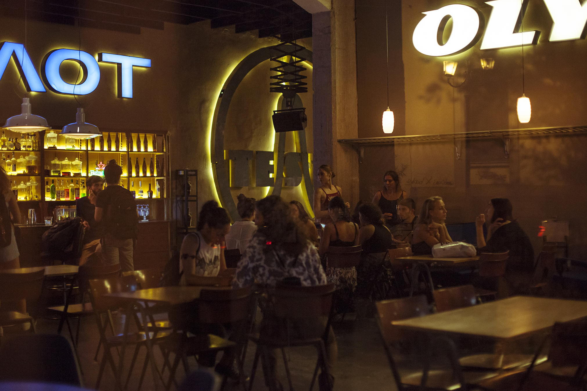

# 📂 DOSSIER #1: BIOS (Pireos 84)

- **Kategorie:** Urige Industrial-Bar, ehrliche Nachbarschafts-Kneipe & Rooftop ohne Stock im Arsch
- **Adresse:** Pireos 84 / Ecke Salaminos 13 (Kerameikos / Metaxourgeio)
- **Google Maps:** [BIOS Athen](https://www.google.com/maps/search/?api=1&query=Bios+Athens&query_place_id=ChIJ_cOT3CC9oRQRcZdnJp_dsRA)
- **Laufweg ab unserem Apartment (Korinnis):** **ca. 400 m / 5 Min. zu Fuß** (einfach die Pireos-Straße Richtung Südwesten runterstolpern)

## 🕒 Voraussichtliche Öffnungszeiten & November-Check
- **Erdgeschoss (Tesla Café-Bar):** Täglich 10:00–02:00 Uhr (Fr & Sa bis 03:00 Uhr)
- **Dachterrasse (Bios Rooftop / 3. OG):** Frühling bis Herbst **täglich ab 18:00 Uhr** bis 02:00 Uhr (Fr/Sa bis 03:00 Uhr)
- **Wetter-Faktor im November:** Die 300 m² große Dachterrasse verfügt über eine massive Zelt-/Planen-Konstruktion, die bei Wind oder Regen Schutz bietet, ohne uns den Blick auf die Akropolis zu verbauen. Sollte es abends doch zu frisch am Hintern werden, verlagern wir das Trinkgelage einfach nahtlos ins Erdgeschoss in die **Tesla Bar**.
- **Aktueller Event-Check (05.–08.11.2026):** Laut offiziellem BIOS-Spielplan gibt es an unserem Wochenende keine geschlossene Ticket-Veranstaltung im Haus — also regulärer, freier Bar- und DJ-Betrieb für unsere Runde.

## 🏭 Architektur, Vibe & Publikum
- **Das Gebäude:** Ehemalige Perdios-Fabrik (fünfstöckiger Industrial-Bau), seit 2002 eine der bekanntesten Kiez-Institutionen für entspannte Drinks mit Aussicht.
- **2 Bereiche für uns Ochos:**
  - **Rooftop („Taratsa“, 3. Stock):** Ehrlicher Sichtbeton statt steifer weißer Tischdecken. Wir fläzen uns in **Liegestühle (Deck Chairs)** oder an einfache Metalltische. Auf eine große weiße Hauswand werden abends stumm alte Kultfilme projiziert, während lokale DJs lässige Beats, Indie, Downbeat oder Deep House auflegen. Dazu gibt es einen völlig ungeschminkten Blick auf die beleuchtete Akropolis mit einem eiskalten Bier in der Hand.
  - **Tesla Café-Bar (Erdgeschoss):** Urig eingerichtet mit **originalen Vintage-Zugsitzen** und alten Airline-Leuchtreklamen, mit direktem Blick auf die vorbeiziehenden Autoscheinwerfer der Pireos-Straße.
- **Publikum:** 90 % Athener Locals (ca. 25–40 Jahre) aus der Nachbarschaft. Null Schickimicki, kein Dresscode, kein Türsteher-Gehabe — hier kann jeder so aufschlagen, wie er aus dem Flieger gefallen ist.
- **Insider-Tipp zum Eingang:** Von außen kaum beschildert. Der Eingang zur Dachterrasse liegt unscheinbar direkt um die Ecke in der Seitenstraße **Salaminos 13** (offene Tür → Treppe oder Aufzug hoch in den 3. Stock).

## 🍽️ Essen: Snacks oder richtige Mahlzeit?
- **Klare Einordnung:** **Reine Bar — kein Ort für ein richtiges Abendessen!**
- **Was es gibt:** Zum Bier und zu den Drinks bekommen wir standardmäßig Schalen mit **gewürztem Gratis-Popcorn** (macht schön durstig für die nächste Runde) sowie einfache Bar-Snacks/Fingerfood (tagsüber im Tesla Café kleine Sandwiches/Bagels).
- **Wichtig für Donnerstagabend:** Wenn wir nach dem Flug ordentlich Kohldampf haben, planen wir das Essen **nicht** im BIOS ein, sondern nutzen den Laden für das erste schnelle Druckbetankungs-Bier oder später für den Absacker.

## 🍹 Getränke, Specials & Preise
- **Signature Drink:** **„Papoto“** (Wortspiel aus *Pagoto* = Eis und *Poto* = Drink) — ein gefrorener Rum-Slush-Cocktail (meist Mango oder Erdbeere), in dem kopfüber ein komplettes **Eis am Stiel (Popsicle)** steckt. Sieht nach Kindergeburtstag aus, knallt aber amtlich. Absoluter Kult-Drink des Ladens.
- **Sonstiges Angebot:** Ehrliche, unkomplizierte Longdrinks, Rum-Drinks, Fass- und Flaschenbier. Keine überkandidelte Pinzetten-Gastronomie, sondern eine bodenständige Tränke.
- **Preise & Einlass:** Für eine Akropolis-Dachterrasse extrem günstig — **Bier 4–6 €, Cocktails 7–10 €**. Kein Eintritt auf dem Dach, kein Mindestverzehr, keine Reservierung (Walk-in only).

## 🎯 Beste Uhrzeit & Taktischer Einsatz
- **Option 1 – Der „Touchdown-Drink“ (Donnerstag ca. 20:00 Uhr):** Koffer in unserem Apartment in der Korinnis in die Ecke pfeffern, 5 Minuten die Straße runterlaufen, auf dem Dach mit dem ersten eiskalten Bier auf die beleuchtete Akropolis und unsere Herrentour anstoßen und danach weiter zum richtigen Essen (z. B. 5 Min. rüber nach Psyri in die *Avli Taverne* oder weiter zu *Upupa Epops*).
- **Option 2 – Der „Heimweg-Absacker“ (00:30–02:00 Uhr):** Wenn wir nachts aus Petralona (*Line Athens* / *Upupa Epops*) oder Gazi zurück Richtung Bett wanken, liegt das BIOS exakt auf unserem Heimweg — ideal für das berühmte „eine geht noch“-Bier vor dem Schlafen.

## 📸 Bilder
- 
- 
- 