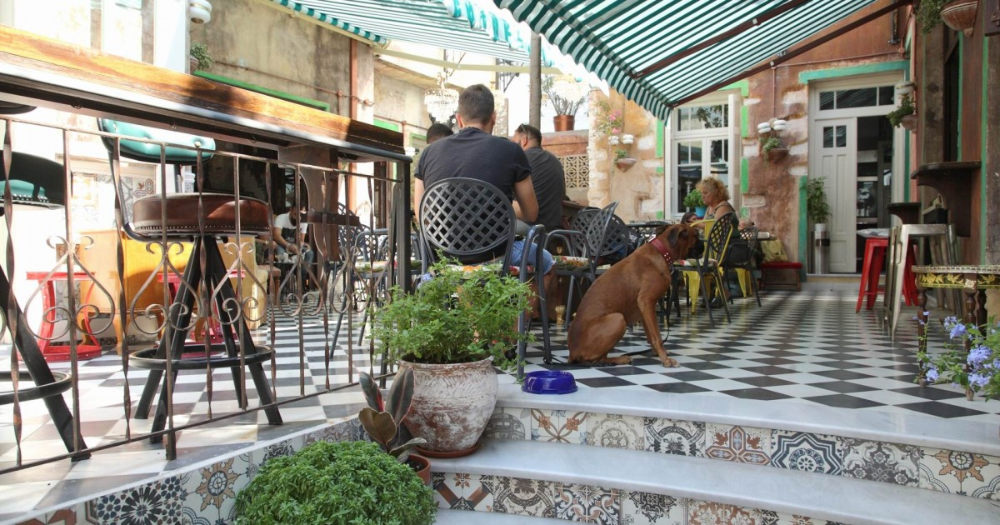
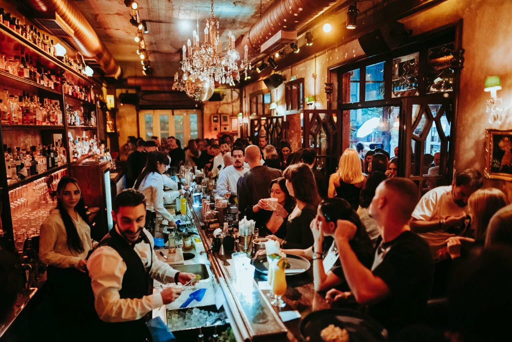
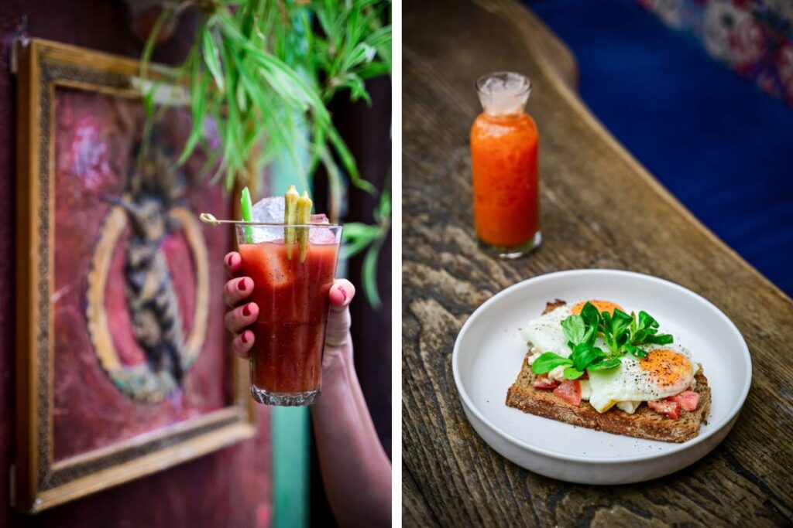
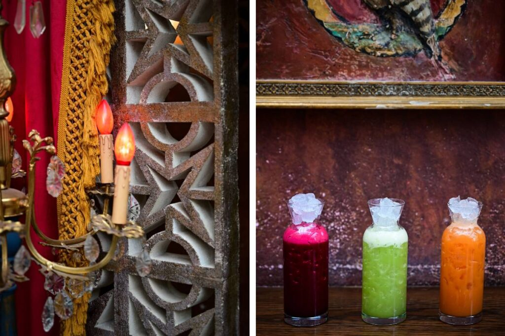
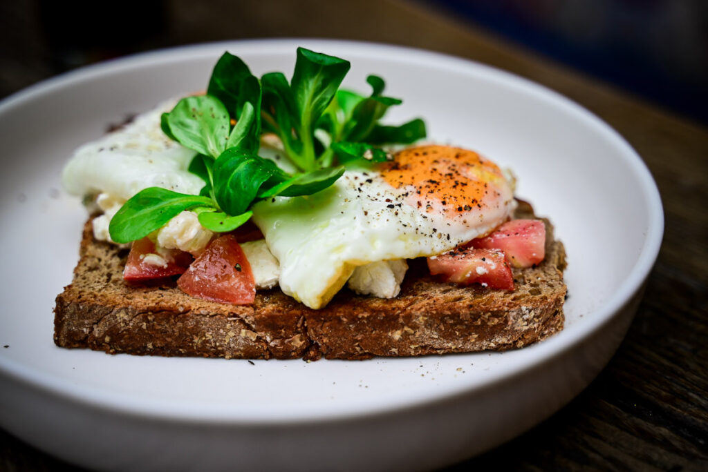

# 📂 DOSSIER #2: UPUPA EPOPS – The Bar (Alkminis 7)

- **Kategorie:** All-Day-Cocktailbar, Vintage-Innenhof, Brunch & gehobenes Barfood
- **Adresse:** Alkminis 7 & Theanous, Kato Petralona (direkt hinter der alten Pavlidis-Schokoladenfabrik)
- **Google Maps:** [Upupa Epops](https://www.google.com/maps/search/?api=1&query=Upupa+Epops+Athens&query_place_id=ChIJ6aOwMeG8oRQRtecCV4GFOvY)
- **Weg ab Apartment (Korinnis):** **1,9 km / ca. 20–22 Min. zu Fuß** (die Pireos-Straße runter über Gazi) oder **5 Min. im Uber/Taxi** (ca. 5–6 €). Liegt knapp **10 Gehminuten vom *Line Athens*** entfernt.

## 🕒 Tatsächliche Öffnungszeiten & Küchenzeiten
- **Barbetrieb:** Täglich ab **09:00 Uhr** geöffnet — **So–Do bis 02:00 Uhr**, **Fr & Sa bis 03:00 Uhr**.
- **Brunch-Küche:** Täglich durchgehend von **09:00 bis 18:00 Uhr** (!).
- **Abendküche (Dinner & Barfood):** Täglich von **18:00 bis ca. 23:45 Uhr**.
- **November- & Wetter-Check:** Der große Innenhof ist von drei Hauswänden windgeschützt eingerahmt und mit Markisen sowie Heizstrahlern ausgestattet. Falls es spät abends zu frisch wird, zieht man in die angrenzenden 1930er-Jahre-Wohnhäuser um, die wie ein eklektisches Vintage-Wohnzimmer mit Samtsofas, Antiquitäten und langer Holzbar eingerichtet sind.

## 🦜 Architektur, Vibe & Publikum
- **Das Ensemble:** Drei verlassene Arbeiterhäuser aus den 1930er-Jahren wurden samt ihren Höfen zu einem zusammenhängenden „Dorf im Viertel“ verschmolzen. Der Name *Upupa epops* ist der lateinische Name für den Wiedehopf (zieht sich als Motiv durch Deko und Karte). Kurioses Detail: Da direkt nebenan die historische Pavlidis-Schokoladenfabrik steht, liegt in den Gassen rundherum oft der Geruch von geröstetem Kakao in der Luft.
- **Der Vibe:** Maximalistischer Retro-Charme, bunte Bodenfliesen, Zitrusbäume und Lichterketten. Es wirkt wie ein großes, sehr stylisches Freiluft-Wohnzimmer.
- **Musik & Lautstärke:** Grooviger Mix aus Soul, Funk, Indie und elektronischen Beats, aber **bewusst so abgemischt, dass man sich am Tisch noch sehr gut unterhalten kann** (im Gegensatz zum *Line Athens* nebenan, das ab 22:00 Uhr auf volle Club-/Warehouse-Lautstärke dreht).
- **Publikum:** Ca. 25–45 Jahre, überwiegend Athener aus dem Viertel, Freundesgruppen und Cocktail-Liebhaber. Lässig-gepflegt, sehr entspannt.

## 🍽️ Essen: Snacks oder richtige Mahlzeit?
- **Klare Einordnung:** **Vollwertiges, richtig starkes Essen!** Hier könnt ihr problemlos euer komplettes Abendessen (oder ein spätes Kater-Frühstück) einplanen.
- **Highlights der aktuellen Abendkarte (ab 18:00 Uhr):**
  - **Pizzette (handgezogener Teig, ideal zum Teilen in der Gruppe):**
    - *Bianca (14 €):* Trüffelcreme, Waldpilze, Taleggio-Käse, Mozzarella & Parmaschinken
    - *Spicy (13,50 €):* Scharfe Spianata Romana, geräucherter Scamorza-Käse, grüner Spargel & sonnengetrocknete Tomaten
    - *Rossa (12 €):* Hausgemachte frische Salsiccia, Tomatensauce, Parmesan & Baby-Rucola
  - **Burger, Sandos & Streetfood-Twists:**
    - *Double Smash Burger (10 €):* Doppeltes Rinder-Patty im Potato Bun mit Cheddar, Pickles & Haus-Sauce
    - *Truffle & Cheese Burger (15 €):* Mit Bacon, hausgemachter Trüffel-Pilz-Creme und handgeschnittenen „Rock“-Pommes
    - *Crispy Chicken Sando (11 €):* Panko-Parmesan-Chicken mit fermentiertem Coleslaw & Limetten-Mayo
    - *Gyros auf indischem Naan-Brot (12 €):* Wahlweise vom Schwein oder Hähnchen
  - **Pasta & Mains:** *Linguine Carbonara* mit geräucherter Pancetta, Taleggio & pochiertem Ei (13 €), *Kartoffel-Gnocchi* (12,50 €) oder *Rinderfilet mit Fries* (23 €).
- **Highlights der Brunch-Karte (bis 18:00 Uhr):**
  - Sauerteigbrot von der berühmten Athener Steinmühlen-Bäckerei *Pnyka*, z. B. als *Kagianas* (griechisches Rührei mit Tomate, kretischem Galomyzithra-Frischkäse & Thymianhonig, 9,50 €) oder *Eggs Benedict* (10–11 €).
  - Hausgebackene *Focaccia mit Pistazien-Mortadella, Stracciatella & Basilikumpesto* (9,50 €).
  - *Pancakes mit Pistaziencreme, Schokolade & knusprigem Kadaifi-Engelshaar* (11,50 €).

## 🍹 Getränke, Specials & Preise
- **Bar-Niveau:** Mitgründerin **Marfi Bali** ist eine feste Größe der Athener Barszene. Extrem gut sortiertes Backboard (seltene Rums, Gins, Whiskys) und hohe Mixology-Qualität ohne arrogantes Gehabe.
- **Signature Cocktails:**
  - **„Conference of the Birds“-Linie:** Aufwendige Eigenkreationen wie der *Amnesia* (Blend aus gereiften Rums, frischer Ananas, Ingwer, hausgemachtem Falernum, Oleo Saccharum & Absinth) oder *Signore Rubino* (Hennessy Cognac, Bénédictine, roter Wermut & Orangenöle).
  - **„The Forgotten Ones“ (Neu):** 80er-Jahre-Trash-Klassiker (*Miami Vice*, *Tequila Sunrise*, *Banana Split*, *Long Island*), aber mit modernen Bar-Techniken und frischen Zutaten auf High-End-Niveau neu interpretiert.
  - **Daydrinking-Specials:** Hausgemachte rote und weiße Sangria sowie eine eigene *Vitamin Bar* mit frisch gepressten Detox-Säften (z. B. Karotte-Sellerie-Ingwer) für den Tag danach.
- **Preise:** **Cocktails 10–13 €, Bier 5–7 €, Hauptgerichte/Pizzette 10–15 €** — für die gebotene Qualität extrem fair.

## 🎯 Beste Uhrzeit & Taktischer Einsatz
- **Option 1 – Donnerstagabend „Dinner-Base“ (ca. 20:00–22:00 Uhr):** Wenn ihr nach dem Flug richtig Hunger habt, direkt hier starten: Im Hof Pizzette, Smash Burger und die ersten zwei Runden Cocktails bestellen, in Ruhe ankommen und quatschen. Gegen **22:00 Uhr lauft ihr knapp 10 Minuten rüber ins *Line Athens***, genau dann, wenn dort die Musik aufgedreht wird.
- **Option 2 – Der „Lebensretter-Brunch“ (Fr/Sa/So 13:00–17:30 Uhr):** Weil es hier **bis 18:00 Uhr Brunch** gibt, ist das dein Ass im Ärmel, falls die Gruppe nach einer harten Partynacht erst am Nachmittag einsatzbereit ist, wenn normale Cafés längst kein Frühstück mehr machen.
- **Reservierungs-Hinweis:** Donnerstags kommt man meist spontan unter; falls ihr am Wochenende abends mit der ganzen Gruppe zum Essen hinwollt, kurz vorher durchklingeln (`+30 212 1055214`).

## 📸 Bilder
- 
- 
- 
- 
- 
