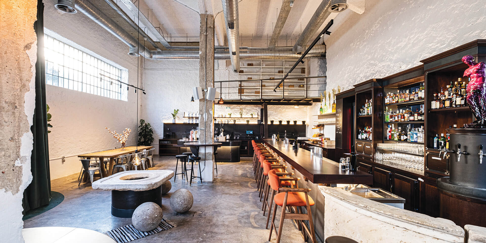
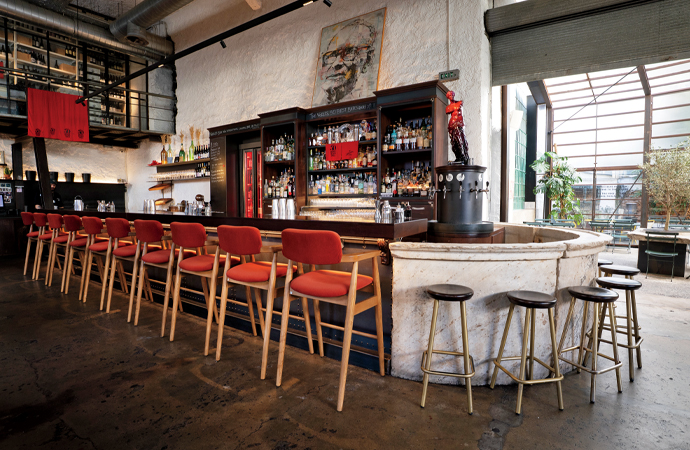
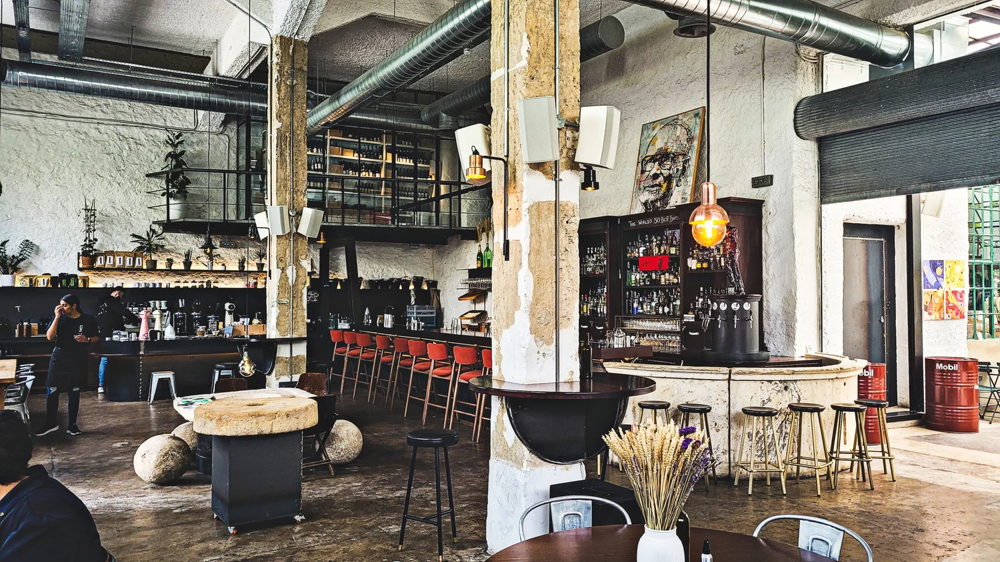
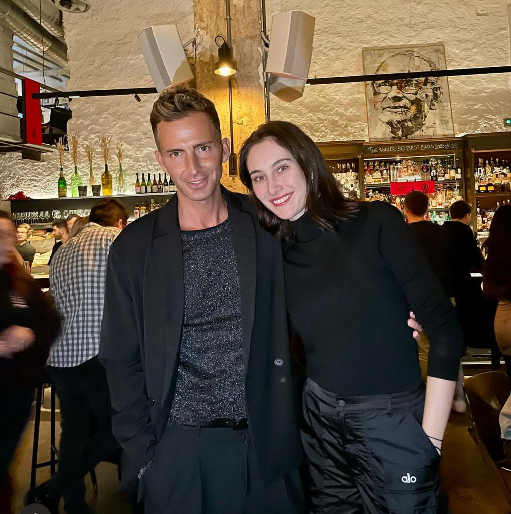

# 📂 DOSSIER #3: LINE ATHENS (Agathodaimonos 37)

- **Kategorie:** Spektakuläre All-Day-Warehouse-Bar, eigene Brauerei/Brennerei & Late-Night-Party-Hotspot (**Platz 1 Europe's 50 Best Bars 2026** & **Platz 5 The World's 50 Best Bars 2026**)
- **Adresse:** Agathodaimonos 37, Kato Petralona
- **Google Maps:** [Line Athens](https://www.google.com/maps/search/?api=1&query=Line+Athens&query_place_id=ChIJ13n7hoG9oRQRXHgFVrMGEGU)
- **Laufwege:**
  - **Vom *Upupa Epops*:** **800 m / knapp 10 Min. zu Fuß**
  - **Von unserem Apartment (Korinnis):** **2,5 km / ca. 28 Min. zu Fuß** oder **6–7 Min. im Uber/Taxi** (ca. 6 €)

## 🕒 Voraussichtliche Öffnungszeiten & Küchenzeiten
- **Barbetrieb:** Täglich **10:00–02:00 Uhr** (Fr & Sa bis **03:00 Uhr**)
- **Küche:**
  - **Brunch / Day Menu:** 10:00–17:00 Uhr
  - **Abendkarte (Barfood & Sharing Plates):** 17:00 bis ca. **23:30 Uhr**
- **November- & Wetter-Check:** Für den November kaum zu schlagen: Die riesige Backstein- und Industriehalle (450 m²) spielt ihre Stärken drinnen voll aus, und selbst der Übergang zum begrünten Innenhof hat einen **glasüberdachten Wintergarten (Conservatory)**. Wir sind hier also zu 100 % wetterunabhängig.

## 🏗️ Räumlichkeiten, Vibe & Publikum
- **Die Location (450 m² alte Werkshalle):** Hier haben sich die Macher von *The Clumsies* (Vasilis Kyritsis & Nikos Bakoulis) und *Three Cents* (Dimitris Dafopoulos) ihren ultimativen Männertraum gebaut — eine riesige Halle mit eigener Bierbrauerei, Brennerei und Sauerteig-Bäckerei unter einem Dach (früher war hier mal die Zoumboulakis-Halle drin).
- **Der Raum-Effekt beim Reinkommen:** Wir gehen durch eine schwere Holztür und einen dicken dunkelgrünen Samtvorhang und stehen plötzlich in einer Halle, in die locker acht normale Kneipen passen würden:
  1. **Links die gläserne Brennerei:** Ein komplettes Brau- und Destillations-Setup hinter Glas, darüber auf einer Empore (Mezzanine) die Flaschensammlung der hauseigenen Obstweine.
  2. **Mitte die riesige Holz-Hauptbar & Stein-Zapfbar:** Zentral zieht sich der endlose dunkle Holz-Tresen durch den Raum; rechts daneben steht eine halbrunde Steinbar (gebaut um einen historischen Athener Marmorbrunnen), an der eigenes Bier und Fass-Cocktails gezapft werden.
  3. **Rechts das Werkstatt-Rolltor & der Hof:** Ein massives Rolltor wie aus einer alten Autowerkstatt steht offen und gibt den Blick frei in den verglasten Wintergarten und den begrünten Patio dahinter.
  4. **DJ-Booth:** Am rechten Ende steht ein massives Holz-DJ-Pult mit fetter Vinyl-Sammlung.
- **Der Vibe-Wechsel (Wichtig für unser Timing!):**
  - **Bis ca. 21:00 Uhr:** Lässiges Industrial-Bistro & entspanntes Anzapfen an Tischen, extrem aufmerksamer und viel entspannterer Service als im oft hektischen *Clumsies*.
  - **Ab ca. 21:30 / 22:00 Uhr:** Das Licht wird heruntergefahren, ein Teil der Tische verschwindet, das Soundsystem drückt ordentlich Bass in die Halle (House, Electronic, Funk/Groove) und der Innenraum wird zur **vollen Steh- und Tanz-Party**. Wenn wir zwischendurch in Ruhe quatschen wollen, gehen wir einfach durchs Rolltor nach hinten in den ruhigeren Wintergarten/Hof.
- **Publikum:** Starkes Ausgeh-Publikum (25–45 Jahre), Athener Nachtschwärmer, Gastro-Leute und internationale Bar-Fans. Weltklasse-Laden, aber komplett locker und ohne Schnösel-Faktor.

## 🍽️ Essen: Snacks oder richtige Mahlzeit?
- **Klare Einordnung:** **Deftiges Sauerteig-Barfood & geniale Sharing-Gerichte** (kein klassisches Sitz-Restaurant mit großen Tellern wie im *Upupa*, aber perfekt zum Teilen direkt zum Bier und den Drinks).
- **Was wir unbedingt auf den Tisch stellen sollten:**
  - **The Bread Experience (7 € – Pflichtbestellung!):** Das Line hat einen eigenen Sauerteig-Ofen (preisgekrönt). Wir bekommen einen ganzen, warmen Laib Sauerteigbrot mit schwarzem Oliven-Aufstrich, Olivenöl und selbstgemachter „Cheese-Cream“ (herzhafter Frischkäse aus der eigenen Brauerei-Molke).
  - **Line's Hot Dogs / Artisanal Buns (9–11 €):** Hausgebackene Brioche-Buns (teilweise mit Tintenfischtinte tiefschwarz gefärbt), die richtig was können:
    - *Beef Sausage Dog (9 €):* Rinderwurst, Pilz-Ketchup, gelber Senf & Essiggurken-Mayo
    - *Tempura Shrimps Dog (9,50 €):* Knusprige Garnelen im schwarzen Bun mit Tarama (würziger Fischrogen-Creme)
    - *Short Ribs Bun (11 €):* Langsam geschmorte Rinderrippe mit geräuchertem Metsovone-Käse & Trüffel
  - **Weitere Bites & Dessert:** *Beef Tartare* mit Trüffel & Kartoffelkruste (13 €), *Fried Chicken* mit schwarzem Knoblauch (10 €), *Sourdough French Toast* mit griechischer Bougatsa-Grießcreme (7 €) und der legendäre *Basque Cheesecake*.

## 🍷 Getränke, Specials & Preise
- **Das Alleinstellungsmerkmal – „Why-ins“ (Weine ohne Trauben):** Zusammen mit dem griechischen Spitzenweingut *Thymiopoulos* vergärt das Line echtes Obst nach klassischer Weinmethode (ohne eine einzige Weintraube). Kein Öko-Vortrag, sondern schmeckt einfach brutal gut — unbedingt eine Runde für den Tisch bestellen:
  - *Pomegranate Why-in* (Granatapfel — trocken, würzig, leicht rauchig)
  - *Fig Why-in* (Feige) oder *Honeydew Melon Why-in* (Honigmelone)
  - *Sparkling Strawberry Wine* (Erdbeer-Schaumwein mit griechischem Bergtee & Tomate)
- **Selbstgebrautes Bier & Wermut:** Eigenes *Symbiosis* Session IPA & New England IPA frisch vom Fass (6–7,50 €) sowie eigener Feigen-Wermut.
- **Signature Cocktails (alle überraschend fair bei 10–13 €):**
  - *Delusional Margarita (11 €):* Tequila Blanco, Mezcal, grüne Oliven, Koriander & Limette (salzig, rauchig, einer der besten Drinks der Karte)
  - *Leftover Spritz:* Haus-Spirituosen, Rose, Tomate, Kardamom & Holunderblüte
  - *12 Stars Collins (11 €):* Metaxa 12 Stars, Baumwollhonig-Geist, Honig-Essig & roher Baumwollhonig
  - *Mary Pickford (11 €):* Hausgemachter Granatapfel-Brand, fermentierte Ananas & Granatapfel-Melasse
- **Preise:** Für die offiziell **beste Bar Europas 2026** fast unverschämt günstig: **Cocktails 10–13 €, Why-ins im Glas 7–9 €, Bier 6–7,50 €, Essen 7–13 €**.

## 🎯 Beste Uhrzeit & Taktischer Einsatz
- **Die perfekte Kombi mit *Upupa Epops*:** Erst im *Upupa Epops* (oder einer Taverne) ordentlich zu Abend essen und im Hof vorglühen, dann gegen **21:00 / 21:30 Uhr die 10 Minuten rüber ins *Line* spazieren**. So sichern wir uns noch entspannt einen Platz für eine *Bread Experience*, eine Ladung Hot Dogs und die erste Runde *Why-ins* oder IPAs, bevor ab 22:00 Uhr die Halle brennt und der DJ aufdreht.
- **Tipp für unsere 8er-Truppe:** Wenn wir am Donnerstag- oder Freitagabend sicher einen Tisch für alle Mann wollen, kurz über `lineathens.gr` oder telefonisch (`+30 211 7507185`) reservieren — an der riesigen Mittelbar und im Stehen kommen wir aber auch spontan rein.

## 📸 Bilder
- 
- 
- 
- 