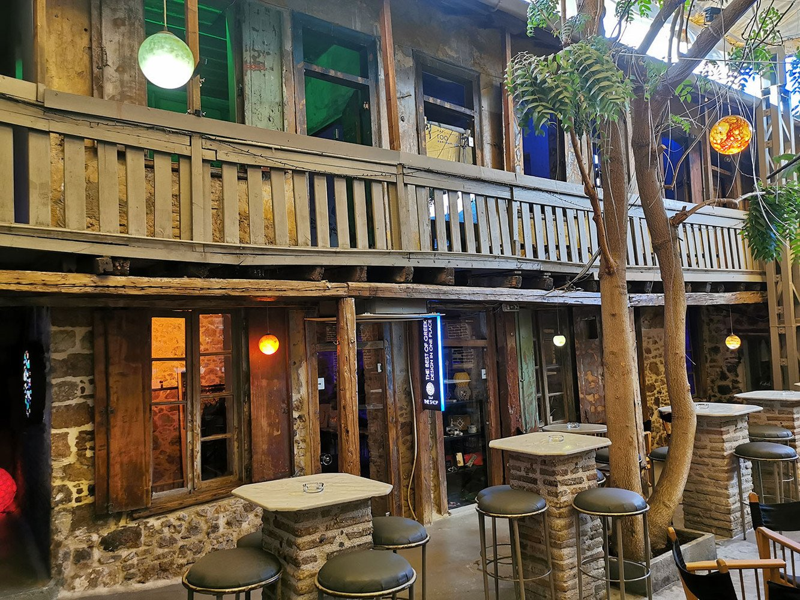
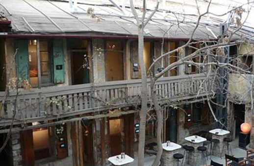
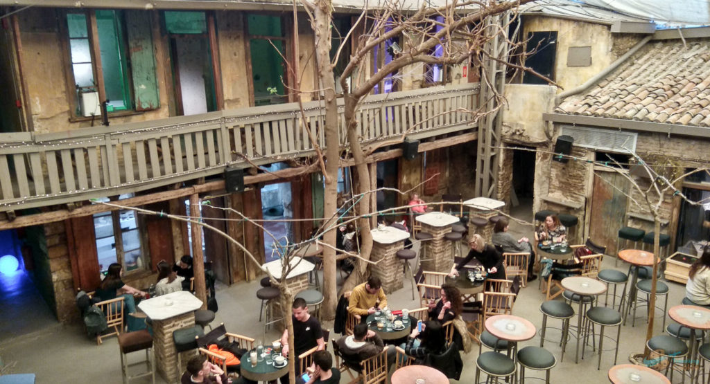
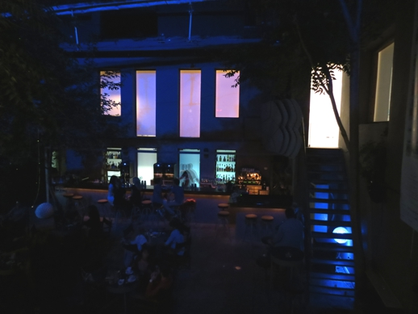
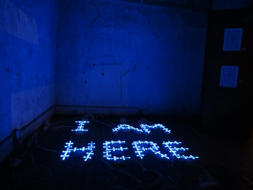

# 📂 DOSSIER #4: T.A.F. – THE ART FOUNDATION (Normanou 5)

- **Kategorie:** Versteckter 19.-Jh.-Innenhof („Athener Ruinenbar“), Kunstgalerie & All-Day-Cocktailbar
- **Adresse:** Normanou 5, Monastiraki (kleine Seitengasse direkt zwischen Ermou-Straße und dem Flohmarkt *Ifestou*)
- **Google Maps:** [TAF (The Art Foundation)](https://www.google.com/maps/search/?api=1&query=TAF+The+Art+Foundation+Athens&query_place_id=ChIJk4XyViK9oRQRz5_VHhupvS8)
- **Laufweg ab Apartment (Korinnis):** **ca. 800 m / 8–10 Min. zu Fuß** (quer durch die Gassen von Psyri). Liegt buchstäblich **Tür an Tür mit *Couleur Locale* (Normanou 3)**.

## 🕒 Tatsächliche Öffnungszeiten & November-Check
- **Bar im Innenhof:** Täglich **10:30–02:00 Uhr** (Fr & Sa bis **03:00 Uhr**)
- **Kunstgalerie (1. OG) & Design-Shop:** Täglich **12:00–20:00 Uhr** (bei Ausstellungs-Events oft bis 21:00 Uhr, **Eintritt komplett frei**)
- **Wetter-Faktor im November:** Der gesamte Innenhof wird in der kühleren Jahreszeit **winterfest überdacht und beheizt** — der Clou dabei: Die echten, hohen Bäume wachsen mitten durch den geschützten Hof. Ihr sitzt also trocken und warm, aber trotzdem „draußen“ unter Bäumen.

## 🏛️ Räumlichkeiten, Geschichte, Vibe & Publikum
- **Die krasse Geschichte des Gebäudes (Baujahr 1870):** Das Haus ist das letzte erhaltene Hof-Ensemble dieser Art in Monastiraki. Es wurde 1870 (noch unter König Otto) ursprünglich als **Arrest-/Gefängnisbau** errichtet und diente später bis zur deutschen Besatzungszeit als ärmliches **Gemeinschafts-Wohnhaus für 13 Familien** und Handwerksbetriebe, die sich den Hof und eine einzige Küche teilten. Jahrzehntelang verfiel das Gebäude, bis 2009 das Kunstkollektiv *metamatic:taf* einzog.
- **Der „Speakeasy“-Effekt beim Reinkommen:** Wenn ihr abends durch die dunkle, fast ausgestorbene Flohmarktgasse *Normanou* lauft, sind alle Rollgitter der Trödelläden heruntergelassen. Nur ein winziges Leuchtschild neben einer alten, verwitterten Holztür markiert den Eingang. Man geht durch einen kargen Stein-Vorraum — und steht plötzlich in einem beleuchteten, begrünten Innenhof voller Menschen.
- **Die Raumaufteilung (Ruinenbar trifft Galerie):**
  - **Erdgeschoss (Der Hof):** In der Mitte steht die große, rundum bespielte Quadrat-Bar unter hohen Bäumen, drumherum Tische und schwarze Regisseurstühle. Die abbröckelnden Steinmauern und der Putz aus 150 Jahren wurden bewusst im Originalzustand („Shabby Ruin Look“ wie bei den berühmten Budapester Ruinenbars) belassen.
  - **1. Stock (Holzbalkon & Ausstellungsräume):** Über eine alte Treppe gelangt man auf einen umlaufenden Holzbalkon, von dem aus man von oben auf die Bar und das Publikum im Hof schaut. Die ehemaligen winzigen Schlafstuben der 13 Familien rund um den Balkon sind heute einzelne **Mini-Galerieräume**, durch die man mit dem Drink oder vorab kostenlos schlendern kann.
- **Musik & Vibe:** Kein Bumm-Bumm-Schuppen, sondern richtig geschmackvoller Sound: Das Resident-DJ-Team legt abends **Jazz, Nu-Jazz, Soul, Funk, Afro-Grooves und elektronische Downbeats** auf.
- **Publikum:** Bunt gemischt (20–45 Jahre) — Athener Kunststudenten, Architekten, Kreative und Reisende, die den Eingang gefunden haben. Sehr entspannt, null Dresscode.

## 🍽️ Essen: Snacks oder richtige Mahlzeit?
- **Klare Einordnung:** **Café- & Cocktailbar mit kleiner Snack-Karte — kein Ort für ein großes Abendessen!**
- **Was es gibt:**
  - Zu Bier und Drinks gibt es standardmäßig Schälchen mit **Erdnüssen/Knabbereien aufs Haus**.
  - Tagsüber und am frühen Abend gibt es eine kleine Karte mit **Sandwiches, Tortillas, Salaten, Käse-/Aufschnitt-Platten** (mit Produkten kleiner griechischer Erzeuger) und Süßem.
- **Taktischer Hinweis:** Wenn der Hof abends ab 21:00 Uhr voll ist, hat die Bar klar Vorrang vor der kleinen Küche. Esst vorher in Psyri (z. B. 4 Min. entfernt in der *Avli Taverne*) und kommt für die Drinks ins TAF.

## 🍹 Getränke, Specials & Preise
- **Konzept-Cocktails:** Das Bar-Team entwirft jede Saison eine eigene Cocktailkarte, die sich thematisch an die laufenden Kunstprojekte anlehnt und stark mit griechischen Kräutern, Mastiha, Tsipouro und Zitrusfrüchten arbeitet.
- **Bekannte Haus-Klassiker & Winter-Specials:**
  - *Judy in Disguise:* Mandarine mit feinen Noten von dunkler Schokolade und Lavendel
  - *Mandaray:* Würzig-frischer Drink mit berühmtem Mandarinen-Destillat von der Insel Chios und Zitrus
  - *Hot Butteraki (Winter-Special):* Falls es abends frisch ist — heißer kretischer Raki, verfeinert mit Butter, Orange und süßen Wintergewürzen
  - Dazu klassisches griechisches Fass-/Flaschenbier, Wein und kalter Ouzo/Tsipouro.
- **Preise:** Mitten im Zentrum sehr fair — **Bier 4,50–6 €, Cocktails 8–10 €, Kaffee 3,50–4,50 €**. Kein Eintritt.

## 🎯 Beste Uhrzeit & Taktischer Einsatz
- **Option 1 – Der „Kenn-ich-eine-Geheimtür“-Move (Do/Fr/Sa ab 21:30–02:00 Uhr):** Perfekt, wenn ihr aus Psyri oder vom Monastiraki-Platz kommt. Du führst die Jungs in eine scheinbar tote, dunkle Seitengasse, drückst die alte Holztür auf und plötzlich stehen alle im vollen, beleuchteten Baum-Innenhof. Der Überraschungseffekt funktioniert bei Erstbesuchern zu 100 %.
- **Option 2 – Der „Kultur-Alibi-Stopp“ am Nachmittag (16:00–19:30 Uhr):** Wenn ihr noch vor 20:00 Uhr reinschaut, sind oben auf dem Holzbalkon noch alle kleinen Galerieräume offen — ideal für einen schnellen Rundgang (15 Min.) + ersten Drink unten im Hof.
- **Direkter Doppelpass:** Da das Rooftop **Couleur Locale (Normanou 3)** buchstäblich das Nachbarhaus in derselben winzigen Gasse ist, könnt ihr in 30 Sekunden zwischen „Blick von oben auf die Akropolis“ (*Couleur Locale*) und „versteckter Ruinen-Innenhof“ (*TAF*) wechseln.

## 📸 Bilder
- 
- 
- 
- 
- 
