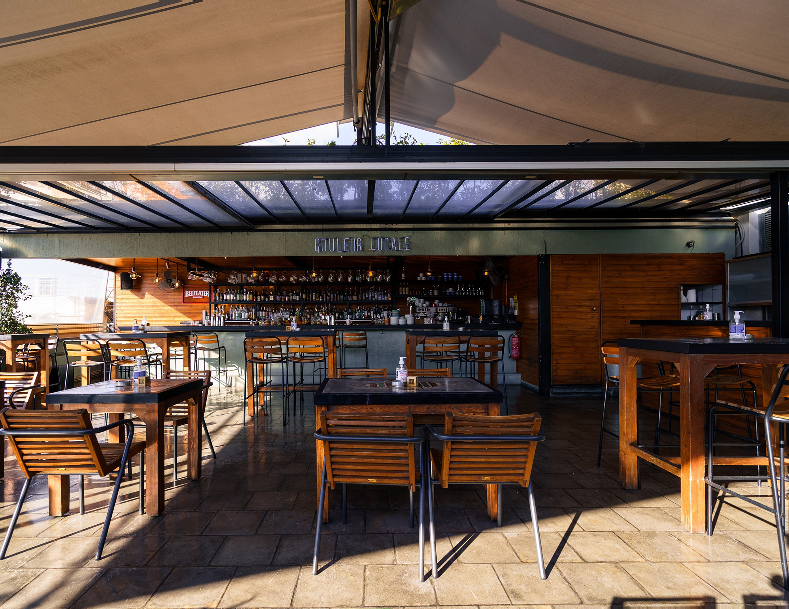
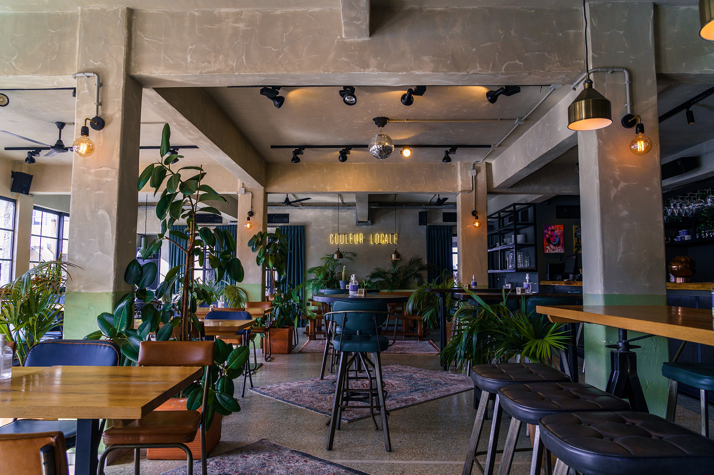
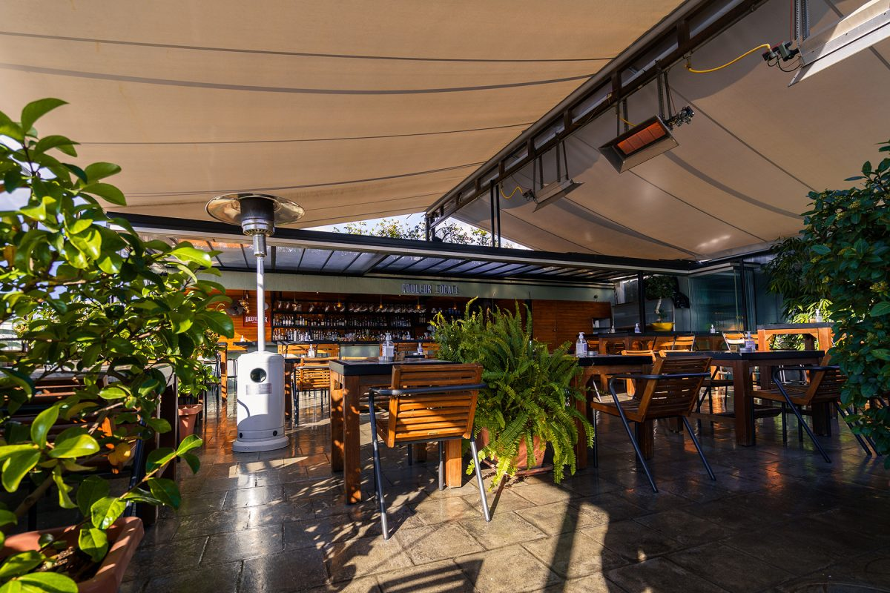
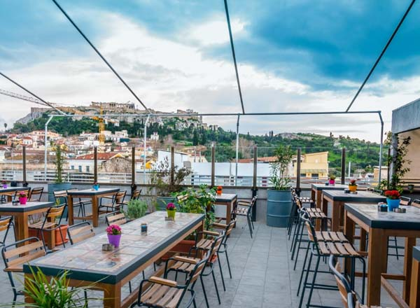
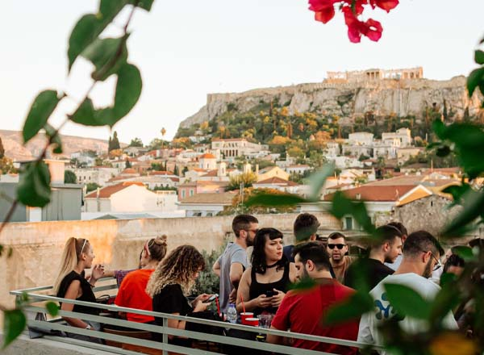

# 📂 DOSSIER #5: COULEUR LOCALE (Normanou 3)

- **Kategorie:** Versteckte All-Day Rooftop-Bar & Bistro (3. Stock) mit Frontalblick auf die Akropolis
- **Adresse:** Normanou 3 (in der Ladenpassage / *Stoa*), 105 55 Monastiraki, Athen
- **Google Maps:** [Couleur Locale](https://www.google.com/maps/search/?api=1&query=Couleur+Locale+Athens&query_place_id=ChIJYzvSVSK9oRQRXdJTkbjBNUs)
- **Kontakt:** Tel. `+30 216 7004917` | [couleurlocaleathens.com](https://couleurlocaleathens.com/en/)
- **Laufweg ab Apartment (Korinnis):** **ca. 800 m / 8–10 Min. zu Fuß** (quer durch Psyri). Liegt **direkt neben dem *TAF – The Art Foundation* (Normanou 5)** — keine 15 Meter Fußweg von Haustür zu Haustür.

## 🕒 Voraussichtliche Öffnungszeiten, Küchenzeiten & November-Check
- **Voraussichtliche Öffnungszeiten:** So–Do **09:30–01:00 Uhr**, Fr & Sa **09:30–02:00 Uhr**
- **Küchen- & Barzeiten (offizieller Katalog 2026):**
  - **Coffee, Smoothies & Morning:** 09:30–19:30 Uhr
  - **Brunch-Küche:** 09:30–15:00 Uhr
  - **Dinner- & Burger-/Pinsa-Küche:** **15:00–23:45 Uhr** (durchgehend warme Küche ab Nachmittag bis kurz vor Mitternacht!)
  - **Cocktails & Night-Bar:** 17:30–00:45 Uhr (Fr/Sa bis kurz vor 02:00 Uhr)
- **Wetter-Faktor im November:** Ganzjährig geöffnet. Die große Dachterrasse im 3. OG ist mit **Pergola-/Zeltüberdachung, Windschutz und Heizstrahlern** ausgestattet; zusätzlich gibt es den hellen, rundum verglasten **Indoor-View-Bereich** mit großeer Bar und freiem Blick auf den Akropolis-Felsen.

## 🏛️ Räumlichkeiten, Vibe & Publikum
- **Der „Aufzug-Speakeasy“-Effekt:** Unten in der schmalen Antiquitäten- und Trödelgasse *Normanou* deutet fast nichts auf eine große Rooftop-Bar hin. Ihr biegt in eine unscheinbare, alte Händler-Passage (*Stoa*) ein, fahrt mit dem Aufzug in den 3. Stock — und sobald sich die Tür öffnet, steht ihr direkt vor einem **Breitwand-Panorama der Akropolis und des Parthenon** über den Ziegeldächern von Monastiraki und Plaka.
- **Architektur & Raumaufteilung:** Ehemaliges Handwerker- und Lagerhaus, umgebaut im warmen Retro-/Boho-Stil mit viel Holz, Tischen mit bunten Vintage-Fliesen, Upcycling-Lampen aus den alten Lagerbeständen und Töpfen voller griechischer Kräuter (Basilikum, Minze, Rosmarin). Die lange Hauptbar geht an einem Ende direkt in die offene Küche über. (Der 2. Stock dient als separater Event-Space).
- **Musik & Stimmung:** Das genaue Gegenteil einer steifen Hotel-Dachterrasse. Tagsüber sonnig-entspannt; ab dem frühen Abend legen täglich wechselnde DJs **Funk, Soul, Nu-Disco, Freestyle und elektronische Grooves mit Ethnic-/Greek-Touch** auf. Ab **ca. 20:30/21:00 Uhr** wird es voll, laut und sehr gesellig (Stehtische & Bar-Crowd).
- **Publikum:** Trotz der 1A-Aussicht sehr viele **junge Athener Locals (25–40 Jahre)**, Freundesgruppen und Reisende, die keine Lust auf Schickimicki-Preise haben. Dresscode: Komplett locker (Casual).

## 🍽️ Essen: Snacks oder richtige Mahlzeit?
- **Klare Einordnung:** **Vollwertiges Bistro- & Streetfood-Menü (durchgehend 15:00–23:45 Uhr) + großes Brunch-Menü (09:30–15:00 Uhr)** — deutlich mehr richtiges Essen als nebenan im *TAF*.
- **Ehrlicher Qualitäts-Check:** Sehr solide für **Burger, Club-Sandwiches oder eine große Käse-/Wurstplatte zum Teilen** neben den Drinks. Keine Hochküche (von der Pinsa/Pizza sollte man keine kulinarischen Wunder erwarten, und wenn der Laden brechend voll ist, dauert die Küche manchmal etwas länger).
- **Konkrete Gerichte & Preise (aktuelle Karte 2026):**
  - **Burgers (alle inkl. Pommes):**
    - *Classic Cheeseburger:* 13,00 €
    - *Chicken Burger* mit Coleslaw, Honig-Senf-Sauce & Bacon: 13,50 €
    - *BBQ Burger* mit Beef-Patty, geschmortem Pulled Pork, karamellisiertem Bacon, Bourbon-BBQ-Mayo, Cheddar, Spicy Honey & Spiegelei: 14,50 €
    - *Mini Burgers (4er-Mix zum Teilen):* 14,50 €
  - **Sandwiches, Mains & Platten zum Teilen:**
    - *Couleur Locale Club* (Focaccia, Crispy Chicken, karamellisierter Bacon, Coleslaw, Curry-Mayo & Pommes): 14,00 €
    - *Pulled Pork Sandwich:* 13,50 € | *Classic Club:* 12,00 €
    - *Griechische Käse- oder Aufschnitt-Platte* (von kleinen Erzeugern aus ganz Griechenland, für 2 / 4 Personen): 15,00 € / 23,00 €
    - *Schweinefilet (Psaronefri)* mit hausgemachter BBQ-Sauce & Süßkartoffeln: 18,00 € | *Chicken Tagliata:* 17,00 €
    - *Pinsa Romana* (Margherita 11 €, Graviera 12 €, Chorizo 12,80 €, BBQ Chicken 14 €)
  - **Brunch (09:30–15:00 Uhr):** *Salty Pancakes* mit Cheddar-Sauce, Bacon & Spiegelei (9,00 €), *Salty Waffle* mit Crispy Chicken & Avocado (10,80 €), *Croque Madame* (10,50 €), *Tsoureki-Waffel* mit Mastiha-Creme & Kaimaki-Eis (12,00 €).

## 🍹 Getränke, Signature Drinks & Preise
- **Starkes Preis-Leistungs-Verhältnis:** Für den direkten Postkarten-Blick auf die Akropolis sind die Preise extrem fair (in den großen Hotel-Rooftops zahlt ihr fast das Doppelte).
- **Signature Cocktails (12–15 €):**
  - *Sleep No More (13 € – der absolute Nr.-1-Bestseller des Hauses!):* Rumours Dry Gin, Chios-Mastiha, Passionsfrucht, frischer Gurkensaft, Ingwer und Basilikum.
  - *Nemesis (14 €):* Mezcal-Blend (The Lost Explorer & Vida), Thymian-Likör, Oregano-Cordial & Limette.
  - *Anise Sour (13 €):* Barbagianni Ouzo, Amaretto, Vanille, Limette, Passionsfrucht & Meringue-Creme.
  - *Celtic Sour (14 €):* Bushmills Irish Whiskey, griechischer Zimtlikör (*Roots Kanela*), Bergamotte, Mandarine, Honig & Matcha.
  - *Nights in Tulum (15 €)* & *El Mexicano (14 €)* (Tequila-/Mezcal-Signatures).
- **Sundowner-Spritzes (11–12 €):**
  - *Athenian Spritz (11 €):* Otto’s Athens Vermouth, Prosecco & Tonic.
  - *Soleil Spritz (12 €):* Pfirsichlikör, *Kitro Naxou* (Zitronatzitronen-Destillat von Naxos), Moscato d’Asti & Ginger Ale.
  - *Esperos (12 €):* Mandarinenlikör, Yuzu, Prosecco & Pink Grapefruit Soda.
- **Bier, Wein & Kaffee:** Griechisches Fassbier *Mamos Pilsener* oder *Nymfi Lager* (0,4 l: **7,00 €**), *Septem 8th Day IPA* (**7,00 €**), *Murphy’s Irish Stout* (0,5 l: **7,00 €**), griechische Weine im Glas (**8–9 €** / Flasche **28–32 €**), *Freddo Espresso / Cappuccino* (**4,80–4,90 €**).

## 🎯 Beste Uhrzeit & Taktischer Einsatz
- **Option 1 – Der perfekte Sundowner-Move (16:45–19:00 Uhr):** Im November geht die Sonne in Athen gegen **17:20 Uhr** unter, und kurz danach wird die Akropolis angestrahlt. Wenn ihr gegen 16:45 Uhr ohne Reservierung reinlauft, bekommt ihr entspannt einen Platz mit freier Sicht, nehmt die goldene Stunde + die beleuchtete Akropolis bei einem *Sleep No More* oder *Athenian Spritz* mit und könnt nebenbei Burger oder eine Käseplatte snacken.
- **Option 2 – Der „Normanou-Doppelpack“ (Aufzug + Ruinenhof):** Da **Couleur Locale (Normanou 3)** und **TAF (Normanou 5)** buchstäblich Nachbarhäuser sind, ist die unschlagbare Kombi: Erst oben im 3. Stock vom *Couleur Locale* den Akropolis-Blick zum Sonnenuntergang mitnehmen — und wenn es dunkel ist, mit dem Aufzug runter, 15 Meter nach links durch die Holztür ins *TAF* in den versteckten Ruinen-Innenhof wechseln.
- **Reservierung / Walk-in:** Walk-in klappt tagsüber und am späten Nachmittag problemlos; für Freitag-/Samstagabend in größerer Gruppe kann man kurz durchklingeln (`+30 216 7004917`).

## 📸 Bilder
- 
- 
- 
- 
- 
