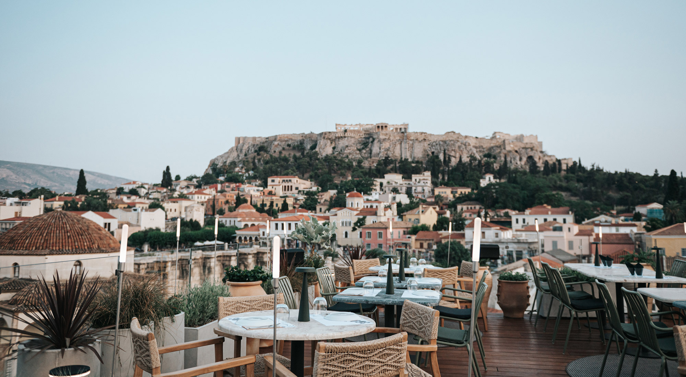
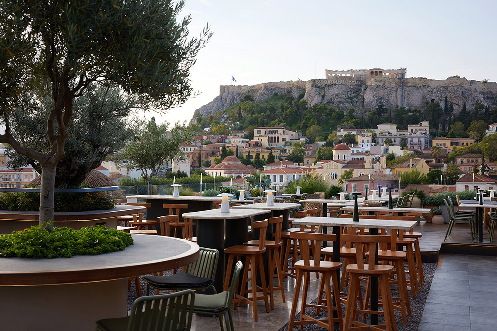
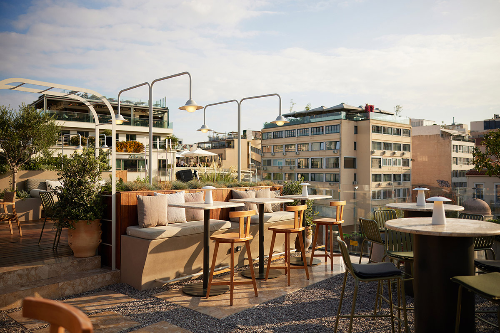
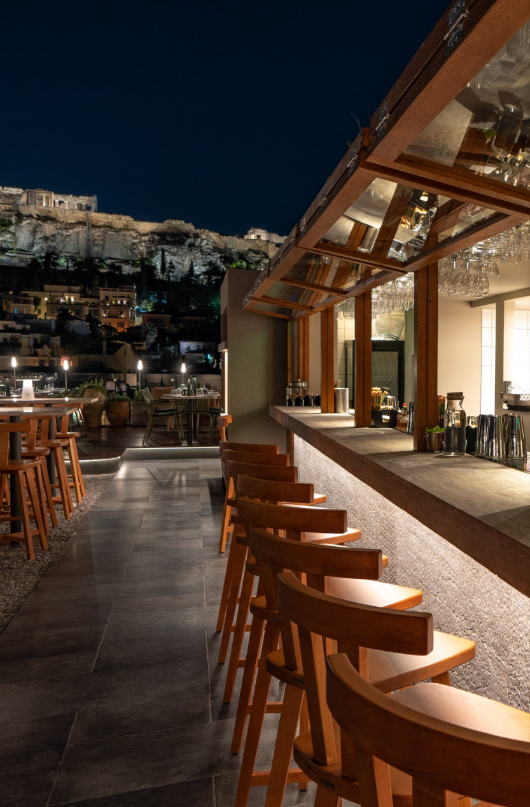
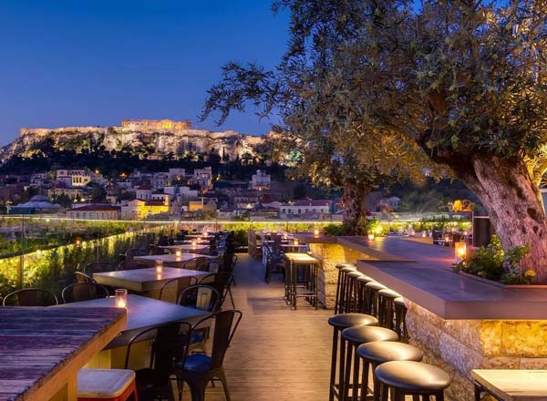

# 📂 DOSSIER #6: 360 COCKTAIL BAR & RESTAURANT (Ifestou 2)

- **Kategorie:** 3-stöckige Industrial-Rooftop-Bar & Restaurant direkt am Monastiraki-Platz
- **Adresse:** Ifestou 2 (Eingang direkt am Monastiraki-Platz neben der Metro-Station), 105 55 Monastiraki, Athen
- **Google Maps:** [360 Cocktail Bar](https://www.google.com/maps/search/?api=1&query=360+Cocktail+Bar+Athens&query_place_id=ChIJr77kUSK9oRQRm8vabceEUIY)
- **Kontakt:** Tel. `+30 210 3210006` | `info@three-sixty.gr` | [three-sixty.gr](https://three-sixty.gr/)
- **Laufweg ab Apartment (Korinnis):** **ca. 800 m / 9 Min. zu Fuß** (durch Psyri bis zum Monastiraki-Platz).
- **Distanz zu TAF & Couleur Locale:** **ca. 110 m / 1 Minute zu Fuß** (nur einmal aus der Normanou-Gasse vor zum Monastiraki-Platz).

## 🕒 Voraussichtliche Öffnungszeiten, Küchenzeiten & November-Check
- **Voraussichtliche Öffnungszeiten:** So–Do **10:00–01:30 Uhr**, Fr & Sa **10:00–02:30 Uhr** (freitags/samstags an der Bar oft bis 03:00 Uhr)
- **Küchen- & Barzeiten:**
  - **Coffee & Brunch:** ab 10:00 Uhr bis in den Nachmittag
  - **Lunch & Dinner Restaurant:** durchgehend warme Küche bis ca. **23:30 / 00:00 Uhr**
  - **Cocktail-Bar & DJ-Sets:** bis Betriebsschluss (01:30 bzw. 02:30 Uhr)
- **Wetter-Faktor im November:** Absolut wetterfest durch den **dreistufigen Aufbau** (auf dem Dach des *360 Degrees Hotel*):
  1. **Oberstes Dachdeck (Open-Air Rooftop Garden):** Begrünter Dachgarten mit Bäumen, Kräutern, großeer quadratischer Mittelbar, Markisen/Schirmen und starken Heizstrahlern.
  2. **Darunterliegende verglaste Panorama-Etagen (Indoor Lounge & 2. OG Restaurant):** Komplett wettergeschützt im Industrial-Design mit bodentiefen Panoramafenstern direkt auf den belebten Monastiraki-Platz und hoch zur Akropolis.

## 🏛️ Räumlichkeiten, Vibe & Direktvergleich mit Couleur Locale
- **Architektur & Look:** Während das *Couleur Locale* (Normanou 3) versteckt in einer Hinterhof-Passage liegt und eher wie ein entspanntes Boho-/Wohnzimmer-Bistro wirkt, sitzt das **360** **direkt in der ersten Reihe am Monastiraki-Platz**. Unten am Platz führt ein kleiner Eingang (samt beschrifteten Treppenstufen und Aufzug) hoch in eine Kombination aus **Industrial-Loft (Stahl, Backstein, viel Glas)** und einem **begrünten Dachgarten-Biergarten** ganz oben.
- **Der 360°-Blickwinkel:** Ihr schaut nicht nur frontal auf die **Akropolis und den Parthenon**, sondern habt gleichzeitig den direkten Tiefblick auf das Gewusel des **Monastiraki-Platzes** (Tzistarakis-Moschee, Pantanassa-Kirche, Straßenmusiker) sowie den Rundumblick bis zum Lykabettus-Hügel.
- **Vibe & Publikum:** Etwas schicker, größer und touristischer frequentiert als das *Couleur Locale*, aber durch die große Quadrat-Bar auf dem Dach abends sehr lebendig (Mischung aus 50 % internationalen Gästen und 50 % Athener Ausgeh-Crowd, 25–45 Jahre). Musik: Mainstream-House, Vocal-Grooves, Funk & Club-Tunes am späteren Abend.

## 🍽️ Essen: Snacks oder richtige Mahlzeit?
- **Klare Einordnung:** **Vollwertiges Restaurant mit gehobener griechisch-mediterraner Küche (Chef Kostas Giannakos)** + **Brunch & Bar-Fingerfood** — kulinarisch aufwendiger (aber auch spürbar teurer) als im *Couleur Locale*.
- **Konkrete Gerichte & Preise:**
  - **Bar-Snacks, Pinsa & Burger (ideal zum Drink):**
    - *Black Angus Beef Burger* bzw. *Mini Burgers* mit BBQ-Sauce, geräuchertem Metsovone-Käse & Zwiebel-Chutney: **ca. 15–18 €**
    - *Pinsa Romana* mit Tomatensauce, Mozzarella & Basilikum-Pesto oder griechischem Aufschnitt: **ca. 13–16 €**
    - *Fish & Shrimp Sticks* mit Zitronen-Olivenöl-Dip / *BBQ Chicken Wings*: **ca. 12–15 €**
  - **Gehobene Restaurant-Küche (Dinner, ca. 35–45 € p. P.):**
    - *Poli Salad* (marinierter Kohl, Orangen-Dressing, Baby-Gemüse, Walnüsse, Pinienkerne & Graviera-Crumble): **ca. 13–14 €**
    - *Griechischer Salat* mit Feta aus Monemvasia & Rinder-Pastrami aus Drama: **ca. 14 €**
    - *Calamarata Pasta* mit Safran-Sauce aus Kozani, Kalathaki-Käse aus Limnos, Chili-Olivenöl & frischem Garnelen-Tatar: **ca. 19–22 €**
    - *Surf ’n’ Turf vom Grill* (griechisches Kalb, Schafswurst, Garnelen & Baby-Squid) oder *Bio-Kalulsschulter-Steak*: **ca. 24–32 €**
  - **Brunch & Desserts:** *Knusprige Galaktoboureko-Rolle* mit Ägina-Pistazien, Zimt-Orangen-Sirup & Kaimaki-Eis (**ca. 10–12 €**), Eierspeisen & Sandwiches (**10–14 €**).

## 🍹 Getränke, Signature Cocktails & Preise
- **Cocktail-Konzept („Graffiti Menu“):** Sehr starke Bar-Mannschaft, die klassische Drinks mit griechischen Aromen kombiniert.
- **Signature Cocktails (ca. 12–16 €):**
  - *Greek Kaimaki (der langjährige Bestseller des Hauses):* Spielt mit dem Geschmack des traditionellen griechischen Mastiha-/Salep-Eises.
  - *360 New Clear Sangria:* Trockener Weißwein, Feige und Orange (geklärt/clarified).
  - *Matcha Fragola Spritz:* Erdbeere, Matcha & Bubbles.
  - *Colpo Grosso*, *Rose Apricot* & *360 Sunset Daiquiri*.
- **Bier & Wein:** Große Auswahl an **griechischen Craft-Bieren** (*Kirki Pale Ale*, *Pikri IPA*, *Pikri Forbidden IPA*, *Beach Bum Tropical Ale*, *La Felicita Pilsner*) sowie *Budweiser Lager* (**ca. 7–8,50 €**); griechische Weine im Glas (**8–12 €**).

## 🎯 Beste Uhrzeit & Taktischer Einsatz (360 vs. Couleur Locale)
- **Wann Couleur Locale (Normanou 3), wann 360 (Ifestou 2)?**
  - **Couleur Locale** ist **lässiger, versteckter, günstiger** und hat das jüngere Athener Local-Publikum.
  - **360 Cocktail Bar** ist eure **perfekte Alternative direkt nebenan (1 Min. Fußweg)**, wenn:
    1. im *Couleur Locale* zum Sonnenuntergang kein Platz mehr mit freier Sicht ist,
    2. das Wetter abends ungemütlich wird und ihr auf Nummer sicher im **verglasten Industrial-Stockwerk direkt über dem Monastiraki-Platz** sitzen wollt, oder
    3. ihr auf dem Dach statt Burgern lieber **richtiges griechisches Dinner (Pasta, Steak, Meze) oder griechische Craft-IPAs (*Pikri / Kirki*)** wollt.
- **Wichtiger Insider-Hinweis zu Reservierungen:** Für einen **Restaurant-Tisch in der ersten Reihe am Abend** verlangt das 360 bei Reservierungen oft einen **Mindestverzehr (ca. 40–50 € p. P.)** bzw. setzt auf Dinner-Gäste. **Taktik für euch:** Wenn ihr nur auf 1–2 Drinks hochwollt, stellt euch einfach ohne Reservierung direkt an die **große 360-Grad-Mittelbar auf dem Dach** — dort gibt es keinen Mindestverzehr und den besten Rundumblick!

## 📸 Bilder
- 
- 
- 
- 
- 
