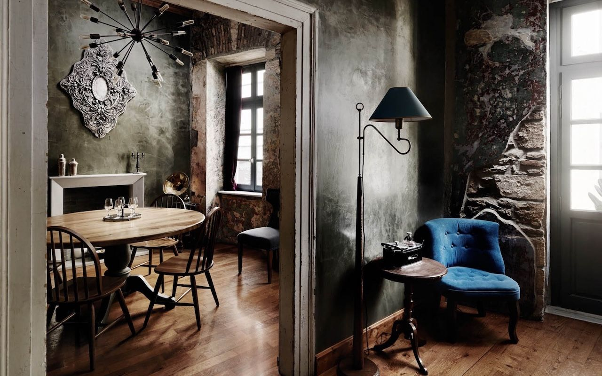
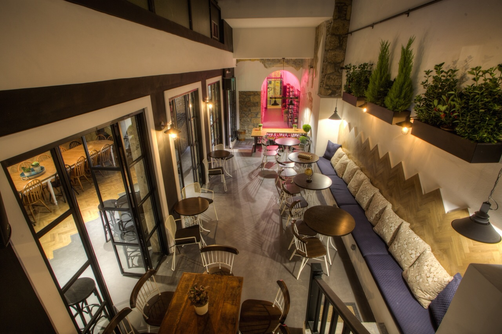
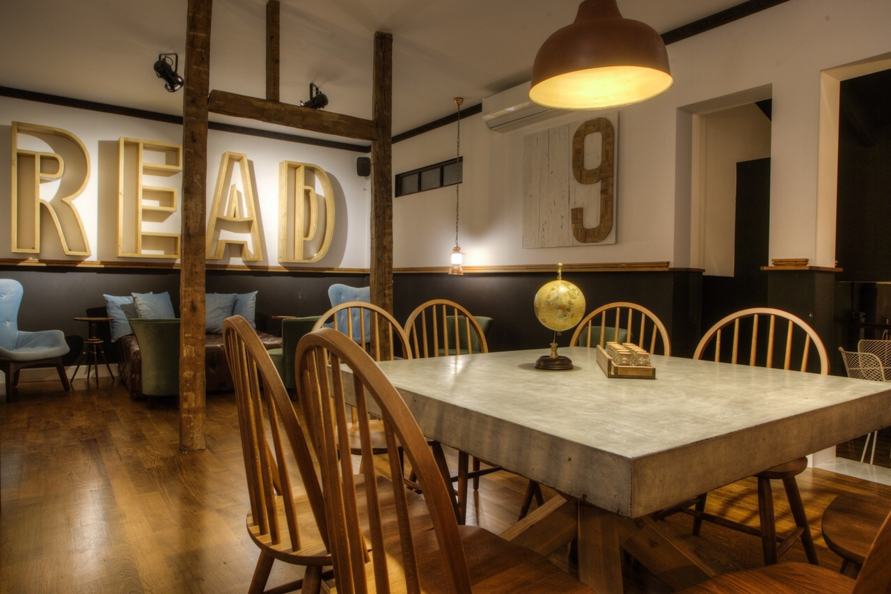
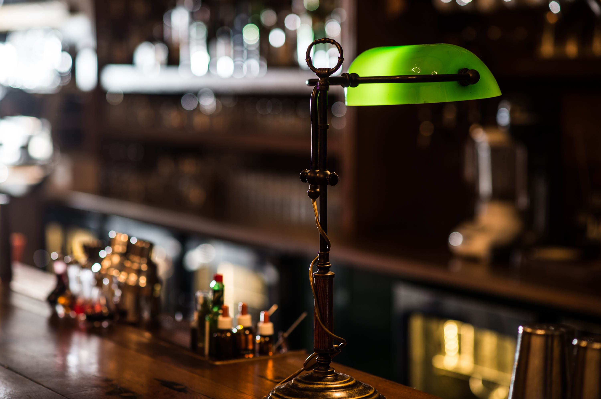
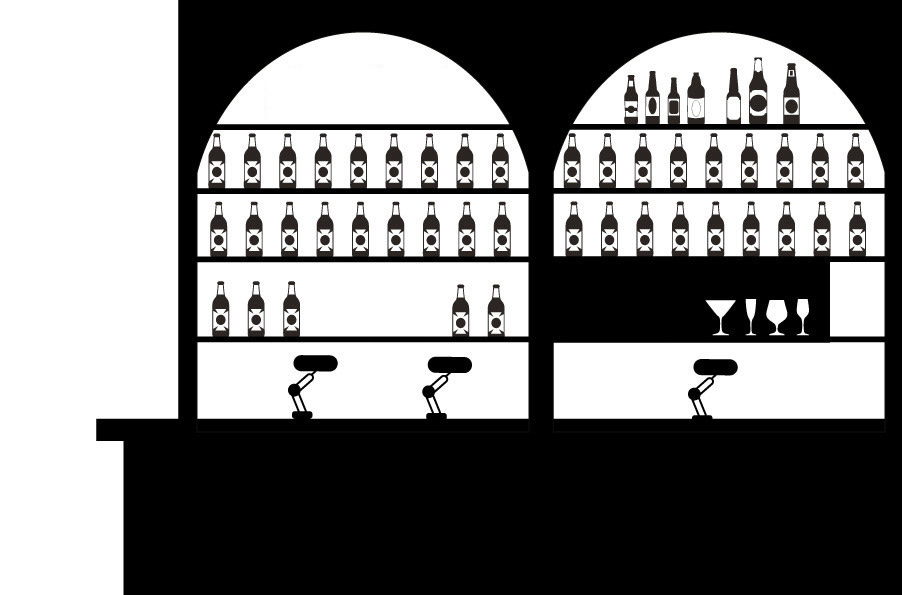

# 📂 DOSSIER #7: THE CLUMSIES (Praxitelous 30)

- **Kategorie:** Weltklasse All-Day Cocktail Bar & Neoklassisches Stadthaus (Platz 30 *Europe’s 50 Best Bars 2026* / ehem. Platz 3 weltweit)
- **Adresse:** Praxitelous 30, 105 61 Athen (Historisches Zentrum / Dreieck zwischen Klafthmonos-Platz & Monastiraki)
- **Google Maps:** [The Clumsies](https://www.google.com/maps/search/?api=1&query=The+Clumsies+Athens&query_place_id=ChIJYatZZTu9oRQRJrkQceYY2uQ)
- **Kontakt:** Tel. `+30 210 3232682` | `info@theclumsies.gr` | [theclumsies.gr](https://www.theclumsies.gr/)
- **Laufweg ab Apartment (Korinnis):** **ca. 740 m / 8–9 Min. zu Fuß** (fast schnurgerade über die *Evripidou*-Straße nach Osten — euer direkter Einstiegspunkt in die Zentrum-Cocktailmeile!).
- **Distanzen auf der Cocktailmeile:**
  - -> **Barro Negro** (*Ioannou Paparrigopoulou 15*): **120 m / 1,5 Min. zu Fuß**
  - -> **Baba au Rum** (*Klitiou 6*): **180 m / 2 Min. zu Fuß**
  - -> **The Bar in Front of the Bar** (*Petraki 1*): **450 m / 5 Min. zu Fuß**
  - -> **Monastiraki-Dreieck** (*TAF / Couleur Locale / 360*): **600 m / 7 Min. zu Fuß**

## 🕒 Tatsächliche Öffnungszeiten, Küchenzeiten & November-Check
- **Gesamt-Öffnungszeiten:** So–Do **10:00–02:00 Uhr**, Fr & Sa **10:00–04:00 Uhr**
- **Küchenzeiten (offizielles Menü):**
  - **Brunch & Day-Dishes:** Mo–Fr bis 16:00 Uhr, Sa & So bis 17:00 Uhr
  - **All-Day & Barfood-Küche:** Täglich durchgehend bis **23:30 Uhr**
- **Wetter-Faktor im November:** 100 % wetterfest. Das komplette neoklassische Stadthaus von 1919 ist ein verwinkeltes Indoor-/Atrium-Erlebnis über mehrere Ebenen. Der begrünte Innenhof (*Atrium/Courtyard*) hat ein **verschließbares Glasdach**, durch das tagsüber Licht einfällt, während ihr abends trocken und warm sitzt. Im Obergeschoss gibt es sogar einen Raum mit offenem Kamin.

## 🏛️ Räumlichkeiten, Vibe & Publikum
- **Architektur & Raum-Zonen:** Gegründet 2014 von den beiden griechischen *World Class Bartender*-Champions Vasilis Kyritsis und Nikos Bakoulis in einem restaurierten Herrenhaus von 1919 (ehemals das legendäre „Doron“-Haus). Das Haus teilt sich in mehrere komplett unterschiedliche Zonen:
  1. **Die vordere High-Energy-Bar (EG):** Hohe Decken, lange Holztheke, gedimmtes Licht, ausgefallene Kronleuchter — hier pulsiert abends das Herz des Ladens.
  2. **Das begrünte Atrium / Innenhof (EG hinten):** Unter dem beweglichen Glasdach mit vertikalen Pflanzenwänden und großen Gruppentischen.
  3. **Reading Room / Mezzanin:** Ein paar Stufen höher — tagsüber und am frühen Abend entspannter Wohnzimmer-Vibe mit Bücherregalen und Sesseln.
  4. **„The Room“ (Geheimraum im 1. OG – bis 10 Personen!):** Ein verstecktes Herrenzimmer hinter einer separaten Tür mit **echtem Billardtisch (Pool/Snooker), Kamin, Bücherwand, großeer Vinyl-Plattensammlung und eigenem Barkeeper** (nur auf Vorreservierung!).
- **Stimmungsverlauf (Tag vs. Nacht):** Tagsüber und bis ca. 20:00 Uhr entspanntes All-Day-Café & Aperitif-Spot; ab **21:30 / 22:00 Uhr** verwandelt sich das Erdgeschoss in eine **300-Personen-Partybar** mit DJ-Sets (Funk, Soul, House, Pop/Freestyle), an der getanzt wird, während die Barkeeper im Akkord Cocktails auf Weltniveau rausfeuern (gewann nicht umsonst den Titel *Best International High Volume Cocktail Bar*).
- **Publikum:** Bunte Mischung aus internationalen Cocktail-Pilgern (die wegen der *World’s 50 Best*-Liste kommen) und Athener Nachtschwärmern (25–45 Jahre). Smart Casual.

## 🍽️ Essen: Snacks oder richtige Mahlzeit?
- **Klare Einordnung:** **Gehobenes Comfort-Food, kreative Sandwiches, Bao Buns, Burger & vollwertige Gerichte (bis 23:30 Uhr)** — ursprünglich mitentwickelt von Sternekoch Nikos Karathanos. Perfekt, um beim ersten oder zweiten Drink ordentlich zu essen, ohne vorher in ein separates Restaurant zu müssen.
- **Konkrete Gerichte & Preise (aktuelle Speisekarte):**
  - **Abend- & Barfood-Highlights (täglich bis 23:30 Uhr):**
    - *Truffle Mini Burgers* (Brioche-Buns, Beef-Patty & Trüffel-Mayo): **11,00 €**
    - *The Clumsies Beef “Pastitsio”* (kurze griechische Rigatoni mit langsam geschmortem Ochsenschwanz-Ragout, Parmesan-Schaum & schwarzem Trüffelöl): **15,00 €**
    - *Beef Tartare “Soutzoukakia Style”* (Rindertatar mit pikanter Florina-Paprikacreme, Pickles, Kapern & Mehrkornbrot): **15,00 €**
    - *Pork Bao Bun* (Schweinenacken mit Soja-Hoisin-Glasur, Sweet-Chili-Mayo & Röstzwiebeln): **12,00 €**
    - *Spicy Shrimp Tacos* (Panko-Garnelen, scharfe Sauce, Koriander & Limette): **12,00 €**
    - *Ibérico Pork Skewer* (Ibérico-Spieß mit Mole-BBQ-Sauce, 5-Spice & Kartoffelsticks): **13,00 €**
    - *Tender Chicken Nuggets* (mit Joghurtsauce, Andalouse-Mayo & Bacon-Crumble): **12,00 €**
    - *Cheese & Cold Cuts Platter* (große Platte zum Teilen): **22,00 €**
  - **Brunch & Day-Menu (bis 16:00/17:00 Uhr):**
    - *Pulled Beef Melt Toasty* (Beef-Ragu, geschmolzener Cheddar, Chili-Mayo): **12,00 €**
    - *Steak Sandwich* (Ciabatta, Flap-Steak, Takuan-Mayo, karamellisierte Zwiebeln): **12,00 €**
    - *Bread Bowl* (griechisches *Ladopsomo*-Focaccia gefüllt mit Kartoffelcreme, Hackwurst, Spiegelei & Kartoffelsticks): **11,00 €**
    - *Turkish Eggs / Cilbir* (**10,00 €**) | *Pancakes mit Naxos-Gruyère-Creme, weichen Eiern & knusprigem Prosciutto* (**11,00 €**).

## 🍹 Getränke, Signature Cocktails & Preise
- **Eigenes Fermentations- & Destillations-Labor:** Alle Cordials, Bitters und Essenzen werden im hauseigenen Labor hergestellt. Die aktuelle Konzeptkarte **„Spirits of the City – Polykatoikia“** widmet jeden Drink einer Athener Persönlichkeit (Architekten, Street-Artists etc.).
- **Signature Cocktails (extrem faire 12–14 € für eine Top-50-Weltklassebar!):**
  - *Aegean Negroni (12–13 € – legendärer Haus-Klassiker, von Time Out zum besten Cocktail der Welt gekürt):* Gin-Basis, blau gefärbt und aromatisiert mit griechischem Fenchel, Mastiha, Diktamos-Kraut und Zitrusnoten.
  - *Mediterranean Gimlet (13 €):* Gin mit hausgemachtem „Griechischer-Salat-Cordial“ (klarem Tomatenwasser, Gurke, roter Paprika, Oliven und Oregano) — schmeckt irre frisch und herzhaft-ausbalanciert.
  - *Perfect Imperfection (13 € – Refreshing):* Bombay Sapphire Gin, Mastiha, Kräuteröl, Tonic & Orange Bitters.
  - *Spirit of the City (12 € – Sweet & Sour):* Gin, braune Butter (*Beurre Noisette*), Aprikose, Gurke & Koriander.
  - *Rec & Play (14 € – Sweet & Bitter):* Dewar’s 12J Whisky, geröstetes Ananas-Bitter, Martini Riserva Ambrato & ein Hauch Chorizo-Öl.
  - *YesterNow (14 € – „Espresso Martini Not“):* Patron Silver Tequila, Ilegal Mezcal, Mokka, Jasminreis, Kokosnuss & Kaffir-Limette.
  - *Kykeon (13 € – Sweet & Boozy):* Metaxa 12 Stars, Gerstenmalz, Pfirsich-Amaretto & Polei-Minze.
- **Flaschen-Cocktails zum Mitnehmen:** *Take Me Home* Bottle (**40,00 €**).

## 🎯 Beste Uhrzeit & Taktischer Einsatz für eure Gruppe
- **Taktik 1 – Der Donnerstagabend-Vorteil (Touchdown-Tag, ca. 20:30–22:30 Uhr):** Am Freitag- und Samstagabend ab 22:00 Uhr steht vor dem *Clumsies* oft eine lange Schlange mit Türsteher-Selektion. **Am Donnerstagabend** (wenn ihr gegen 20:00 Uhr im Apartment in der *Korinnis* eingecheckt seid) lauft ihr in **8 Minuten** rüber, kommt deutlich entspannter rein und könnt direkt die *Truffle Mini Burgers* oder das *Beef Pastitsio* + einen *Aegean Negroni* bestellen.
- **Taktik 2 – Startpunkt der 500-Meter-Cocktailmeile (ca. 18:30–21:00 Uhr):** Perfekt als **Station 1 am frühen Abend**, wenn man noch ohne Gedränge einen Tisch im begrünten Innenhof bekommt und die Barkeeper Zeit zum Fachsimpeln haben — danach geht es in 2 Minuten zu Fuß weiter zu **Barro Negro** oder **Baba au Rum**.
- **Taktik 3 – „The Room“ für eure Männertruppe anfragen:** Falls ihr bis zu 10 Jungs seid und Lust auf eine exklusive Runde am eigenen Billardtisch mit Kamin, Vinyl-Platten und eigenem Barkeeper habt, lohnt sich ein Anruf unter `+30 210 3232682`!

## 📸 Bilder
- 
- 
- 
- 
- 
