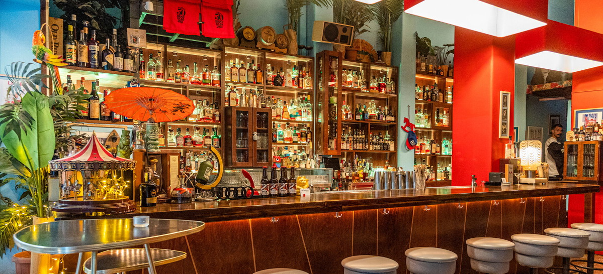
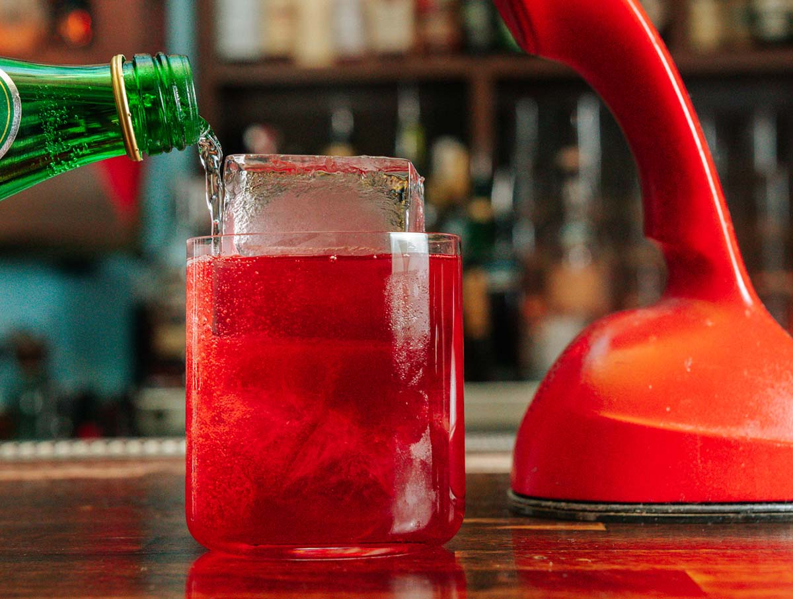
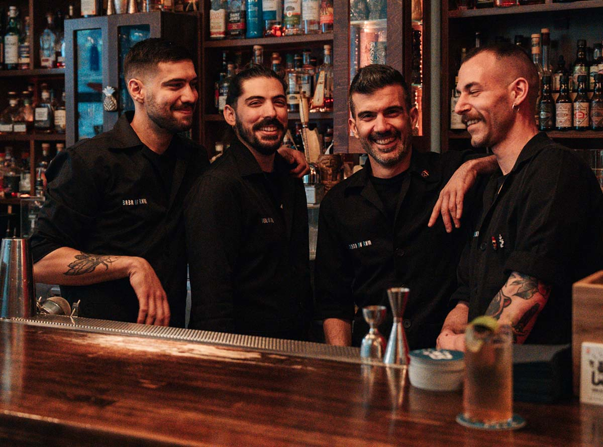
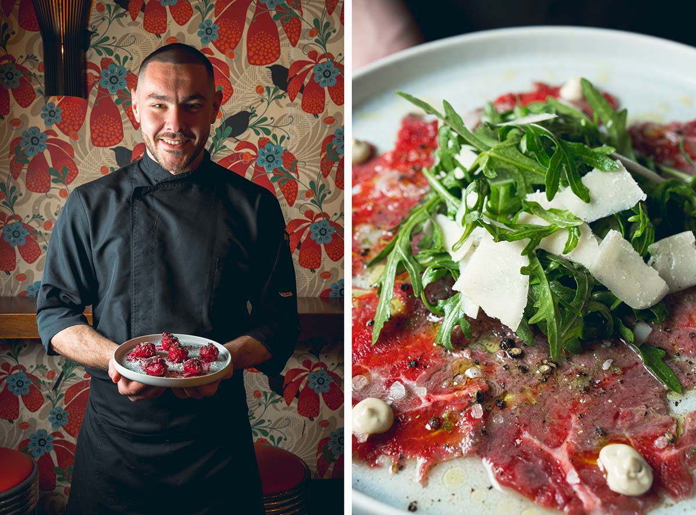
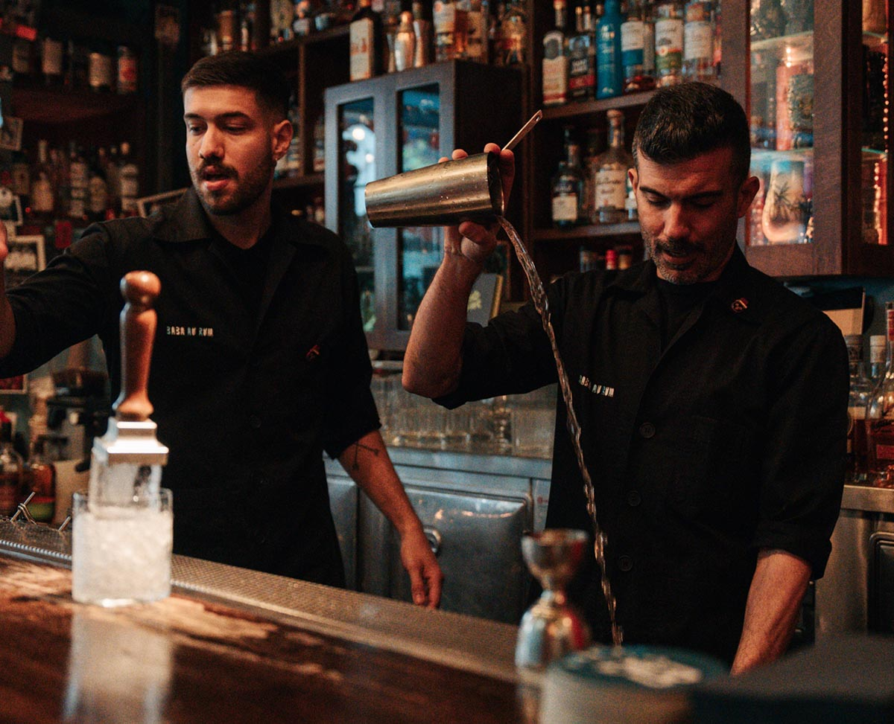

# 📂 DOSSIER #8: BABA AU RUM (Klitiou 6)

- **Kategorie:** Die Ur-Mutter der Athener Cocktail-Szene & legendärer Rum-Tempel mit 400+ Abfüllungen (Platz 14 *Europe’s 50 Best Bars 2026* / Platz 25 weltweit)
- **Adresse:** Klitiou 6 (Fußgängergasse), 105 60 Athen (Historisches Zentrum / *Emporiko Trigono*)
- **Google Maps:** [Baba au Rum](https://www.google.com/maps/search/?api=1&query=Baba+au+Rum+Athens&query_place_id=ChIJFVsBjjy9oRQR7XnarON2k94)
- **Kontakt:** Tel. `+30 211 7109140` | `info@babaaurum.com` | [babaaurum.com](https://www.babaaurum.com/)
- **Laufweg ab unserem Apartment (Korinnis):** **ca. 950 m / 10 Min. zu Fuß** (über *Evripidou* -> *Athinas* -> *Vyssis/Klitiou*).
- **Distanzen auf der Cocktailmeile:**
  - -> **The Clumsies** (*Praxitelous 30*): **180 m / 2 Min. zu Fuß**
  - -> **Barro Negro** (*Ioannou Paparrigopoulou 15*): **150 m / 1,5 Min. zu Fuß**
  - -> **The Bar in Front of the Bar** (*Petraki 1*): **300 m / 3,5 Min. zu Fuß**
  - -> **Monastiraki-Dreieck** (*TAF / Couleur Locale / 360*): **500 m / 6 Min. zu Fuß**

## 🕒 Voraussichtliche Öffnungszeiten, Reservierung & November-Check
- **Voraussichtliche Öffnungszeiten:** So–Fr **19:00–03:00 Uhr**, Sa **19:00–03:30 Uhr** (reine Abend- & Nachtbar — tagsüber übernimmt der eigene Schwesterladen *In Love Again* direkt gegenüber in der Klitiou 3–5!).
- **Reservierungspolitik:** **Keine Reservierungen (First-come, first-served)!**
- **Wetter-Faktor im November:** Zweigeteiltes Setup:
  1. **Innenraum (komplett wetterfest):** Kompakte, dunkel getäfelte Bar (ca. 30–40 Sitz-/Stehplätze) mit langer Holztheke, roten Lederhockern und deckenhohen Flaschenregalen.
  2. **Fußgängergasse Klitiou (Outdoor mit Heizstrahlern):** Da der Innenraum schnell voll ist, spielt sich an trockenen Abenden die halbe Party **mitten auf der schmalen Fußgängergasse** an hohen Stehtischen und unter Markisen/Heizstrahlern ab.

## 🏛️ Räumlichkeiten, Geschichte, Vibe & Publikum
- **Der Urknall der Athener Barszene:** Als Gründer Thanos Prunarus das *Baba au Rum* im März 2009 eröffnete, gab es in Athen noch fast keine ernsthafte Cocktailkultur. Er baute eine der **größten Rum-Sammlungen Europas (über 400 verschiedene Rums und Rhum Agricoles aus aller Welt, inklusive ausgestorbener Destillerien wie *Caroni*)** auf und machte die kleine Klitiou-Gasse zur berühmtesten Ausgehmeile der Stadt.
- **Design & Raum:** Eine lässige Mischung aus **1960er-Jahre-Bistro und kubanischer Rum-Bar**: Mintgrüne Fassade, dunkles Holz, coole Retro-Tapeten, gedimmtes bernsteinfarbenes Licht und eine ehrfürchtig beleuchtete Backbar bis unter die Decke, vor der jedem Rum-Trinker das Herz aufgeht.
- **Musik & Stimmung:** Kein billiger Tiki-Kitsch mit Plastikpalmen, sondern richtig starker Sound: **Jazz, Afro-Cuban, Rare Groove, Funk, Soul und später Indie/Disco**. Ab **21:30 Uhr** schwappt die Menge aus der Bar auf die Klitiou-Gasse — genau dieser unkomplizierte Street-Drinking-Vibe mit einem Weltklasse-Drink in der Hand ist wie gemacht für unsere Truppe.
- **Publikum:** Rum-Liebhaber, internationale Bar-Reisende und Athener Stammgäste (25–50 Jahre). Weltklasse-Niveau, aber null abgehoben.

## 🍽️ Essen: Snacks oder richtige Mahlzeit?
- **Klare Einordnung:** **Kein Restaurant — reine Cocktailbar mit Gratis-Knabbereien & dem gegenüberliegenden Schwesterladen *In Love Again*!**
- **Was es zum Drink gibt:**
  - Zum Cocktail bekommen wir an der Bar traditionell **Nüsse/Bar-Snacks** (und zu gereiften Rums oft ein abgestimmtes Stück dunkle Schokolade).
  - **Der geniale Gassen-Trick (*In Love Again*, Klitiou 3–5):** Genau 4 Meter gegenüber auf der anderen Seite der schmalen Fußgängergasse hat das Baba-au-Rum-Team seinen eigenen Café-Laden **In Love Again** eröffnet. Von dort kommen tagsüber und bis in den Abend **Sandwiches/Focaccia, kleine Pizzen und starkes Gebäck** (u. a. der namensgebende *Baba au Rhum*-Kuchen, amtlich getränkt in echtem Rum!). Für ein richtiges Abendessen sollten wir aber vorher ins *The Clumsies* (2 Min.) oder nach *Psyri* gehen.

## 🍹 Getränke, Signature Cocktails & Preise
- **Extrem faire Preise (11–14 €!):** Für eine Bar, die seit über einem Jahrzehnt ununterbrochen in den *World’s 50 Best* steht, sind **11 bis 14 € pro Cocktail** im europäischen Vergleich fast geschenkt.
- **Sektion 1: „The Baba Au Rum’s Classics“ (Rum- & Tiki-Meisterwerke mit ordentlich Umdrehungen):**
  - *Spicy Baba No. 7 (11 € – der meistbestellte Drink des Hauses seit 2010!):* 7 Jahre gereifter Don Q Rum aus Puerto Rico, frischer Ingwer, Limette, süße Beeren, Minze & Cranberry.
  - *Mai Tai nach Original-Rezept von Trader Vic 1930 (12 €):* Gilt unter Barkeepern als einer der besten Mai Tais Europas (mit Appleton Estate 12 €, als Upgrade mit *Appleton 12 Y.O.* 16 € oder *Habitation Velier* 22 €).
  - *Baba’s Zombie (14 € / als Ultra-Premium „Star-5-Zombie“ 23 €):* Ein schweres Geschütz aus **fünf gereiften Karibik-Rums**, frischen Tropensäften, Falernum, Dry Curaçao, Gewürzen und Bitters — „numbingly good“ (nach zwei Stück davon spricht man fließend Altgriechisch).
  - *Devil’s Milk (11 €):* Jamaikanischer Kokos-Rum, scharfe Chili, Limette, Barbados-Falernum, Schokoladen-Bitters & Muskatnuss.
  - *Supremus No. 58 (11 €):* Rhum Agricole, gereifter Rum, Limette, destilliertes Falernum & weißer Sommertee.
- **Sektion 2: Ausgefallene Haus-Specials (11–12 €):**
  - *Cherry Bomb Mai Tai (12 €):* Jamaika-Rum, Kirsche, indonesischer Spezialitätenkaffee, Minze & Limette.
  - *The Unapologetic Skyline (12 €):* Peruanischer Pisco, Trauben, Birne, Holunderblüte — abgerundet mit einem feinen Topping aus **griechischem Feta-Käse**!
  - *Beatnik Paloma No. 3 (11 €):* Tequila Blanco, Mezcal, Rote Bete, schwarzer Kardamom, Estragon, Minze & Three Cents Grapefruit Soda.
  - *Street Jazz Highball (11 €):* Leichter Scotch Whisky, grüner Apfel, Feige & Blauschimmelkäse-Note mit Bubbles.
  - *Harlequin’s Carnival (12 €):* Irish Whiskey, hausgemachter Himbeer-Wermut, frischer Dill, Bénédictine & braune Butter.

## 🎯 Beste Uhrzeit & Taktischer Einsatz für unsere Runde
- **Taktik 1 – Früher Abend an der Holztheke (19:00–21:00 Uhr):** Da man nicht reservieren kann, ist 19:00 bis 20:30 Uhr unser goldenes Zeitfenster, wenn wir mit der Truppe **drinnen an der Theke sitzen** und uns von den Barkeepern durch seltene Rums oder einen perfekten *Mai Tai* lotsen lassen wollen.
- **Taktik 2 – Station 2 oder 3 auf der Cocktailmeile (21:30–01:30 Uhr):** Nach dem *Clumsies* (inkl. Burger/Pastitsio-Grundlage) in **2 Minuten** rüber in die Klitiou-Gasse laufen, *Baba’s Zombie* oder *Spicy Baba No. 7* an der Theke abholen und direkt im Gassengewusel vor der Tür weiterfeiern!

## 📸 Bilder
- 
- 
- 
- 
- 