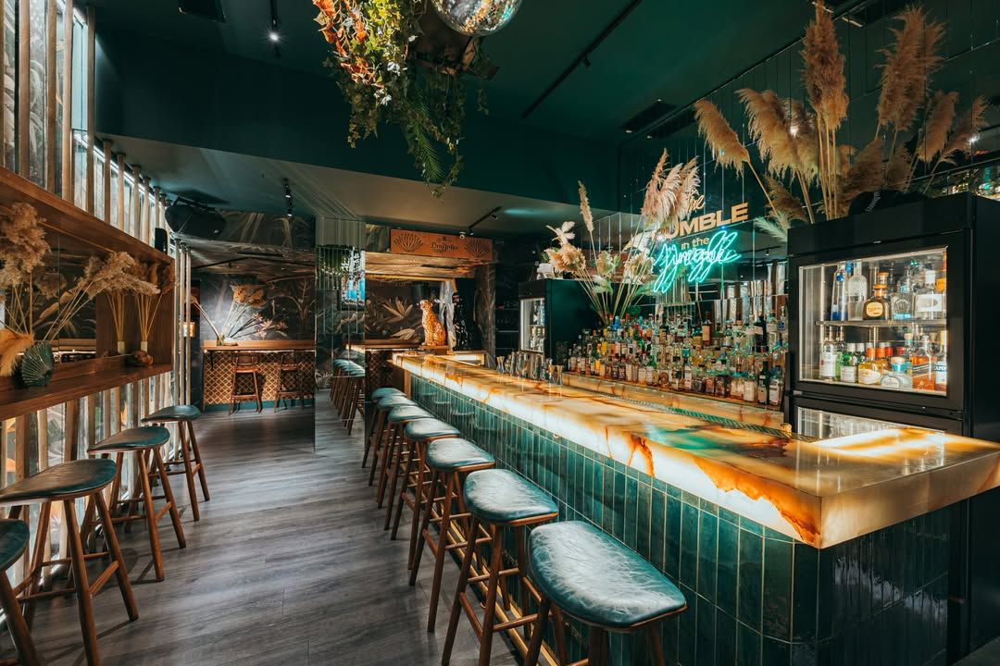
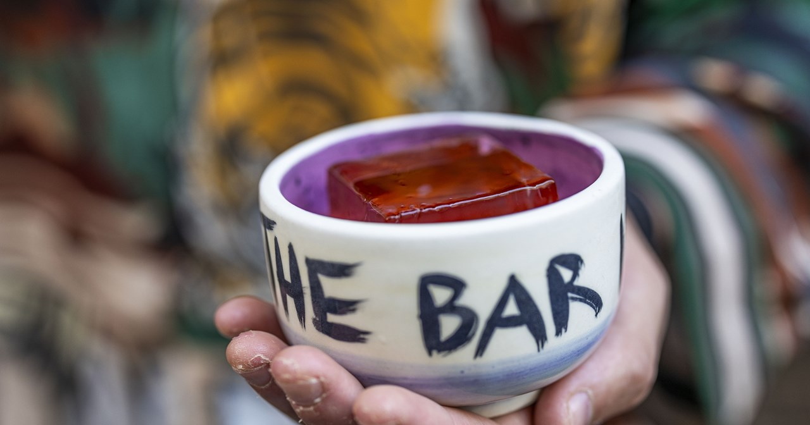
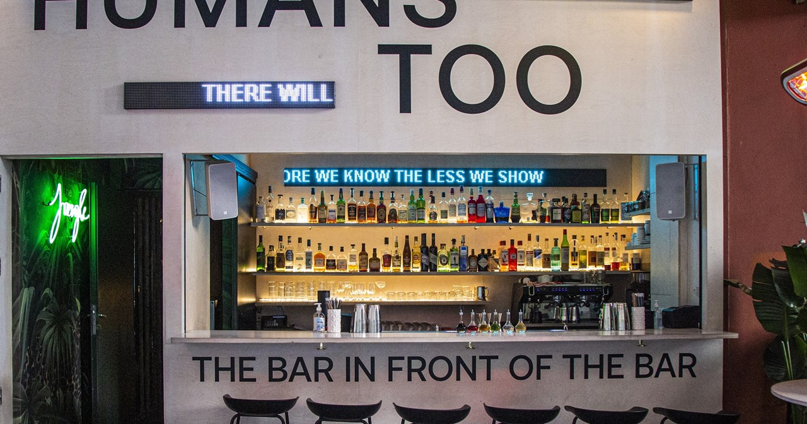
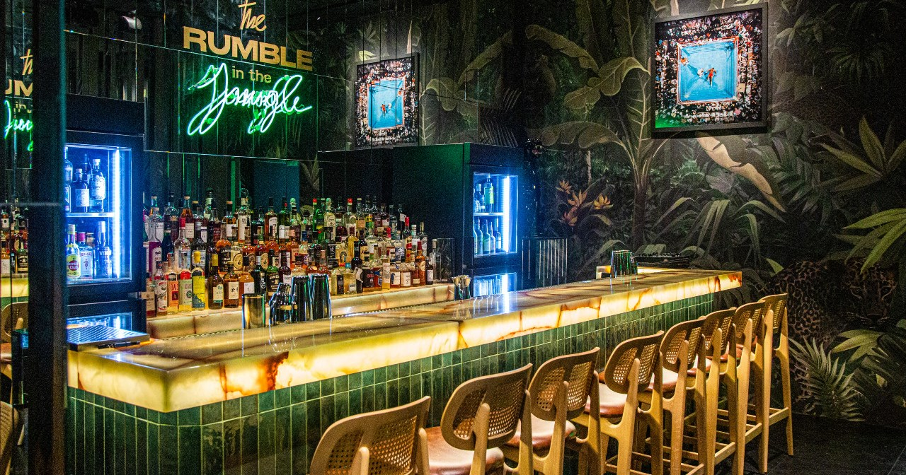
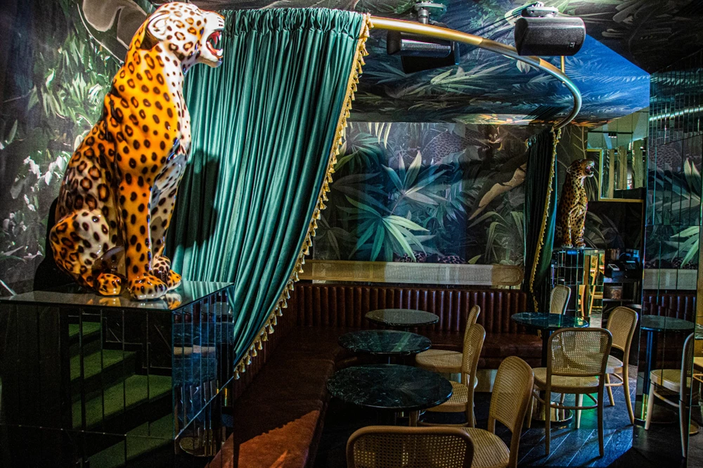

# 📂 DOSSIER #9: THE BAR IN FRONT OF THE BAR & RUMBLE IN THE JUNGLE (Petraki 1)

- **Kategorie:** Avantgarde Zero-Waste Street-Bar + verstecktes Indoor-Speakeasy *Rumble in the Jungle* (**Platz 2 in *Europe’s 50 Best Bars 2026* & Platz 19 weltweit** + *Highest Climber Award*)
- **Adresse:** Petraki 1 (kleine Fußgängergasse zwischen Ermou & Mitropoleos), 105 63 Athen
- **Google Maps:** [The Bar in Front of the Bar](https://www.google.com/maps/search/?api=1&query=The+Bar+in+Front+of+the+Bar+Athens+Petraki+1)
- **Kontakt:** Tel. `+30 211 7352018` / `+30 698 0635896` | [thebarinfrontofthebar.gr](https://thebarinfrontofthebar.gr/)
- **Laufweg ab Apartment (Korinnis):** **ca. 1,25 km / 13 Min. zu Fuß** (der südöstliche Endpunkt eurer Zentrum-Cocktailmeile Richtung Syntagma).
- **Distanzen auf der Cocktailmeile:**
  - -> **Baba au Rum** (*Klitiou 6*): **300 m / 3,5 Min. zu Fuß**
  - -> **Barro Negro** (*Ioannou Paparrigopoulou 15*): **400 m / 4,5 Min. zu Fuß**
  - -> **The Clumsies** (*Praxitelous 30*): **450 m / 5 Min. zu Fuß**
  - -> **Monastiraki-Dreieck** (*TAF / Couleur Locale / 360*): **650 m / 7 Min. zu Fuß**

## 🕒 Voraussichtliche Öffnungszeiten & Das 2-in-1-Konzept (November-Check)
- **Voraussichtliche Öffnungszeiten:**
  - **Draußen (*The Bar in Front of the Bar*):** Täglich ab **18:00 / 19:00 Uhr bis 02:00/02:30 Uhr** (Fr & Sa bis **03:00 Uhr**).
  - **Drinnen (*Rumble in the Jungle* Speakeasy):** Täglich ab **19:00 Uhr bis 02:30 Uhr** (Fr & Sa bis **03:30 Uhr**).
- **Wetter-Faktor im November (Geniales Doppel-Setup!):**
  1. **Vorderseite (Outdoor Street-Bar):** Eine freistehende Holz-/Edelstahltheke direkt auf der Fußgängergasse *Petraki* unter Markise und Heizstrahlern.
  2. **Hinter der unmarkierten Tür (100 % wetterfestes Indoor-Speakeasy *Rumble in the Jungle*):** Sobald es euch draußen zu frisch wird (oder ihr sitzen wollt), drückt ihr einfach die unscheinbare Tür direkt hinter dem Straßentresen auf und steht mitten in einer warmen, tropisch-urbanen Indoor-Cocktailbar mit großem Marmortresen!

## 🏛️ Geschichte, Räumlichkeiten, Vibe & Publikum
- **Wie ein 6-Wochen-Pop-up zur Nr. 2 in Europa wurde:** Im Juli 2021 wollten die drei Freunde Alexandros Tselepis, Konstantinos Theodorakopoulos und Symeon Papanikolaou eigentlich ihre Indoor-Bar *Rumble in the Jungle* (benannt nach dem legendären Boxkampf Ali vs. Foreman 1974) eröffnen. Weil die Bauarbeiten und Genehmigungen drinnen noch dauerten, zimmerten sie für geplante 6 Wochen eine provisorische Theke *vor* die Baustelle auf das Pflaster der Petraki-Gasse. Der Laden schlug so brutal ein, dass die Straßenbar blieb und 2026 bis auf **Platz 2 der besten Bars Europas** (direkt hinter *Line Athens*!) schoss.
- **Der Look & die LED-Laufschrift:** Über dem Straßentresen läuft ein rotierendes LED-Laufband mit trocken-ironischen Sprüchen (*„Your ex was here yesterday“*, *„Talk to your therapist about us“*, *„People like you should drink with people like us“*). Die Barkeeper tragen jeden Tag ein anderes Outfit-Motto (mal Streetwear mit umgedrehten Caps, mal Anzug zum Dry Martini).
- **Drinnen im *Rumble in the Jungle*:** Dunkler, extrem stylischer Raum mit einer riesigen Dschungel-Wandtapete (inspiriert vom Post-Impressionisten Henri Rousseau), massiver Marmortheke, zwei **-23°C-Tiefkühlern** für eiskalte Gläser/Pre-Batches sowie eigenem Destillations- und Fermentationslabor.
- **Musik & Crowd:** Ab **21:30 / 22:00 Uhr** verwandelt sich die schmale Petraki-Gasse in einen einzigen pulsierenden Open-Air-Dancefloor (Hip-Hop, Funk, Afro-House, Indie-Grooves; donnerstags ab 22:00 Uhr feste DJ-Reihe *„Whisper it, Don’t Say it“*). Junges, extrem Szenekundiges Publikum (22–40 Jahre), internationale Bartender und Athener Locals.

## 🍽️ Essen: Snacks oder richtige Mahlzeit?
- **Klare Einordnung:** **Reine Cocktailbar (keine Speisekarte für Abendessen).**
- **Taktischer Hinweis:** Kommt hierher nicht hungrig! Esst vorher im *The Clumsies* (5 Min.), bei *Avli* in Psyri oder holt euch auf dem Rückweg noch spätes Streetfood.

## 🍹 Getränke, Das Täglich Wechselnde Menü & Preise
- **Das Konzept (Draußen vs. Drinnen):**
  - **Draußen (*The Bar in Front of the Bar*):** Es gibt **keine feste Karte!** Jeden einzelnen Tag stehen **exakt 8 neue Zero-Waste-Cocktails** auf der Tafel, die komplett aus den frischen Überschüssen, Kräutern und Destillaten des eigenen Labors und der Indoor-Bar entstehen.
  - **Drinnen (*Rumble in the Jungle*):** Feste, hochkreative Konzeptkarte rund um den Boxkampf von 1974 und kulinarische Kindheitserinnerungen.
- **Berühmte Signature Drinks aus dem Hauslabor (ca. 9–13 €!):**
  - *Kafeneio:* Hommage an das traditionelle griechische Kaffeehaus mit Mokka-/Tsipouro- & Gewürznoten.
  - *Tacos Margarita:* Tequila & Mezcal mit destillierten Mais-Tortilla-, Koriander-, Chili- und Limetten-Aromen.
  - *CREAM & Talking Heads:* Geklärte Milch-Punches & herzhaft-fruchtige Highballs.
  - *Rope-a-Dope & Spit Bucket (im Rumble in the Jungle):* Benannt nach Muhammad Alis Box-Taktik — komplexe, im eigenen Rotationsverdampfer destillierte Signatures.
- **Preisniveau:** Mit **ca. 9 bis 12 € draußen** (und **11 bis 14 € drinnen**) die wohl günstigste Top-20-Weltklassebar der Erde.

## 🎯 Beste Uhrzeit & Taktischer Einsatz für eure Gruppe
- **Der „2-Bars-in-1“-Move (Donnerstag ab 21:30 Uhr oder Freitag/Samstag 20:00–01:00 Uhr):**
  1. Stellt euch erst draußen an den Straßentresen von *The Bar in Front of the Bar*, lest die Sprüche auf der LED-Anzeige und lasst euch vom Barkeeper einen der 8 Tages-Drinks empfehlen.
  2. Danach sagt ihr dem Team an der Theke Bescheid und wechselt **durch die geheime Tür direkt dahinter** ins **Rumble in the Jungle** an den Marmortresen!
  - **Extra-Tipp für euren Ankunftstag (Donnerstag, 05.11.):** Donnerstags ab 22:00 Uhr steigt hier immer die wöchentliche Partyreihe *„Whisper it, Don’t Say it“* mit DJ Chris Child — falls ihr nach dem *Clumsies* noch Bock auf richtig guten Sound habt!

## 📸 Bilder
- 
- 
- 
- 
- 
