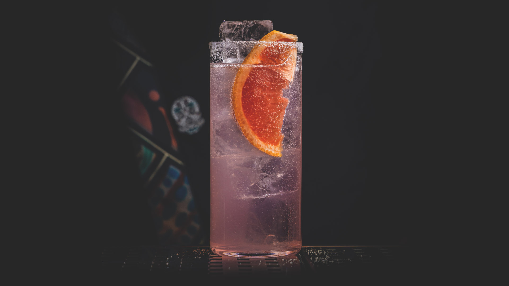
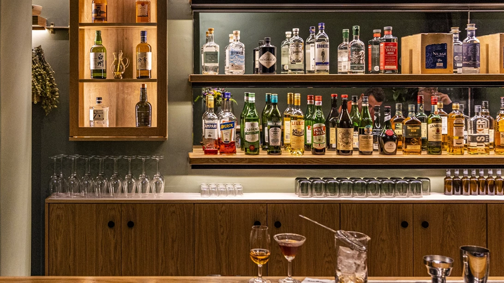
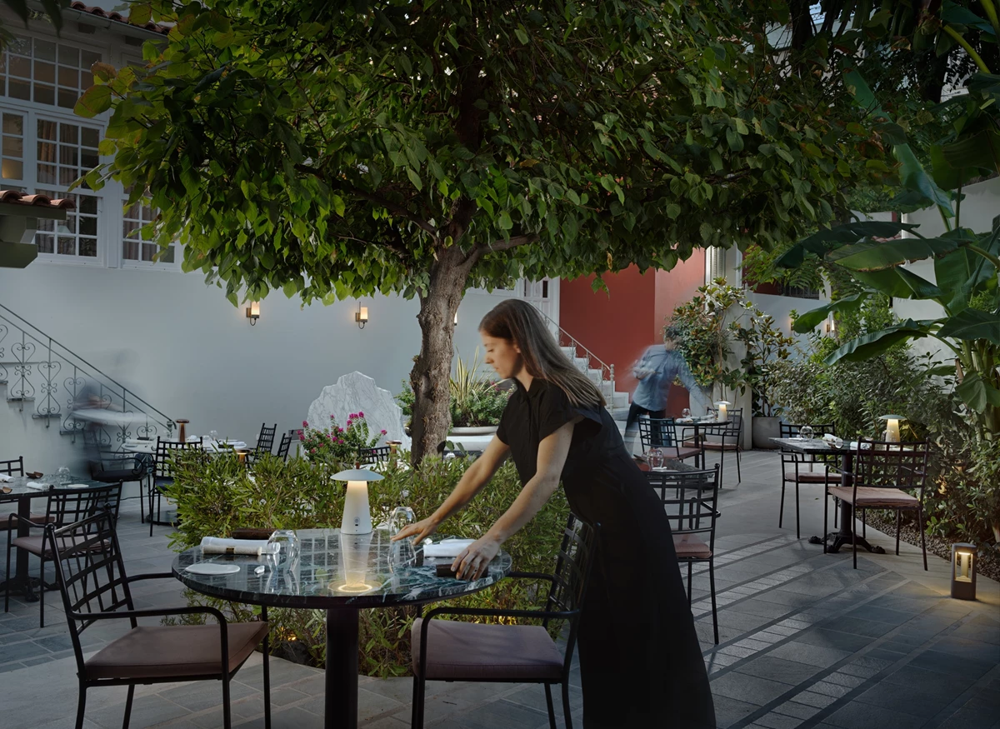
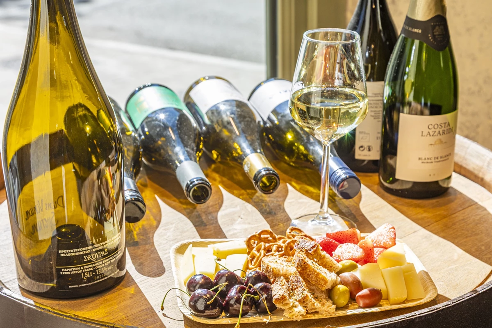
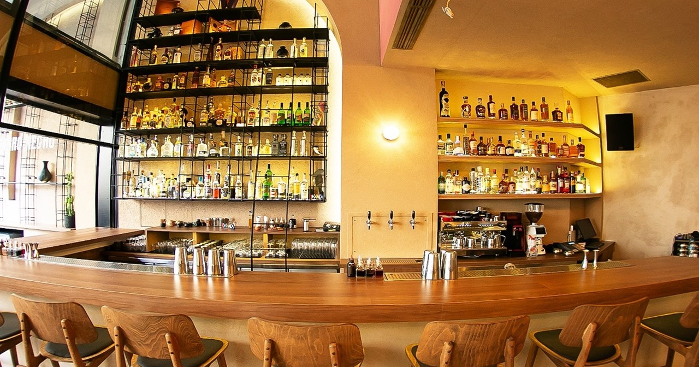

# 📂 DOSSIER #10: BARRO NEGRO ATHENS (Ioannou Paparrigopoulou 15)

- **Kategorie:** Erste Tequila- & Mezcal-Agavenbar Athens & offizielle *Paloma Embassy* (**Platz 13 in *Europe’s 50 Best Bars 2026* & Platz 40 weltweit**)
- **Adresse:** Ioannou Paparrigopoulou 15 (direkt am Klafthmonos-Platz), 105 61 Athen
- **Google Maps:** [Barro Negro Athens](https://www.google.com/maps/search/?api=1&query=Barro+Negro+Athens+Ioannou+Paparrigopoulou+15)
- **Kontakt:** Tel. `+30 210 0107618` | [barronegroathens.com](https://www.barronegroathens.com/)
- **Laufweg ab Apartment (Korinnis):** **ca. 820 m / 9 Min. zu Fuß**
- **Distanzen auf der Cocktailmeile & im Zentrum:**
  - -> **Black Duck Garden** (*Ioannou Paparrigopoulou 5–7*): **50 m / 30 Sek. zu Fuß** (direkt nebenan in derselben Straße)
  - -> **The Clumsies** (*Praxitelous 30*): **120 m / 1,5 Min. zu Fuß** (einmal direkt um den Block!)
  - -> **Baba au Rum** (*Klitiou 6*): **150 m / 1,5 Min. zu Fuß**
  - -> **The Bar in Front of the Bar** (*Petraki 1*): **400 m / 4,5 Min. zu Fuß**

## 🕒 Voraussichtliche Öffnungszeiten & November-Check
- **Voraussichtliche Öffnungszeiten:**
  - **So–Do:** 18:00 – 02:00 Uhr
  - **Fr & Sa:** 18:00 – 03:00 Uhr
  - *(Reine Abend- und Nachtbar; Walk-in / First-come, first-served an Bar und Stehtischen).*
- **Wetter-Faktor im November:** **100 % wetterfeste Indoor-Location auf zwei Ebenen** plus überdachter Kolonnaden-Außenbereich an der ruhigen Fußgängerzone *Paparrigopoulou*. Im Erdgeschoss zieht sich die lange, warm ausgeleuchtete Haupttheke entlang; eine Treppe führt hinunter ins atmosphärische Untergeschoss (*Oaxaca Room / Palenque*), das einer mexikanischen Mezcal-Destillerie nachempfunden ist.

## 🏛️ Geschichte, Räumlichkeiten, Vibe & Publikum
- **Die Gründer & der Name:** Eröffnet 2019 von **Stelios Papadopoulos** (dem weltweit ersten Nicht-Mexikaner, der von der nationalen mexikanischen Tequila-Kammer CNIT offiziell den Titel *„Tequila Connoisseur“* verliehen bekam) und **George Kavaklis**, zusammen mit Bar Manager **Ilias Givisis**. Der Name *Barro Negro* (*„Schwarzer Ton“*) stammt von der berühmten schwarzen Töpferkunst aus Oaxaca, Mexiko.
- **„Modern Mexico“ statt Sombrero-Kitsch:** Keine bunten Ponchos oder Mariachi-Dekoration — stattdessen urbaner Minimalismus aus warmem Terrakotta, schwarzer Oaxaca-Keramik, Sichtbeton, Kakteen, Neon-Schriftzügen und einem imposanten Backbar-Regal mit über **140 handverlesenen 100%-Agave-Tequilas, Mezcals, Raicillas und Sotols**.
- **Musik & Crowd:** Treibender Sound aus Latin-Funk, Cumbia-Electro, Afro-House und Indie-Beats. Da der Laden exakt im Dreieck zwischen *The Clumsies* (120 m) und *Baba au Rum* (150 m) liegt, ist die Stimmung ab 21:00 Uhr ausgelassen, aber oft einen Tick entspannter am Tresen zugänglich als im Clumsies am Wochenende.

## 🍽️ Essen: Snacks oder richtige Mahlzeit?
- **Klare Einordnung:** **Reine Agaven- & Cocktailbar (keine reguläre Abendessen-Küche).**
- Es gibt Knabbereien/Tortilla-Snacks zum Drink (und nur bei Spezial-Events gelegentliche Ceviche-/Taco-Pop-ups an der Bar).
- **Taktischer Hinweis:** Esst vorher nebenan im *The Clumsies* (Küche bis 23:30 Uhr, 1,5 Min. zu Fuß) oder startet den Abend in einer Taverne in Psyri.

## 🍹 Getränke, Offizielle Karte & Preise
Barro Negro ist Europas offizielle **„Paloma Embassy“** (*Pink Phenomenon*): Kein anderer Laden in Europa setzt so viele perfekt ausbalancierte Palomas um.

### 1. The Favourites & The Mexican Way (11–12 €, Michelada 7 €)
- **Barro Negro Paloma (11 €):** Espolòn Blanco Tequila, frischer Limettensaft, *Vikos Pink Grapefruit Soda* & feiner Salzrand — der absolute Pflicht-Drink beim Reinkommen!
- **Cantarito (11 €):** Espolòn Blanco Tequila, frischer Zitrus-Mix & Pink Grapefruit Soda, traditionell im gekühlten mexikanischen Tonbecher serviert.
- **Batanga (11 €):** Espolòn Blanco Tequila, Limette, Vikos Cola & Salzkruste (traditionell mit dem großen Bar-Messer gerührt).
- **Margarita (11 €):** Espolòn Blanco Tequila, mediterraner Orangenlikör, Limettensaft & Salz.
- **Oaxaca Negroni (12 €):** Rauchiger San Cosme Mezcal, Campari & hausgemachter Wermut.
- **CDMX Espresso Martini (12 €):** Volcan De Mi Tierra Blanco Tequila, Kakao, Vanille, Cold Brew, Belvedere Dirty Brew Coffee, Minze & ein Hauch Fernet Branca.
- **Michelada (7 €):** Eiskaltes Corona-Bier mit Clamato-Tomatensaft, mexikanischen Gewürzen & Sojasauce — perfekter herzhafter Zwischen-Drink!

### 2. Signature Cocktail List – „Hecho en México“ (12–15 €)
- **Para Todo Bien (12 €):** Bruxo X Mezcal, Pfirsich, Kamille, Oolong-Tee-Kombucha & Bubbles (fruchtig, leicht rauchig, prickelnd).
- **Mayans’ Punch (12 €):** Espolòn Reposado Tequila, Passionsfrucht, Kaffee, Limette, hausgemachte *Tepache* (fermentierte Ananas) & geklärte Milchmolke.
- **Mezcal & Tonic (12 €):** Bruxo X Mezcal mit hausgemachtem *„Green Gazpacho Tonic“* (rauchig, grün, herzhaft-frisch).
- **Lokalism (12 €):** Espolòn Blanco Tequila, Melone, Basilikum, griechisches Olivenöl & lakto-fermentierte Kirschtomate.
- **Cenote (12 €):** Espolòn Blanco Tequila, Zitronengras, Schnittlauch, Rhum Agricole, Chili-Likör, grüner Apfel & Gurke.
- **Birria Martini (15 €):** Dry Gin, Mezcal, Aji Amarillo Chili, echte mexikanische *Birria*-Brühe, Steinobst & Fino Sherry (eiskalt, boozy & voller Umami!).
- **Alkoholfrei (0 % ABV, 10–12 €):** *0% Paloma* mit *Almave* (10 € – alkoholfreies Agaven-Destillat) oder *0% Oaxaca Negroni* (12 €).

## 🎯 Beste Uhrzeit & Taktischer Einsatz für eure Gruppe
- **Das perfekte Bindeglied auf der 500-Meter-Cocktailmeile:**
  - Da **The Clumsies** (120 m), **Barro Negro** (Mitte) und **Baba au Rum** (150 m) praktisch ein einziges magisches Bermudadreieck bilden, braucht ihr hier **null Vorplanung**.
  - **Taktischer Trumpf:** Wenn es am Freitag- oder Samstagabend im *Clumsies* oder *Baba au Rum* mal 15 Minuten Wartezeit gibt, lauft ihr einfach 90 Sekunden rüber ins **Barro Negro** und zieht euch eine eiskalte *Paloma* (11 €) oder einen *Oaxaca Negroni* (12 €) an der großen Theke!

## 📸 Bilder
- 
- 
- 
- 
- 
