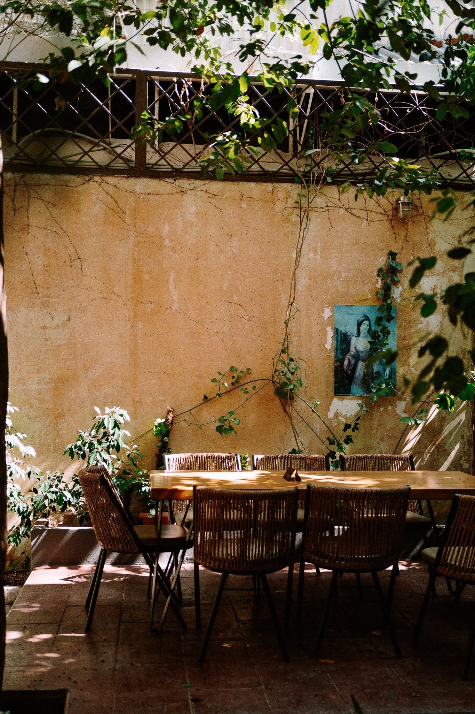
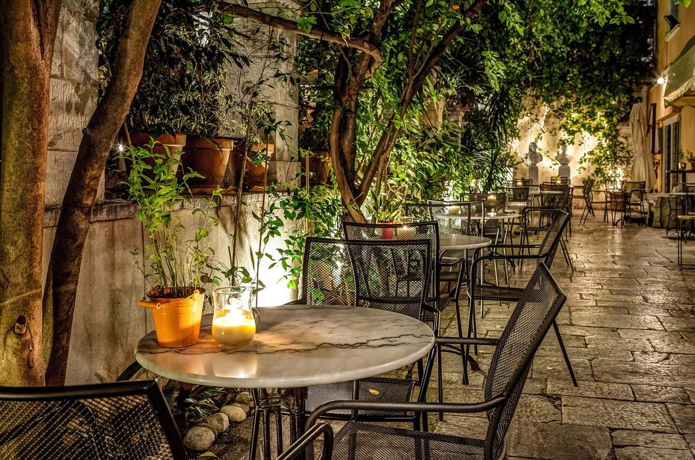
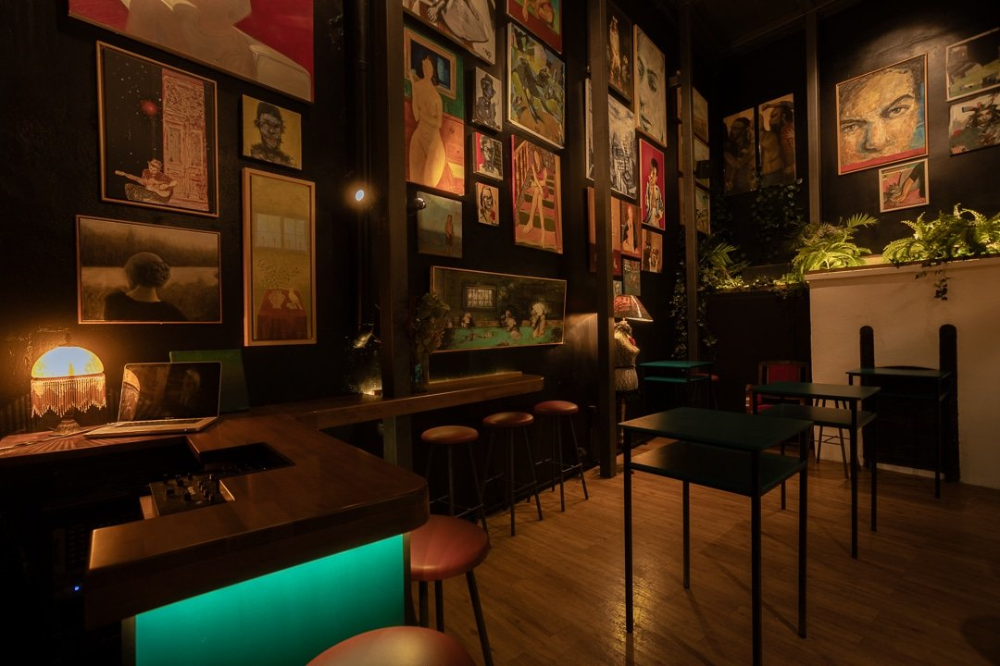
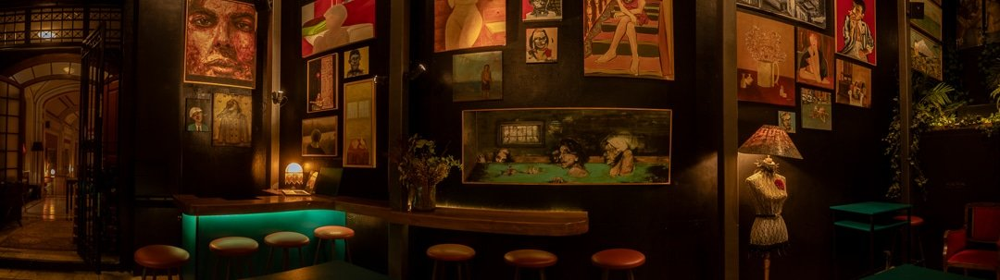
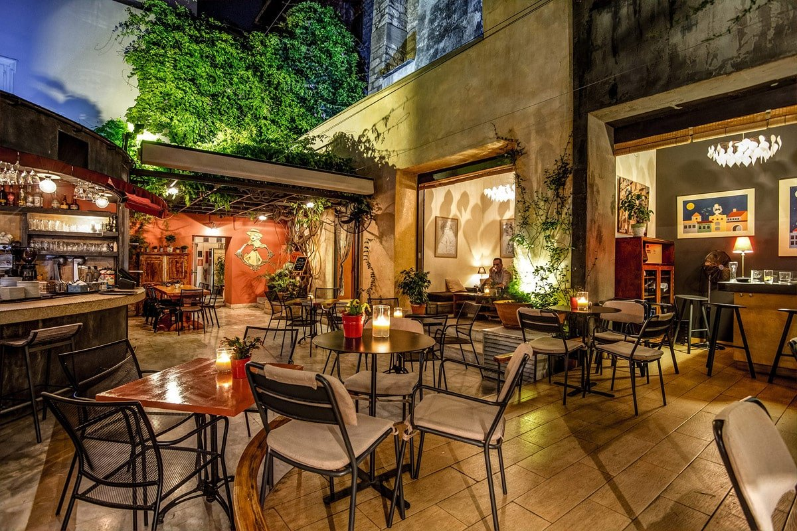

# 📂 DOSSIER #11: BLACK DUCK GARDEN – ATHENS CITY MUSEUM BISTROT (Ioannou Paparrigopoulou 5–7)

- **Kategorie:** Versteckte All-Day-Gartenoase, Wein-Bistro, Galerie & Bar im historischen Hof des Athener Stadtmuseums
- **Adresse:** Ioannou Paparrigopoulou 5–7 (am Klafthmonos-Platz), 105 61 Athen
- **Google Maps:** [Black Duck Garden](https://www.google.com/maps/search/?api=1&query=Black+Duck+Garden+Athens&query_place_id=ChIJQUQvvju9oRQRkefGT4htGAA)
- **Kontakt:** Tel. `+30 210 3254463` | [blackduck.gr](https://blackduck.gr/en/)
- **Laufweg ab Apartment (Korinnis):** **ca. 800 m / 8–9 Min. zu Fuß**
- **Distanzen zu den Nachbar-Spots:**
  - -> **Barro Negro** (*Ioannou Paparrigopoulou 15*): **50 m / 30 Sek. zu Fuß** (direkt 4 Häuser weiter!)
  - -> **The Clumsies** (*Praxitelous 30*): **100 m / 1 Min. zu Fuß** (direkt um die Ecke)
  - -> **Baba au Rum** (*Klitiou 6*): **180 m / 2 Min. zu Fuß**
  - -> **Tales of Ales** (*Miltiadou 19*): **250 m / 3 Min. zu Fuß**

## 🕒 Voraussichtliche Öffnungszeiten & November-Check
- **Voraussichtliche Öffnungszeiten:**
  - **Täglich (Mo–So):** 10:00 – 01:00 / 02:00 Uhr
  - **Küchenzeiten:** Brunch & Snacks ab **10:00 Uhr bis zum späten Nachmittag**, Hauptküche & Barfood durchgehend bis ca. **23:30 Uhr**.
- **Wetter-Faktor im November (Großer Vorteil!):**
  - **Draußen (Der historische Museumsgarten):** Windgeschützter, von hohen neoklassizistischen Mauern umschlossener Palmen-Innenhof auf mehreren Ebenen — bei mildem Novemberwetter tagsüber und nachmittags ein Traum.
  - **Drinnen (Der verglaste Indoor-Patio & die Black Duck Gallery):** Für kühle Abende oder Schauer gibt es das wunderschöne, warm beleuchtete **Indoor-Patio-Atrium**, das direkt in das Athener Stadtmuseum integriert ist (umgeben von historischen Exponaten und wechselnden Kunstwerken der *Black Duck Multiplarte*-Sammlung).

## 🏛️ Geschichte, Räumlichkeiten, Vibe & Publikum
- **Trinken im ersten Königsgarten Griechenlands (1836):** Das Gebäude (1833 erbaut) war die erste provisorische Residenz von **König Otto I. und Königin Amalia** nach ihrer Hochzeit, bevor das heutige Parlamentsgebäude am Syntagma fertiggestellt wurde. Die 18-jährige Amalia legte hier 1836 den allerersten öffentlichen Garten Athens an — **die große Palme, die Königin Amalia damals selbst pflanzte, steht noch heute mitten im Hof des Black Duck Garden!**
- **Vibe & Atmosphäre:** Gegründet 2008 als *Black Duck Multiplarte* (Mischung aus Bistro, Kunstgalerie und Kultur-Salon). Anders als die lauten Party-Bars nebenan herrscht hier ein **entspannt-kultivierter, grüner Oasen-Vibe** mit sanftem Jazz, Soul, Chanson und Lounge-Grooves — man kann sich perfekt unterhalten.
- **Publikum:** Athener Kulturszene, Schauspieler, Architekten, Weinliebhaber und Insider (ca. 30–55 Jahre).

## 🍽️ Essen: Snacks oder richtige Mahlzeit?
- **Klare Einordnung:** **Vollwertiges mediterranes Restaurant, starkes Brunch-Bistro UND erstklassiges Wein-/Bar-Food.**
- **1. Brunch & Tages-Snacks (ab 10:00 Uhr, offizielle Preise):**
  - *Focaccia Pulled Pork* mit Kimchi-Mayo: **11,00 €**
  - *Smoked Salmon Bagel* mit Tartarsauce: **11,00 €** | *Roasted Turkey Bagel* mit Preveza-Graviera: **8,50 €**
  - *Eggs Benedict* (mit Rinder-Jambon **10,00 €** / mit Avocado **10,50 €**) | *Eggs à la Royale* mit Lachs: **12,00 €**
  - *Ofen-Omelett* mit Pilzen & Xinomyzithra (**10,00 €**) oder Hähnchen, Brokkoli & Parmesan (**11,50 €**)
  - *Pancakes* mit Walnuss-Praline & Oreo (**9,00 €**) oder Honig & Blaubeeren (**9,50 €**)
- **2. Bar Food zum Teilen (ideal zu Wein & Drinks):**
  - *Pinsa* mit Tomatensauce, Katiki-Domokou-Frischkäse & Basilikumpesto: **11,00 €**
  - *Mini Tarts (8 Stück)* mit Katiki-Käse & Paprika-Chutney sowie Auberginencreme & Tahini: **12,00 €**
  - *Pulled Pork Sliders (4 Mini-Burger)* mit Kimchi-Mayo: **14,00 €**
  - *Aperitivo Platter* (Feigenpaste, Reifeschinken, Graviera, Oliven, knusprige Focaccia & Tomatenmarmelade): **16,00 €**
  - *Griechische Käse- & Charcuterie-Platte:* **19,00 €**
- **3. Hauptküche (Gehobene griechisch-mediterrane Küche):**
  - *Vorspeisen:* Marinierte Tomate mit Paximadi & Xinomyzithra (**13,00 €**), Warmer Kartoffelsalat mit Hähnchen-Apaki (**15,00 €**), Fava-Püree mit Orange & geräucherter Makrele (**16,00 €**), Sautierte Garnelen mit Pistaziensauce (**16,00 €**), Black-Angus-Carpaccio (**16,50 €**).
  - *Hauptgänge:* Zitroniges Orzo-Risotto / Kritharoto (**15,00 €**), Paccheri-Pasta mit gerösteter Birne & Pecorino (**16,00 €**), Hähnchenfilet (**17,00 €**), Geschmorte Schweinebäckchen auf Blumenkohlcreme (**19,00 €**), Wolfsbarschfilet auf Ofen-Kichererbsen (**24,00 €**), Black Angus Tagliata / Rib Eye (**29,00 €**).

## 🍹 Getränke, Weinkarte & Preise
- **Weinkarte (60+ griechische Etiketten & Mikro-Weingüter):**
  - **Offene Weine (0,15 l):** **5,50 – 8,50 €** (z. B. Hauswein *The Black Duck* Roditis/Assyrtiko oder Agiorgitiko für **6,00 €** im Glas / **22,00 €** die Flasche; *Samaropetra Kyr-Yiannis* **8,00 €**; *Dialogue Assyrtiko/Kydonitsa* **8,50 €**).
  - **Flaschenweine:** Fair kalkuliert zwischen **22,00 und 44,00 €**.
- **Signature „Duck“-Cocktails (9,00 – 12,00 €):**
  - *Spritzer Duck (9,00 €):* Aperol, Prosecco, Rote-Beeren-Cordial & Grapefruit.
  - *Tornado Duck (10,00 €):* Rum, Passionsfrucht, Zitrone, Ingwer & Pink Grapefruit Soda.
  - *Mexicana Duck (11,00 €):* Mezcal, Agave, Zitrone, 3Cents Mandarin & Bergamot Soda & Salz.
  - *Cucu Duck (11,00 €):* Gin, grüner Apfel, Zitrone, Gurke & 3Cents Aegean Tonic.
  - *Duck-groni (12,00 €):* Gin, Campari, Haus-Blend mit Brombeer-Wermut & Chrysantheme.
  - *Fig the Duck (12,00 €):* Whiskey, Limette, grüner Apfel & 3Cents Feigenblatt-Soda.

## 🎯 Beste Uhrzeit & Taktischer Einsatz für eure Gruppe
- **1. Der entspannte Nachmittags-/Sundowner-Anker im Zentrum (15:00 – 19:30 Uhr):**
  - Da euer Flug am Donnerstag erst abends landet (und ihr ca. 19:45 Uhr am Apartment seid), ist das Black Duck Garden stattdessen **perfekt für Freitag- oder Samstagnachmittag**: Wenn ihr durchs Zentrum lauft und vor dem Trubel der Cocktailmeile in Ruhe im grünen Königshof (oder im Kunst-Atrium) eine Flasche griechischen Wein (ab 22 €!) und *Pulled Pork Sliders* / *Aperitivo-Platten* teilen wollt.
- **2. Das perfekte Warm-up direkt neben Barro Negro & Clumsies (18:00 – 20:30 Uhr):**
  - Ihr sitzt hier **30 Sekunden von Barro Negro** und **60 Sekunden vom Clumsies** entfernt. Ideal, um in Ruhe eine Grundlage zu essen, bevor ihr euch ins Getümmel der Top-50-Bars stürzt!

## 📸 Bilder
- 
- 
- 
- 
- 
