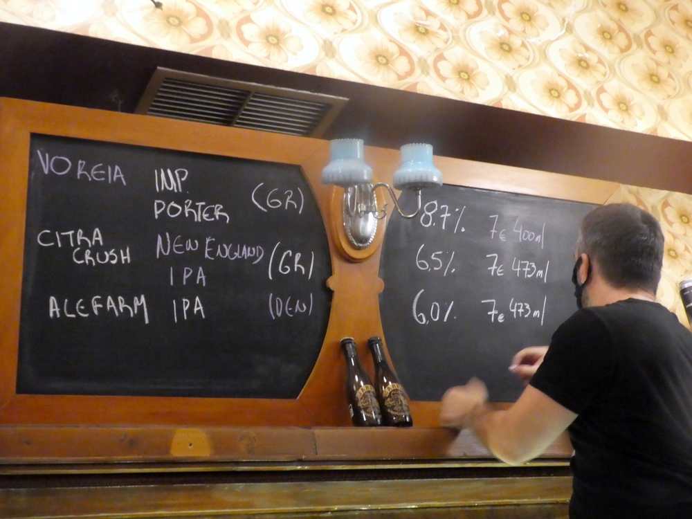
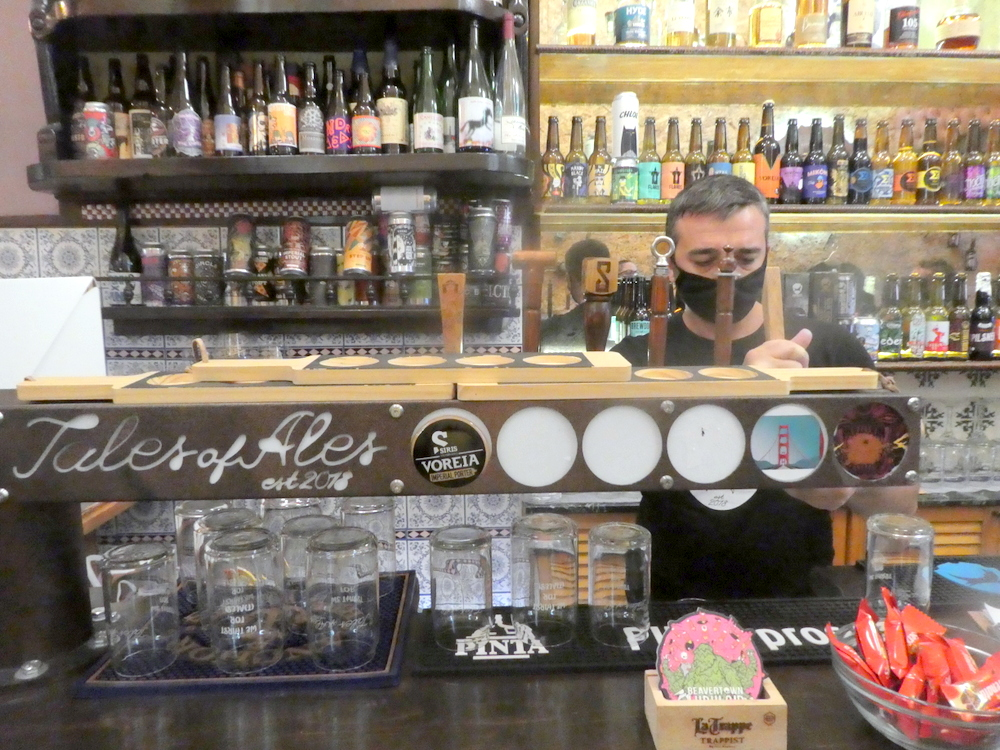
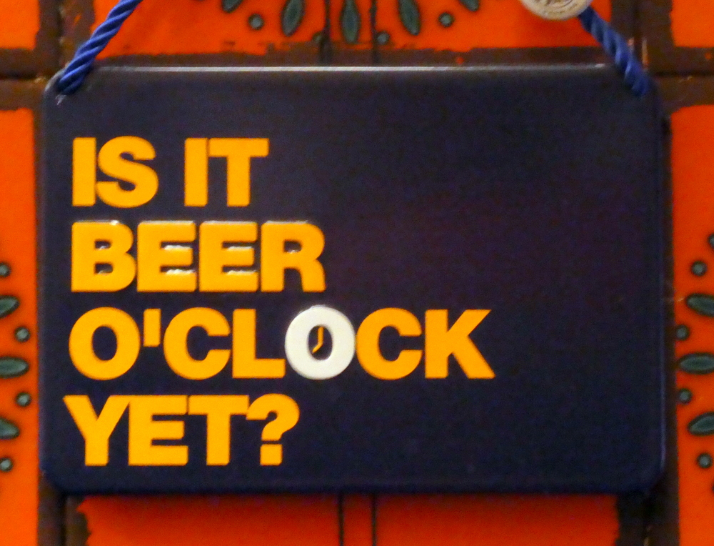

# 📂 DOSSIER #12: TALES OF ALES (Miltiadou 19, Psyri / Syntagma)

- **Kategorie:** Spezialisierte Craft-Beer-Bar & Bottle-Shop (10 rotierende Zapfhähne + 170+ Dosen/Flaschen griechischer & internationaler Mikrobrauereien)
- **Adresse:** Miltiadou 19 (Fußgängergasse im Commercial Triangle zwischen Psyri & Syntagma), 105 60 Athen
- **Google Maps:** [Tales of Ales](https://www.google.com/maps/search/?api=1&query=Tales+of+Ales+Athens&query_place_id=ChIJo-k4daq9oRQRXdpxPjKSk7s)
- **Kontakt:** Tel. `+30 210 3252540` | [talesofales.gr](https://talesofales.gr/)
- **Laufweg ab Apartment (Korinnis):** **ca. 750 m / 8 Min. zu Fuß**
- **Distanzen zu den Nachbar-Spots auf der Cocktailmeile:**
  - -> **The Clumsies** (*Praxitelous 30*): **90 m / 1 Min. zu Fuß** (direkt um die Ecke!)
  - -> **Baba au Rum** (*Klitiou 6*): **140 m / 1,5 Min. zu Fuß**
  - -> **Barro Negro** (*Ioannou Paparrigopoulou 15*): **180 m / 2 Min. zu Fuß**
  - -> **Black Duck Garden** (*Paparrigopoulou 5–7*): **220 m / 2,5 Min. zu Fuß**

---

## 🕒 Voraussichtliche Öffnungszeiten & November-Check
- **Voraussichtliche Öffnungszeiten:**
  - **Mo–Do:** 14:00 – 01:00 Uhr
  - **Fr & Sa:** 14:00 – 02:00 Uhr
  - **So:** 17:00 – 01:00 Uhr
- **Wetter-Faktor im November:** Gemütlicher, komplett rauchfreier Innenraum mit Bar-Tresen und Blick auf die riesigen Kühlwände + **überdachter Außenbereich** mit Tischen/Bänken direkt auf der verkehrsfreien Gasse *Miltiadou*.

## 🏛️ Vibe, Musik & Publikum
- **Atmosphäre:** Gegründet 2018 von Kostas und Agis. Kein steifer Hipster-Tempel, sondern eine extrem herzliche, bodenständige Nachbarschafts-Bierbar. Man wird sofort beraten, bekommt vor dem Bestellen am Zapfhahn immer einen Probeschluck (*Taster*) gezapft und hört dazu einen richtig guten Mix aus **Soul, Funk, Classic Rock und Punk-Rock**.
- **Publikum:** Bunte Mischung aus Athener Bier-Nerds, Leuten aus den umliegenden Plattenläden und Bar-Hoppern, die zwischen zwei 12-€-Cocktails im *Clumsies* und *Baba au Rum* Lust auf ein ehrliches, hopfenfrisches IPA vom Fass haben.

## 🍽️ Essen & Der neue 2026er-Streetfood-Geheimtipp direkt gegenüber!
- **In der Bar:** Handgemachte britische Crisps in ungewöhnlichen Sorten, Platten mit griechischen Handwerkswürsten und Käse lokaler Produzenten sowie spezielles Bier-Schokoladen-Pairing.
- **🔥 INSIDER-KOMBI DIREKT GEGENÜBER (3 Meter über die Gasse!):**
  - Direkt gegenüber in der **Miltiadou 22** hat im Herbst 2026 Athens neuer Streetfood-Liebling **Feta Me Meli** eröffnet: Frischer Feta aus Sparta wird vor euren Augen in hauchdünnes Filo-Teigblatt gewickelt, knusprig ausgebacken und im Papier-Hörnchen mit griechischem Honig (4 Varianten, auch *Spicy Chili-Honey*!) und geröstetem Sesam serviert (ca. 4,50–5,50 €). Perfekter salzig-süß-scharfer Snack zum herben IPA!

## 🍺 Biere, Griechische Top-Brauereien & Preise
- **Vom Fass (bis zu 10 rotierende Taps):** **4,50 – 7,50 €** (Half Pint ab ca. 3,50–4,50 €, Full Pint 5,50–7,50 € je nach Alkoholgehalt/Brauerei).
- **Kühlschrank (170+ Flaschen & Dosen):** Zum gleichen fairen Preis vor Ort eiskalt trinken oder günstiger für euer Apartment in der Korinnis mitnehmen!
- **Nach welchen griechischen Mikrobrauereien ihr fragen solltet:**
  1. **Seven Islands Brewery (Korfu):** Weltklasse-New-England-IPAs (*Citra Crush NEIPA 6,5 %*, Triple IPAs & Imperial Stouts).
  2. **Strange Brew (Athen):** *Jasmine IPA* (6,2 % – der Athener Klassiker mit Jasminblüten), *Dr. Haze* (Double NEIPA) oder *Uncle Jam’s*.
  3. **Kykao Handcrafted (Patras):** Experimentelle Sours, Gose, Farmhouse Ales & fassgereifte Stouts.
  4. **Noctua (Athen):** *Night Vision Black IPA* & *Head Twister Pale Ale* (direkt in Athen nahe Gazi gebraut).

## 🎯 Beste Uhrzeit & Taktischer Einsatz für eure Gruppe
- **1. Der „Apartment-Kühlschrank-Füller“ am Freitagnachmittag:**
  - Lauft kurz (8 Min.) zu **Tales of Ales**, trinkt ein frisch gezapftes *Seven Islands* oder *Strange Brew IPA* vor Ort und nehmt euch ein Paket eiskalter griechischer Craft-Beer-Dosen für euer Apartment in der Korinnis mit.
- **2. Der „Reset-Stopp“ auf der Cocktailmeile:**
  - Wenn ihr abends zwischen *The Clumsies* (1 Min.) und *Baba au Rum* (1,5 Min.) unterwegs seid und nach zwei süß-komplexen Cocktails ein eiskaltes, hopfiges Bier + gegenüber ein heißes *Feta-me-Meli*-Hörnchen einschieben wollt.

## 📸 Bilder
- 
- 
- 
