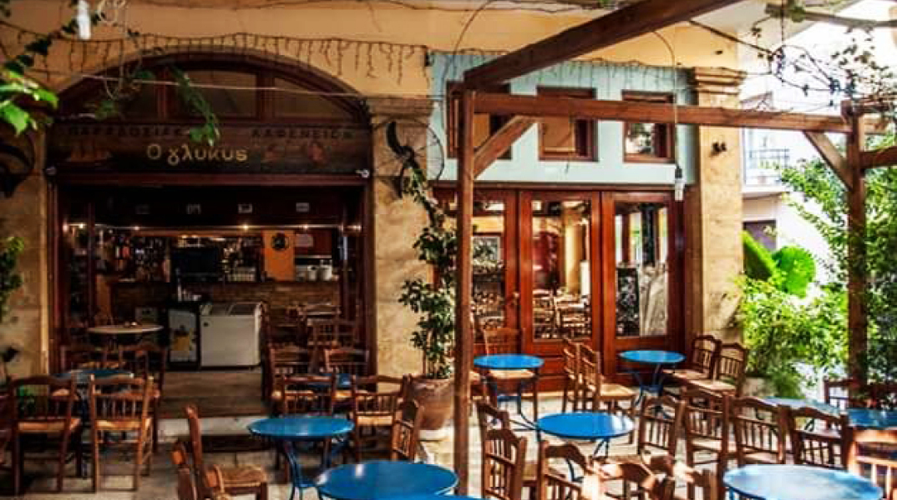
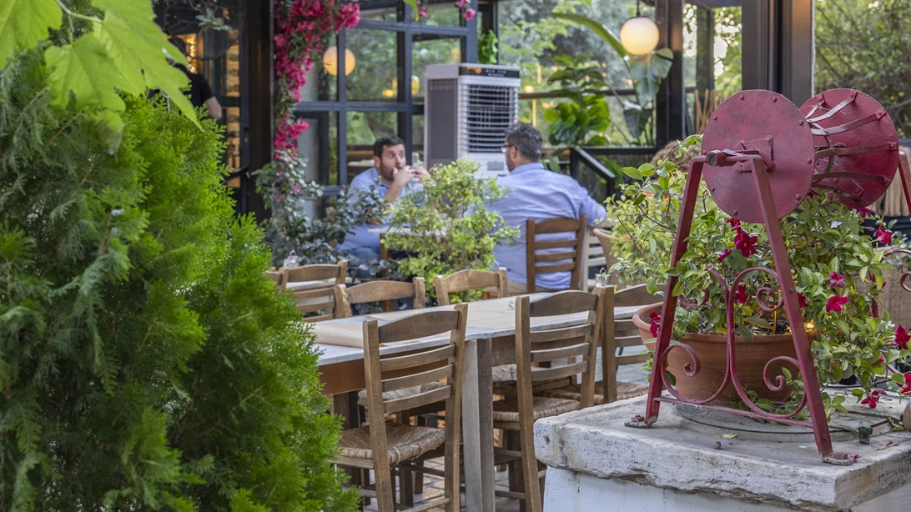
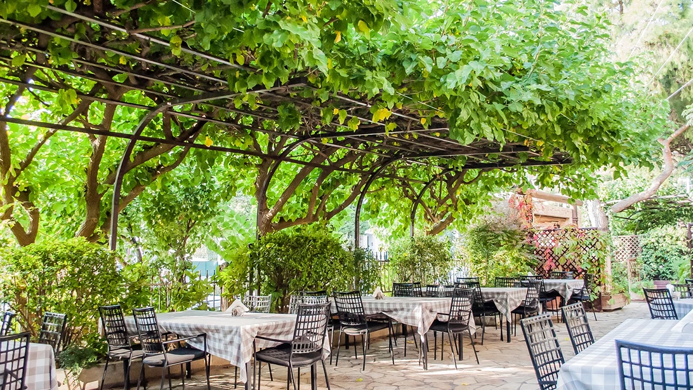
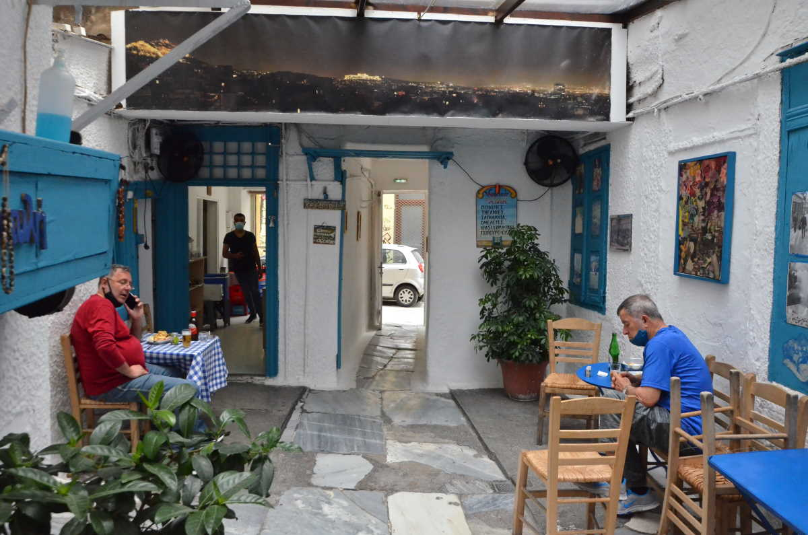
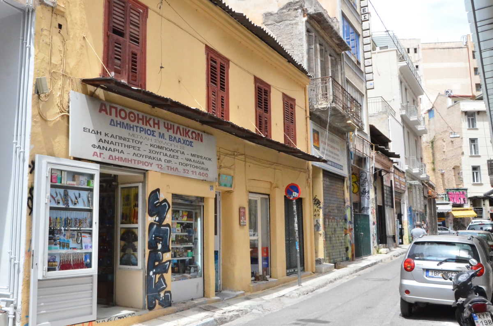

# 📂 DOSSIER #13: AVLI PSYRRI (Agiou Dimitriou 12)

- **Kategorie:** Verstecktes Traditions-Kafeneio & Mezedopoleio im weiß-blauen Hinterhof (seit den 1940ern / 1985 unter Herr Takis)
- **Adresse:** **Agiou Dimitriou 12 (Αγίου Δημητρίου 12)**, 105 54 Psyri, Athen *(direkt zwischen Kalamioti, Evripidou und dem Agion-Anargyron-Platz)*
- **Google Maps:** [Avli Psyrri](https://www.google.com/maps/search/?api=1&query=Avli+Psyrri+Athens&query_place_id=ChIJc99TmCS9oRQR2pw94VIs2tw)
- **Kontakt:** Tel. `+30 210 3217642` *(Achtung: Keine Reservierungen möglich — Walk-in only!)*
- **Laufweg ab unserem Apartment (Korinnis):** **ca. 550–700 m / 5–6 Min. zu Fuß** (unser direkter Nachbarschafts-Geheimtipp mitten in Psyri — quasi auf Kriechdistanz zum Bett!)
- **Distanzen zu den Nachbar-Spots:**
  - -> **The Clumsies** (*Praxitelous 30*): **350 m / 4 Min. zu Fuß**
  - -> **TAF & Couleur Locale** (*Normanou 3–5*): **350 m / 4 Min. zu Fuß**
  - -> **360 Cocktail Bar** (*Ifestou 2*): **400 m / 5 Min. zu Fuß**

## 🕒 Voraussichtliche Öffnungszeiten & November-Check
- **Voraussichtliche Öffnungszeiten:**
  - **Mi–Mo:** **13:00 – 02:00 Uhr**
  - **Dienstag:** Geschlossen *(für unseren Trip Do–So also durchgehend jeden verdammten Tag geöffnet!)*
- **Wetter-Faktor im November:**
  - Der schmale, langgestreckte Innenhof (*Avli*) ist von allen vier Seiten von den zweistöckigen Hausmauern und dem umlaufenden Holzbalkon (*Chagiati*) komplett windgeschützt und im oberen Teil um den Gaskocher und Stammtisch **überdacht**. Trotzdem ist es ein klassischer Alt-Athener Hof — abends im November lassen wir also die Jacke oder den Pulli einfach an. Die bullige Hitze der 3-flammigen Gaskocher, die direkt neben unseren Tischen vor sich hin brutzeln, plus die erste Karaffe Tsipouro erledigen die innere Frostschutz-Arbeit in Rekordzeit!

## 🏛️ Wie wir den versteckten Eingang finden, Geschichte & Vibe
- **So finden wir die geheime Tür:** Wenn wir die schmale *Agiou Dimitriou* entlangschlendern, halten wir nach der Hausnummer **12** Ausschau (ein schlichtes, ockerfarbenes zweistöckiges Alt-Athener Haus aus der Mitte des 19. Jahrhunderts). Es gibt **kein großes Schild** — nur eine schmale Eisentür mit einem winzigen pistaziengrünen/weißen Schildchen *„ΑΥΛΗ“* (wer schon zwei Ouzo im Turm hat, läuft glatt dran vorbei). Wir drücken die Klinke runter, quetschen uns durch einen niedrigen, schmalen Hausflur — und stehen plötzlich mitten auf einer griechischen Insel aus den 1960er-Jahren!
- **Die Kult-Geschichte von Herrn Takis:** Schon in den 1940er-Jahren war hier ein ehrliches Arbeiter-Kafeneio. In den alten Zimmern hinter den blauen Holzfensterläden wohnten früher Familien und im Erdgeschoss saßen Leder- und Gürtelwerkstätten. **Herr Takis** fing hier in den 80ern als Laufbursche an, übernahm den Laden **1985** und ließ alles exakt so, wie es war (inklusive des legendären alten *Kelvinator*-Kühlschranks, der vermutlich älter ist als unsere gesamte Ochos-Truppe). Bis 2010 servierte er nur griechischen Mokka und Frappé an die Opas aus dem Viertel — bis eines Abends eine feierwütige Athener Runde den Hof kaperte und Herr Takis anfing, auf seinem 3-flammigen Gaskocher direkt im Hof deftige Pfannengerichte (*Mezedes*) rauszuhauen.
- **Vibe & Publikum:** Weiß gekalkte Treppen, knallblaue Fensterläden, rot-weiß karierte Wachstischdecken (perfekt, wenn mal wieder ein halbes Glas Tsipouro verschüttet wird), wohlgenährte Hofkatzen auf den Holzstühlen, alte griechische Laïkó-/Rembetiko-Musik aus dem Radio und eine herrlich laute, feucht-fröhliche Stammtisch-Atmosphäre.

## 🍽️ Essen: Was kommt aus den 3 Gusseisen-Pfannen? (Echte Preise!)
Keine schicke Speisekarte, kein Schischi, keine QR-Codes — hier wird ehrliches Männerfutter frisch vor unseren Augen im brutzelnden Fett auf dem 3-flammigen Gaskocher gebraten und mitten auf den Tisch geknallt:
- **Die Pflicht-Bestellung für unsere Ochos-Truppe (fast jedes Gericht kostet lächerliche 4,50 – 9,00 €!):**
  1. **Keftedakia (ca. 6,00 – 7,00 €):** Herr Takis’ berühmte griechische Fleischbällchen — außen extrem knusprig ausgebacken, innen saftig mit frischer Minze (gelten unter Einheimischen als einige der besten Frikadellen in ganz Athen!).
  2. **Choirini Tigania (ca. 7,00 – 8,00 €):** Deftiges Pfannen-Schweinefleisch mit ordentlich Zitrone, Oregano und Knoblauch — der perfekte Schwamm für die nächste Runde Schnaps.
  3. **Saganaki me Pastourma (ca. 6,50 €):** In Filoteig gebackener Käse mit würzigem Rinder-Pastirma (oder klassisches gebratenes Käse-Saganaki für ca. 5,00 € — pures Hüftgold!).
  4. **Choriatiko Loukaniko (ca. 6,00 €):** Gebratene griechische Bauernwurst + ein Berg handgeschnittener, doppelt frittierter Pommes mit Oregano & Feta (**ca. 4,50 €**).
  5. **Tiganito Sikoti (ca. 6,50 €):** Perfekt zart gebratene Leber aus der Gusseisenpfanne (für die harten Jungs am Tisch).
  6. **Pikilia Megali / Große gemischte Hof-Platte (ca. 12,00 – 14,00 €):** Ein riesiger Fleischteller mit Bällchen, Wurst, Schwein, Käse, Gurke, Tomate & ordentlich Tzatziki zum Teilen — danach hat garantiert jeder die amtliche Knoblauchfahne des Todes.

## 🍺 Getränke & Preisniveau (Unschlagbar günstig!)
- **Eiskalte 0,5-l-Flaschenbiere** (*Alfa, Fix, Mythos, Mamos* direkt aus dem alten Kelvinator-Kühlschrank): **ca. 3,50 – 4,00 €**
- **Hauswein in der traditionellen Blech-/Kupferkanne** (0,5 l Weiß / Rosé / Rot): **ca. 5,00 – 6,00 €**
- **Tsipouro / Ouzo / Raki** (200-ml-Karaffe auf Eis — das amtliche Zielwasser): **ca. 6,00 – 7,50 €**
- **Gesamtrechnung:** Wir werden hier inklusive einem Tisch voller Fleisch-Teller, Bier und Wein für **12 bis 16 € pro Nase (!)** pappsatt und selig angetrunken. *(Wichtig: Genug **Bargeld / Cash** einstecken, mit Karte wedeln bringt bei Herrn Takis wenig!)*

## 🎯 Beste Uhrzeit & Taktischer Walk-in-Plan (Ohne Schlange!)
- **Achtung zur Uhrzeit:** Da *Avli* mittlerweile Kultstatus hat, nur ca. 15–20 Tische im schmalen Hof besitzt und **keine Reservierungen** annimmt, steht zwischen **19:30 und 22:00 Uhr** oft eine durstige Schlange draußen auf der Gasse.
- **Die 3 besten Zeitfenster für unsere Truppe:**
  1. **Der Nachmittags-/Mittags-Move (Fr, Sa oder So zwischen 13:00 und 17:00 Uhr):** Wir kapern sofort den besten Tisch mitten im Hof, die Sonne fällt zwischen die blauen Fensterläden und wir eröffnen das Daydrinking standesgemäß mit Fleischbällchen, Tzatziki und eiskaltem Halbliter-Bier!
  2. **Das frühe Abendessen vor der Cocktailmeile (ca. 17:30 – 18:45 Uhr):** Genau bevor der große Abend-Run losgeht — eine spottbillige, fettige Grundlage im Magen, bevor wir 4 Minuten weiter ins *Clumsies* oder *TAF* zum Hochprozentigen abbiegen.
  3. **Der späte Donnerstagabend-Touchdown (nach 22:15 Uhr):** Da die Küche bis spät in die Nacht (oft bis nach Mitternacht, Laden offen bis 02:00 Uhr) brutzelt, ideal für einen deftigen Mitternachts-Absacker am ersten Abend, nur 5 Minuten Torkelmarsch von unserem Apartment in der Korinnis!

## 📸 Bilder
- 
- 
- 
- 
- 
