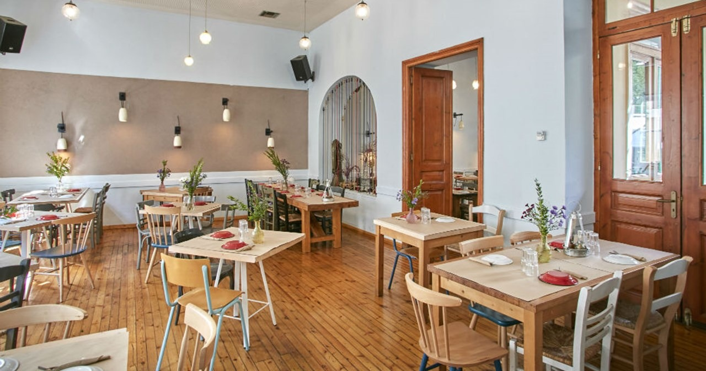
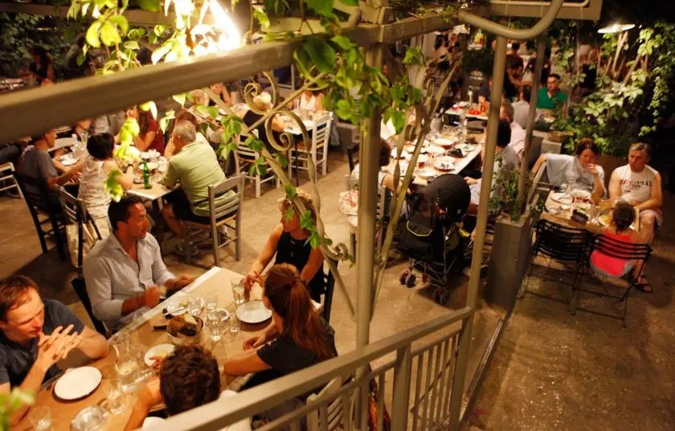
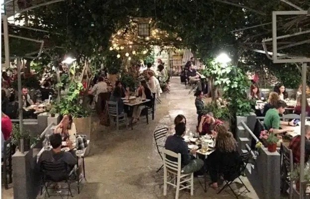
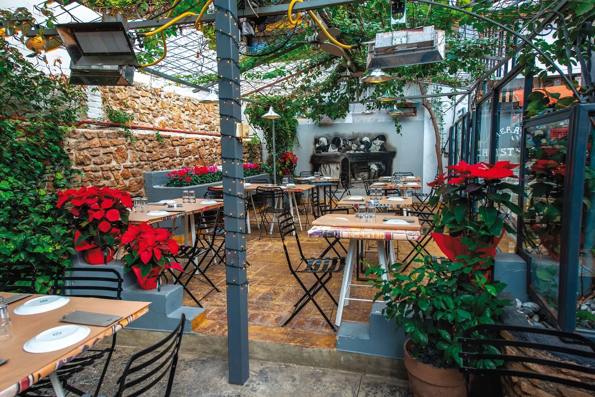
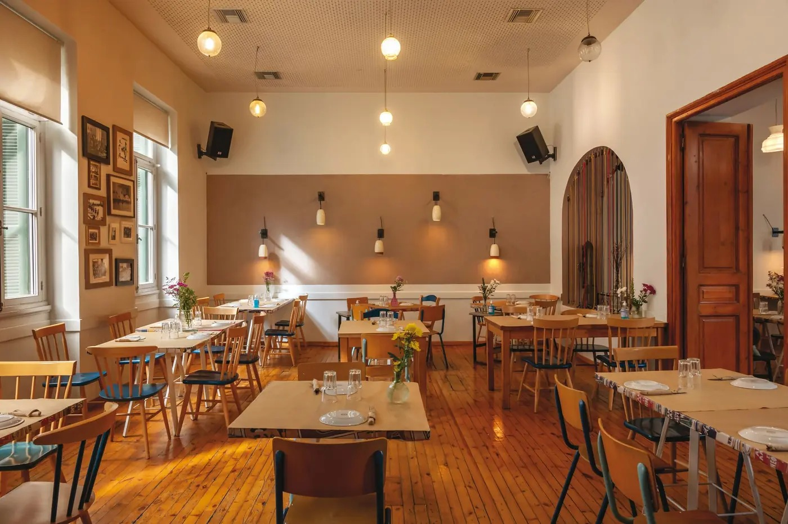

# 📂 DOSSIER #14: AMA LACHEI (STIS NEFELIS) (Kallidromiou 69, Exarchia)

- **Kategorie:** Legendäres Modern-Greek-Mezedopoleio & Garten-Taverne im begrünten Pausenhof (und den alten Klassenzimmern!) einer ehemaligen Grundschule
- **Adresse:** Kallidromiou 69 (Καλλιδρομίου 69), 106 83 Exarchia, Athen *(am Fuße des Strefi-Hügels)*
- **Google Maps:** [Ama Lachei](https://www.google.com/maps/search/?api=1&query=Ama+Lachei+Athens&query_place_id=ChIJETz0yTW9oRQR23hUCd_DS80)
- **Kontakt & Reservierung:** Tel. `+30 210 3845978` | Instagram: [@amalaxeinef](https://www.instagram.com/amalaxeinef/) *(Tipp: Für Freitag-/Samstagabend oder Samstagmittag vorab kurz anrufen!)*
- **Laufweg ab Apartment (Korinnis):** **ca. 1,9–2,1 km / 22–24 Min. zu Fuß** (oder 5–6 € / 6 Min. per Uber/Taxi) — ideal als Einstieg oder Krönung eurer **Exarchia-Runde**!
- **Distanzen zu den Nachbar-Spots in Exarchia:**
  - -> **strakastrüka** (*Kallidromiou 62*): **60 m / 1 Min. zu Fuß** (schräg gegenüber auf derselben Straße!)
  - -> **Spirtokouto / Spirto** (*Kallidromiou 67 / Methonis 66*): **30–100 m / 1 Min. zu Fuß**
  - -> **Rozalia Exarchia** (*Valtetsiou 54*): **350 m / 4 Min. zu Fuß**
  - -> **Tanini Agapi Mou** (*Ippokratous 91*): **500 m / 6 Min. zu Fuß**
  - -> **Pharaoh** (*Solomou 54*): **850 m / 10 Min. zu Fuß**

## 🕒 Voraussichtliche Öffnungszeiten & November-Check
- **Voraussichtliche Öffnungszeiten:**
  - **Mo–Mi:** 12:00 – 23:30 Uhr *(griechisches Brunch-Menü bereits ab 10:00–13:00 Uhr)*
  - **Do–So:** **12:00 – 00:00 Uhr (Mitternacht)**
- **Wetter-Faktor im November (100 % flexibel — Hof & Klassenzimmer!):**
  - **1. Der große, gestufte Schulgarten (Draußen):** Bleibt den **ganzen Winter über geöffnet** — mit starken Heizstrahlern direkt an den Tischen, Weinpergolen, Zitronen- und Orangenbäumen sowie hohen Schutzmauern rundherum.
  - **2. Die ehemaligen Klassenzimmer (Drinnen):** Falls es im November abends doch zu frisch oder regnerisch wird, sitzt ihr drinnen im wunderschön restaurierten neoklassizistischen Schulgebäude auf alten Holzdielen, unter hohen Decken, umgeben von historischen Schwarz-Weiß-Schulfotos (Paraden, Schultheater, Turnstunden aus den 1960ern) und Pop-Art-Elementen.

## 🏛️ Geschichte, Architektur & Vibe
- **Vom Grundschul-Pausenhof zur Kult-Taverne:** Bis Anfang der 1980er-Jahre war das Gebäude in der *Kallidromiou 69* eine echte Athener Grundschule (*Dimotiko Scholeio*). Wenn ihr durch das schmiedeeiserne Schultor die Stufen hinunter in den gepflasterten Hof geht, seht ihr an der Mauer sogar noch die **originalen alten Marmortrinkbrunnen**, an denen die Schulkinder in den 60ern in der großen Pause Wasser getrunken haben!
- **Geschichte seit 1981:** Direkt nach der Schulschließung zog hier 1981 das legendäre Studenten-Tsipouradiko *„Stis Nefelis“* ein; vor rund 12 Jahren wurde es als **„Ama Lachei (stis Nefelis)“** (*„Wenn es sich ergibt...“*) mit großem Garten und gehobener Meze-Küche neu belebt.
- **Der legendäre Samstags-Vibe auf der Kallidromiou:** Jeden **Samstagvormittag bis ca. 15:00 Uhr** findet direkt vor dem Schultor auf der kompletten *Kallidromiou* Athens berühmtester **Laiki Agora (Wochenmarkt)** statt — Händler schreien ihre Preise aus, ganz Exarchia (Musiker, Schauspieler, Studenten, Alt-68er) schlendert mit Einkaufstaschen vorbei und strömt ab 12:30 Uhr direkt in den Schulhof von *Ama Lachei* zum stundenlangen Samstags-Gelage.

## 🍽️ Essen: Gehobene griechisch-kretische Sharing-Küche (Aktuelle 2026er-Kartenpreise!)
Im Gegensatz zum ultra-rustikalen *Avli* spielt *Ama Lachei* kulinarisch eine Liga höher — mit handverlesenen Erzeugern von den Inseln (Kreta, Lesbos, Tinos, Chios, Ios) und kreativen Twists, aber zu extrem fairen Preisen:
- **Mezedes & Vorspeisen für die Tischmitte (4,80 – 12,70 €):**
  - **Fava „Pantremeni“ (6,90 €):** Samtige Platterbse mit karamellisierten Zwiebeln, eingelegtem Gemüse und frittierten Kapern.
  - **Kolokythokeftedes (7,20 €):** Knusprige Zucchini-Käse-Bällchen mit Feta, kretischer Graviera und frischer Kräuter-Joghurt-Creme.
  - **Sfakiani Pita (8,10 €):** Dünner kretischer Pfannenteig gefüllt mit saurer Mizithra, Honig-Sauce und Sesam *(oder die berühmten Feta-Loukoumades / Feta-Doughnuts!)*.
  - **Kretischer Dakos (8,20 €):** Gersten-Zwieback mit Tomaten und cremiger Xynomizithra.
  - **Geräuchertes Heringsfilet aus Lesbos (9,40 €):** Auf lauwarmem Hülsenfrüchte-Salat mit Feta-Creme und getrockneten Tomaten.
  - **Oktopus in Essig-Marinade (12,70 €):** Mit geräucherter Paprika.
  - **Spezial-Käsekarte kleiner Insel-Käsereien (6,40 – 7,80 €):** *Gegrillter Mastelo aus Chios* (7,80 €), *Skepasto Saganaki Kaisareias* im Blätterteig mit Pastirma, *Tsalafouti* (6,40 €), *Volaki aus Tinos* (6,70 €).
- **Fleisch, Fisch & Tagesgerichte zum Teilen (11,50 – 16,20 €):**
  - **Choirinos Sidirodromos / Smoked Pork Ribs (ca. 13,50 – 14,50 €):** Das berühmte Signature-Fleischgericht des Hauses — butterzart geschmorte Schweinerippe mit Glasur aus geräucherter Paprika bzw. Rum-BBQ-Note.
  - **Arnisia Kebapakia:** Saftige Lamm-Kebab-Spießchen auf hausgemachter Sauerteig-Pita.
  - **Garides Kritharoto / Shrimp Orzotto (15,30 €):** Cremiges Orzo-Nudelrisotto mit Garnelen und echtem Safran aus Kozani.
  - **Geschmorte Schweinshaxe / Pork Knuckle (14,20 €)** & **Freilandhuhn in Wein geschmort (11,50 €)**.
- **Desserts (6,10 – 7,10 €):** *Schokoladen-Mosaiko mit Schoko-Namelaka & Salted Caramel* (6,20 €) oder *Cheesecake mit Manouri-Käse, Limette & Waldfrüchten* (7,10 €).

## 🍺 Getränke & Preisniveau
- **Weine kleiner griechischer Weingüter, Tsipouro, Ouzo & Kretischer Raki:** Karaffe Tsipouro/Raki ca. **7,00 – 9,00 €**, Hauswein (0,5 l) ca. **6,00 – 8,00 €**, Flaschenweine ab ca. **18,00 – 28,00 €**.
- **Griechische Biere & Mikrobrauereien:** **4,50 – 6,00 €**.
- **Gesamtrechnung:** Pro Person landet ihr bei einem voll gedeckten Tisch inklusive Getränken bei sehr fairen **20 bis 25 €**.

## 🎯 Beste Uhrzeit & Der perfekte Exarchia-Kombi-Move für eure Gruppe
- **1. Der „Samstagmittag-Markt-Move“ (Absolutes Highlight!):**
  - Schlendert am **Samstag gegen 12:00 / 12:30 Uhr** durch den bunten Wochenmarkt auf der *Kallidromiou*, setzt euch um **12:30 Uhr** in den sonnigen Schulhof von **Ama Lachei** (ab 13:30 Uhr wird es samstags brechend voll!) und startet mit 8–10 Meze-Tellern und Tsipouro ins Wochenende.
  - **Direkter Anschluss (60 Meter weiter!):** Ab **15:00 / 16:00 Uhr** wechselt ihr einfach schräg gegenüber auf die Straßenstufen von **strakastrüka (`Kallidromiou 62`)** oder ins **Spirtokouto (`Kallidromiou 67`)** zum weitertrinken!
- **2. Das große Abend-Warm-up vor Pharaoh / Tanini Agapi Mou:**
  - Perfekt für ein ausgedehntes Abendessen gegen **19:30 / 20:00 Uhr** im beleuchteten, beheizten Schulhof — und danach 6–10 Min. zu Fuß weiter zu Naturwein bei **Tanini Agapi Mou** oder Vinyl-Sound im **Pharaoh**.

## 📸 Bilder
- 
- 
- 
- 
- 
