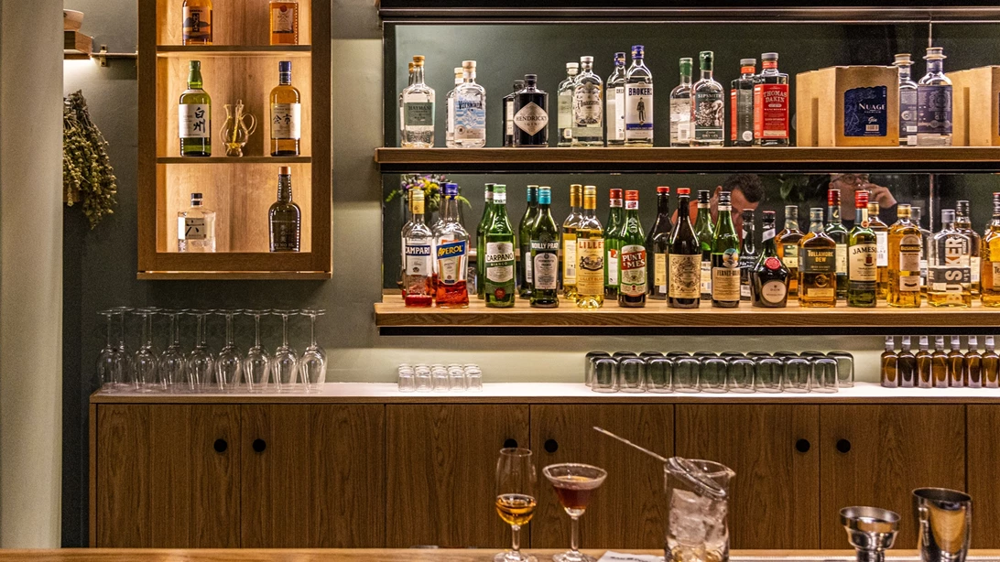
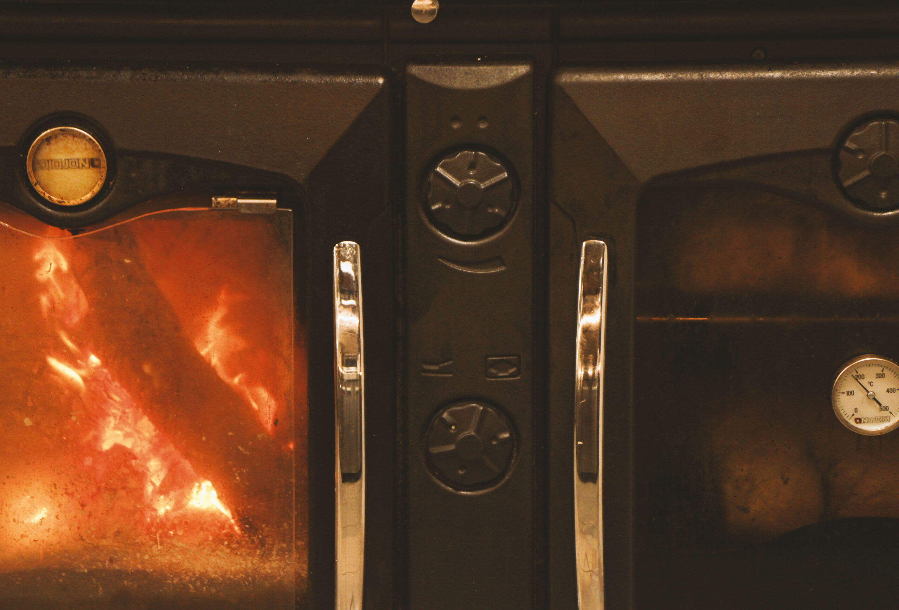
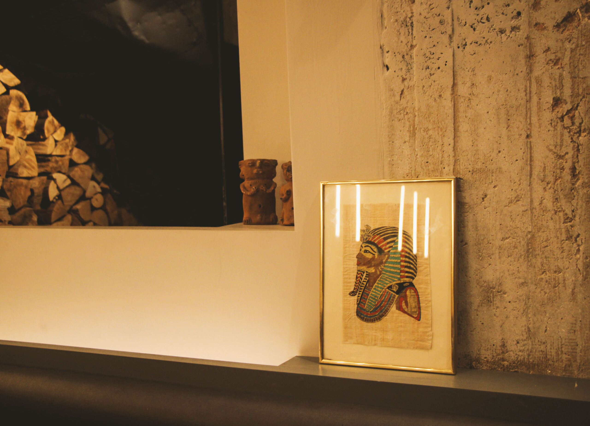
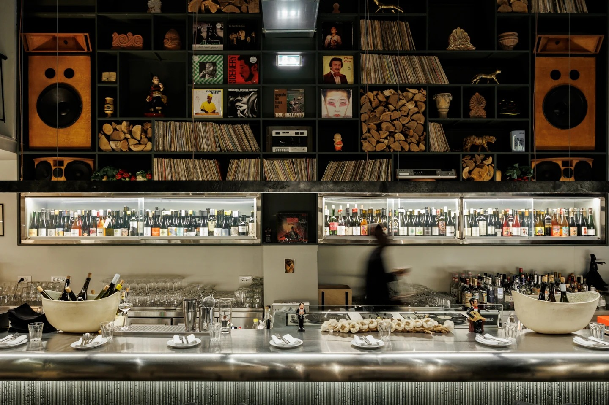
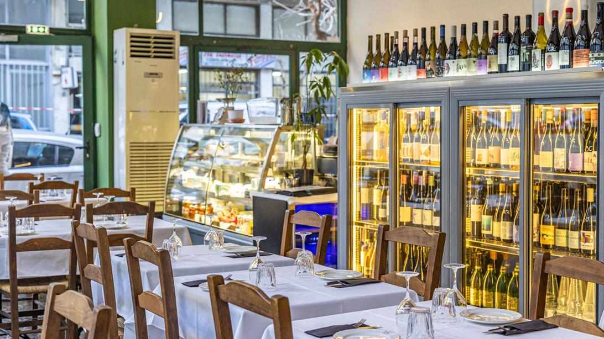

# 📂 DOSSIER #15: PHARAOH (Solomou 54, Exarchia)

- **Kategorie:** Michelin-prämiertes (*Bib Gourmand* & *50 Best Discovery*) Holzfeuer-Restaurant, Natural-Wine-Bar (400+ Positionen) & Audiophile-Vinyl-Listening-Bar
- **Adresse:** Solomou 54 (Σολωμού 54), 106 82 Exarchia, Athen *(am westlichen Rand von Exarchia nahe Omonia / Kanigos-Platz)*
- **Google Maps:** [Pharaoh](https://www.google.com/maps/search/?api=1&query=Pharaoh+Athens&query_place_id=ChIJsZWGvy29oRQRa1OmHuA6FDo)
- **Kontakt & Reservierung:** Tel. `+30 210 3808412` (täglich 11:00–18:00 Uhr außer So) | E-Mail: `reservations@pharaoh.gr` | Web & Online-Booking: [pharaoh.gr](https://pharaoh.gr/)
- **Laufweg ab Apartment (Korinnis):** **ca. 1,1–1,3 km / 12–14 Min. zu Fuß** (direkt über den Omonia-Platz die *3is Septemvriou* / *Solomou* hoch)
- **Distanzen zu den Nachbar-Spots in Exarchia:**
  - -> **Rozalia Exarchia** (*Valtetsiou 54*): **550 m / 6 Min. zu Fuß**
  - -> **Spirtokouto / Spirto** (*Kallidromiou 67 / Methonis 66*): **800 m / 9 Min. zu Fuß**
  - -> **Ama Lachei** (*Kallidromiou 69*) & **strakastrüka** (*Kallidromiou 62*): **850 m / 10 Min. zu Fuß**
  - -> **Tanini Agapi Mou** (*Ippokratous 91*): **1,0 km / 12 Min. zu Fuß**

## 🕒 Voraussichtliche Öffnungszeiten & November-Check
- **Voraussichtliche Öffnungszeiten (Wichtiger Check für euren Trip Do–So!):**
  - **Mo–Do:** **17:30 – 02:00 Uhr** *(Küche bis 00:00 Uhr)*
  - **Fr & Sa:** **13:30 – 02:00 Uhr** *(durchgehend ab Mittag bis 2 Uhr nachts!)*
  - **Sonntag:** **Geschlossen** *(also unbedingt für Donnerstagabend, Freitag oder Samstag einplanen!)*
- **Wetter-Faktor im November:**
  - **100 % wetterfestes, spektakuläres Industrial-Indoor-Space:** Hinter einer unscheinbaren Fassade (ohne großes Schild!) zieht ihr am Eingang einen schweren **smaragdgrünen Samtvorhang** zur Seite und steht in einem hohen, warm beleuchteten Brutalismus-/Mid-Century-Saal mit originalem Athener Mosaikboden, Sichtbetonwänden, offener Feuerküche, langem Marmortresen und Galerie-Loft.

## 🏛️ Konzept, Macher, Musik & Vibe
- **Das Dream-Team hinter Pharaoh:** Gegründet Ende 2022 von vier Koryphäen: Spitzenkoch **Manolis Papoutsakis** (bekannt aus Thessaloniki für *Haroupi* & *Deka Trapezia*), Food-Journalist **Fotis Vallatos**, Wein-Guru **Perry Panagiotakopoulos** und dem international gefeierten Opern-Bariton **Dimitris Platanias**. Benannt ist der Laden nach der Spiritual-Jazz-Legende **Pharoah Sanders**.
- **Kochen wie vor 100 Jahren (0 % Strom, 0 % Gas!):** In der offenen Küche gibt es **weder Elektroherde noch Gasbrenner** — jedes einzelne Gericht wird ausschließlich über **offenem Holzfeuer, Holzkohlegrills und im Holzbackofen** (*Parasia*) zubereitet.
- **Audiophile Vinyl-Listening-Bar:** Die riesige, raumhohe Regalwand hinter der langen Bar ist halb mit gestapeltem Feuerholz und halb mit **Tausenden Vinyl-Schallplatten** gefüllt. Jeden Abend legen Top-DJs ausschließlich von Vinyl (Spiritual Jazz, Afro-Funk, Rare Groove, Soul, Post-Punk, World) über ein maßgeschneidertes High-End-Soundsystem auf.
- **Publikum:** Internationales Gastro- und Musik-Publikum, Athener Kreative, Sommeliers, Künstler und Nachtschwärmer. Cool, urban, lautstark, null steif.

## 🍽️ Essen: Archaische Holzfeuer-Küche mit Michelin-Auszeichnung
Die Karte wechselt nach Marktangebot, folgt aber immer dem Prinzip: **Traditionelle griechisch-kretische Dorfgerichte aus dem Holzofen zum Teilen in der Tischmitte**:
- **Vorspeisen & Holzofen-Klassiker (ca. 7,00 – 15,00 €):**
  - **Sauerteigbrot aus dem Holzofen** & **Taramosalata mit Bottarga (Meeräschenrogen)** — ein absolutes Pflichtgericht!
  - **Dolmadakia (Weinblätter)** mit säuerlichem kretischem *Xygalo*-Joghurt oder geschmorte Kohlwickel (*Lahanodolmades*) aus dem Holzofen.
  - **Wilde Bergkräuter (*Chorta* & *Stamnagathi*)** mit Holzkohle-Aroma, Zitrone und Olivenöl.
  - **Austern aus dem Holzbackofen** oder **Ceviche / Geräucherte Makrele** mit Fenchel-Orangen-Salat.
  - **Eier aus der Holzofen-Pfanne** mit Spargel/Wildpilzen und frisch gehobeltem Trüffel.
- **Hauptgerichte vom offenen Feuer & aus dem Tontopf (ca. 16,00 – 28,00 €):**
  - **Keftedakia:** Hackbällchen vom Holzkohlegrill mit Rauch-Aroma.
  - **Smoked Lamb / Geschmortes Lamm oder Ziege (*Zigouri*)** aus dem Holzofen mit traditioneller griechischer Pasta oder kretischem Hochzeits-Pilaf (*Gamopilafo*).
  - **Geschmortes Rindfleisch mit Gerste (*Giouvetsi*)** oder **Kastanien-Stifado** aus dem Gusseisentopf.
  - **Tagesfang-Fisch** (z. B. Zahnbrasse / Snapper) im Holzofen mit wildem *Askolymbri*-Wurzelgemüse gedämpft.
- **Desserts (ca. 8,00 – 10,00 €):** *Galaktoboureko* (knuspriger Filoteig mit warmer Milchcreme aus dem Holzofen) oder *Grieß-Halva-Creme mit im Holzofen geschmorten Quitten*.

## 🍷 Getränke: 400+ Natural Wines & Craft Drinks
- **Eine der besten Naturweinkarten Europas:** Über **300 bis 400 Positionen** (biodynamisch, unfiltriert, Skin-Contact/Orange Wines aus Griechenland, Frankreich, Italien, Spanien & Georgien), unterteilt von *„easy drinking“* bis *„full funky“*.
  - **Offene Weine im Glas:** **ca. 7,00 – 12,00 €**
  - **Flaschenweine:** **ab ca. 28,00 – 45,00 €** (perfekt zum Teilen in eurer Gruppe!)
- **Außerdem:** Griechische Craft-Biere, Tsipouro und eine feine Liste klassischer Cocktails & starker alkoholfreier Fermente.
- **Gesamtrechnung:** Bei vollem Dinner inkl. Wein ca. **35 – 55 € pro Person** (nur auf 1–2 Gläser Naturwein + Bar-Plates an der Theke ca. **15 – 25 €**).

## 🎯 Beste Uhrzeit & Taktischer Einsatz (Reservierung vs. Walk-in-Trick!)
- **WICHTIG zur Reservierung:** Die Tische im Restaurantbereich sind abends oft Wochen im Voraus ausgebucht (Online-Reservierung bis 6 Personen unter [pharaoh.gr](https://pharaoh.gr/), ab 7 Personen per Mail an `reservations@pharaoh.gr` oder telefonisch unter `+30 210 3808412`).
- **Der geniale Walk-in-Trick für eure Gruppe (ohne Reservierung!):**
  1. **An die lange Vinyl-Bar oder den Küchen-Tresen (Walk-in):** Die lange Bar und der Tresen vor der offenen Feuerküche werden **nicht reserviert**, sondern an **Walk-ins** vergeben! Wenn ihr auf ein Glas Naturwein, 2–3 Holzofen-Mezedes (*Taramosalata*, *Keftedakia*, *Sauerteigbrot*) und den Vinyl-Sound der DJs vorbeischaut (z. B. **direkt bei Öffnung um 17:30 Uhr** oder **spätabends ab 22:30 – 02:00 Uhr** als Late-Night-Wine-Bar!), kommt ihr oft spontan an die Bar.
  2. **Freitag- oder Samstagnachmittag (13:30 – 17:30 Uhr):** Freitags und samstags öffnet Pharaoh schon um **13:30 Uhr mittags** — hier ist die Chance auf einen entspannten Tisch oder großen Bar-Platz für ein legendäres Nachmittags-Feuermahl am allergrößten!

## 📸 Bilder
- 
- 
- 
- 
- 
