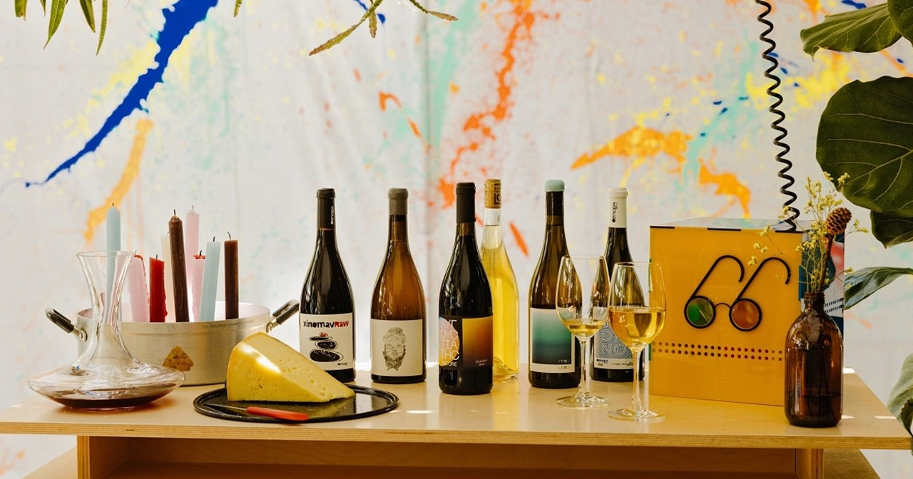
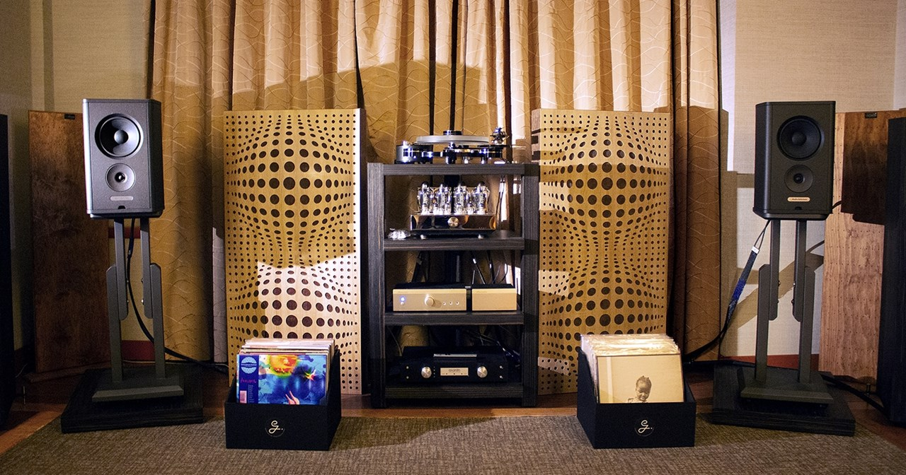
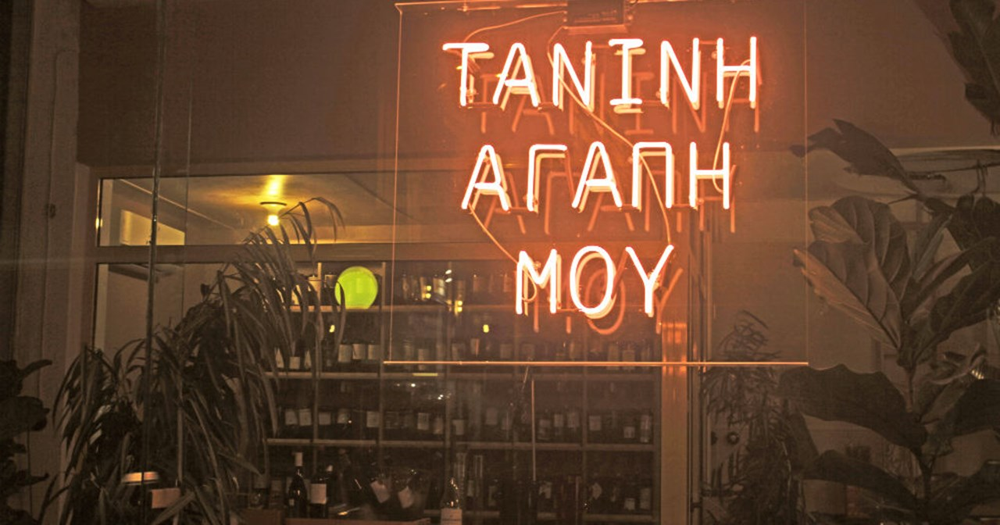
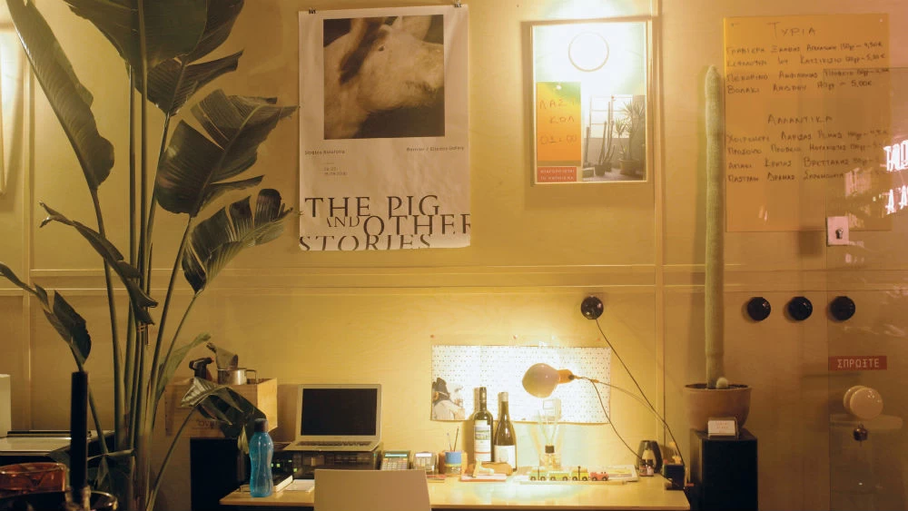
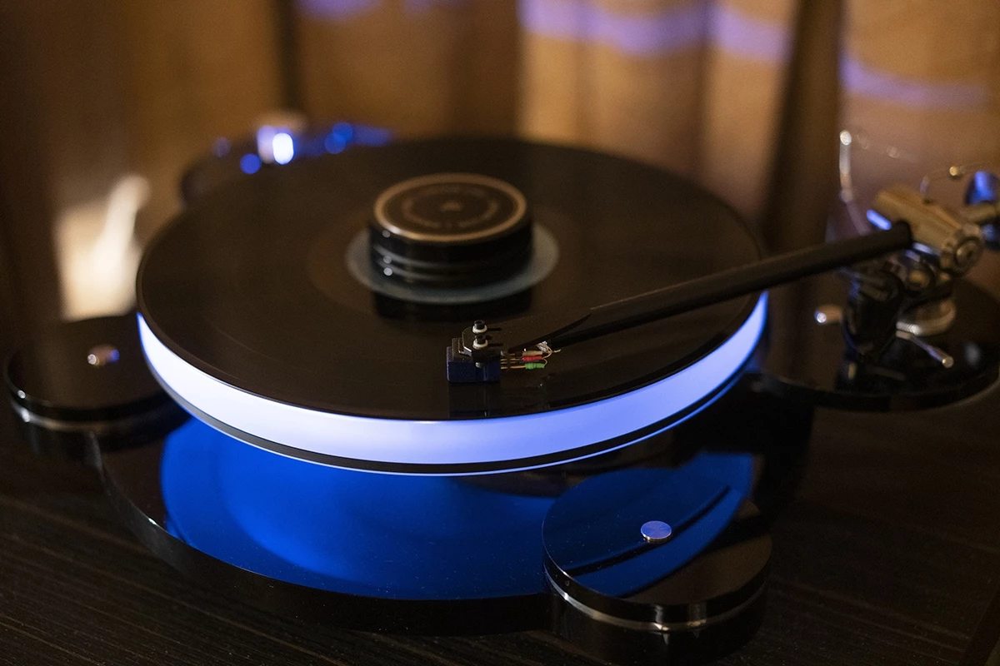

# 📂 DOSSIER #16: TANINI AGAPI MOU (Ippokratous 91 & Methonis, Exarchia)

- **Kategorie:** Unkomplizierte griechische Weinbar ohne Snobismus (100 % griechischer Wein, alle 100+ Flaschen auch glasweise + *Wine on Tap* vom Zapfhahn!) & gemütlicher Gewölbe-Weinkeller
- **Adresse:** Ippokratous 91 & Methonis (Ιπποκράτους 91 & Μεθώνης), 106 80 Exarchia / Neapoli, Athen
- **Google Maps:** [Tanini Agapi Mou](https://www.google.com/maps/search/?api=1&query=Tanini+Agapi+Mou+Athens&query_place_id=ChIJ30D80iy9oRQRPF5kEDJmvgE)
- **Kontakt & Reservierung:** Tel. `+30 211 1150145` | Web: [taniniagapimou.gr](https://taniniagapimou.gr/) | Instagram: [@tanini_agapi_mou](https://www.instagram.com/tanini_agapi_mou/)
- **Laufweg ab unserem Apartment (Korinnis):** **ca. 1,9–2,1 km / 22–24 Min. zu Fuß** (oder 5 Min. per Uber/Taxi) — mitten im gemütlichsten Teil des Schlemmer- und Kneipenviertels Exarchia!
- **Distanzen zu den Nachbar-Spots in Exarchia:**
  - -> **Spirtokouto / Spirto** (*Kallidromiou 67 / Methonis 66*): **350 m / 4 Min. zu Fuß** (direkt die autofreie Fußgängergasse *Methonis* hoch!)
  - -> **strakastrüka** (*Kallidromiou 62* / *Andrea Metaxa 19*): **450 m / 5 Min. zu Fuß**
  - -> **Ama Lachei** (*Kallidromiou 69*): **500 m / 6 Min. zu Fuß**
  - -> **Rozalia Exarchia** (*Valtetsiou 54*): **450 m / 5 Min. zu Fuß**
  - -> **Pharaoh** (*Solomou 54*): **1,0 km / 12 Min. zu Fuß**

## 🕒 Voraussichtliche Öffnungszeiten & November-Check
- **Voraussichtliche Öffnungszeiten:**
  - **Mo–Do & So:** **17:00 / 18:00 – 01:00 Uhr**
  - **Fr & Sa:** **17:00 / 18:00 – 02:00 Uhr**
- **Wetter-Faktor im November (3 Zonen — Draußen, Drinnen & Geheimer Keller!):**
  - **1. Der verkehrsfreie Gehweg auf der Methonis (Draußen):** Gemütliche Tische unter Markisen & Heizstrahlern direkt auf der belebten, autofreien Fußgängerzone *Methonis* mitten unter den Einheimischen.
  - **2. Der bunte Eck-Gastraum (Drinnen):** Warm beleuchtetes Ecklokal mit großen Fensterfronten zur Straße, klassischen Bodenfliesen, warmem Licht, vielen grünen Pflanzen und langer Holzbar.
  - **3. Der unterirdische Gewölbekeller & Listening-Room (UG):** Direkt unter dem Gehweg der *Methonis* liegt der begehbare Weinkeller mit maßgebauter Flaschenwand und einer fetten High-End-Audioanlage (*Chameleon Audio*), in dem regelmäßig Verkostungen mit satter Musik stattfinden!

## 🏛️ Konzept: „Die absolute Demokratie des Weins“ (Null Wein-Snobismus!)
- **Die Story:** Gegründet im Dezember 2018 von den beiden Jugendfreunden **Haris Filippopoulos** und **Stergios Tekeridis** aus dem nordgriechischen Drama. Der Name **„Tanini Agapi Mou“** bedeutet *„Tannin, meine Liebe“* — und genau so herzlich geht es hier zu.
- **Warum der Laden wie gemacht für unsere Ochos-Truppe ist:** Vergesst abgespreizte kleine Finger und belehrende Oberkellner! Hier herrscht das ehrliche Kneipen-Prinzip **„Wein-Demokratie“**:
  1. **Alle 100 bis 120 Flaschen gibt es auch im offenen Ausschank (By the Glass)!** Wir müssen uns am Tisch also nie auf eine einzige Flasche einigen, sondern jeder von uns kann sich kreuz und quer durch völlig verschiedene griechische Weine trinken.
  2. **Kostenlose Probeschlucke wie in einer guten Bierkneipe:** Wir sagen dem Barkeeper einfach in normaler Männersprache, worauf wir Bock haben („trocken und eiskalt“ oder „schwerer Roter mit ordentlich Wumms“), und bekommen erst einmal unkompliziert eingeschenkt zum Probieren.
  3. **Wine on Tap — Wein frisch vom Zapfhahn:** Neben den Flaschen gibt es immer **frisch gezapfte griechische Hausweine direkt vom Hahn / aus dem Fass** (süffig, eiskalt und gefährlich schnell weggetrunken!).
- **Musik & Publikum:** Aus den Boxen läuft ein richtig grooviger Mix aus **Jazz, Funk, Swing und Classic Rock**; das Publikum besteht aus gut gelaunten Einheimischen aus der Nachbarschaft — extrem entspannt, gesellig und gesprächig.

## 🍽️ Essen: Sauerteig-Pinsa, Bruschetta & Deftige Wildschwein-Salami-Platten
Kein steifes 3-Gänge-Restaurant, sondern **perfektes, herzhaftes Bar-Food zum Teilen und Aufsaugen**:
- **Sauerteig-Pizzen (Pinsa) frisch aus dem Ofen (ca. 9,00 – 13,00 €):** Knusprig-luftiger Sauerteigboden, dick belegt mit griechischen Bergkäsesorten, Tomaten, Pilzen oder würzigem Aufschnitt.
- **Herzhafte Bruschettas & Tagesgerichte (ca. 6,50 – 10,00 €).**
- **Große Käse- & Wurst-Platten kleiner griechischer Produzenten (ca. 12,00 – 18,00 €):**
  - Unser Pflichtprogramm: **Wildschwein-Salami aus Drama** (*Salami Agriogourounou*), **geräuchertes Schweinelenden-Steak aus Serres** (*Kapnisti Brizola Serron*) und würzige, gereifte Insel- und Bergkäse aus ganz Griechenland.

## 🍷 Weine, Seltene Rebsorten & Preisniveau
- **100 % Griechischer Weinberg (Handwerkliche Winzerweine aus dem ganzen Land):**
  - **Wine on Tap / Gezapfter Hauswein im Glas:** **ab unschlagbaren 3,50 – 5,00 € (!)**
  - **100+ Flaschenweine offen im Glas (By the Glass):** **ca. 5,00 – 9,50 €**
  - **Ganze Flaschen am Tisch (oder günstiger zum Mitnehmen als Wegzehrung fürs Apartment):** **ca. 18,00 – 38,00 €**
- **Tipp — nach welchen griechischen Rebsorten wir fragen können:**
  - *Sideritis* (knackig-frisch), *Plito* (alte kretische Weißweinrebe), *Mavroudi* & *Mavro Kalavrytino* (würzige, süffige Rotweine), *Aspro Potamisi* (Kykladen) oder ein kräftiger, bernsteinfarbener *Skin-Contact-Wein*.

## 🎯 Beste Uhrzeit & Taktischer Einsatz für unsere Truppe
- **1. Der ideale Zwischenstopp zwischen Festmahl & Kneipennacht in Exarchia (ca. 19:00 – 22:30 Uhr):**
  - Wenn wir uns bei **Ama Lachei** (6 Min. entfernt) oder **Rozalia** (5 Min. entfernt) den Bauch mit Geschmortem vollgeschlagen haben — oder bevor wir weiter ins **strakastrüka** (5 Min.) und **Spirtokouto** (4 Min.) ans Bierfass ziehen: Wir kapern einen Tisch an der Ecke *Ippokratous / Methonis*, bestellen eine heiße Sauerteig-Pinsa plus die Wildschwein-Salami-Platte und lassen uns einmal quer durch die griechische Weinkarte zapfen!
- **2. Der entspannte frühe Abend-Aperitif (ab 18:00 Uhr):**
  - Gegen 18:00–20:00 Uhr bekommen wir mit unserer Gruppe problemlos einen großen Tisch drinnen am Fenster oder draußen in der Fußgängerzone *Methonis* (ab 21:00 Uhr brummt die ganze Ecke auf Hochtouren!).

## 📸 Bilder
- 
- 
- 
- 
- 
