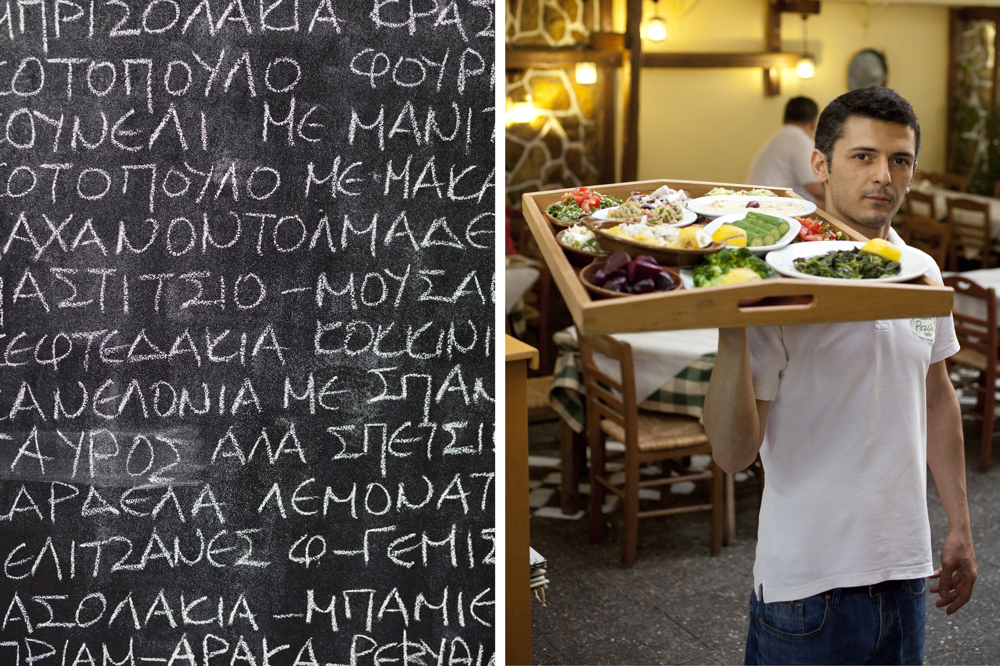
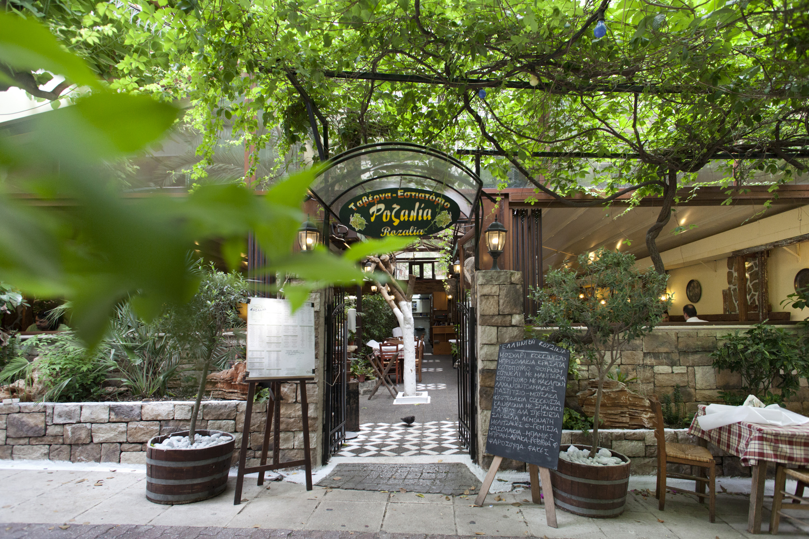
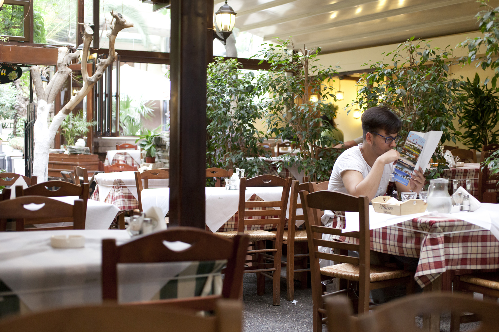
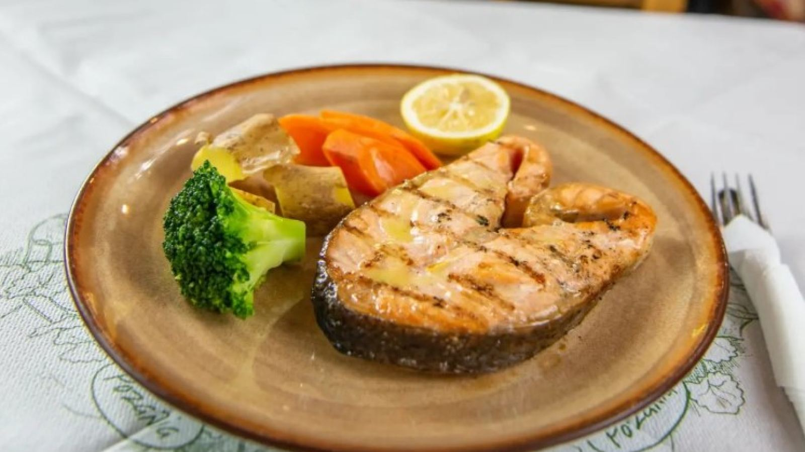
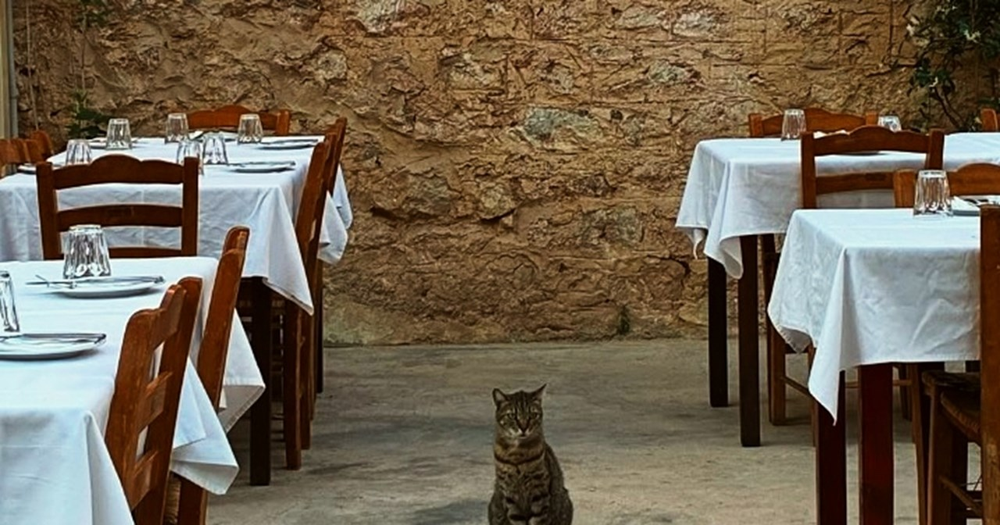

# 📂 DOSSIER #17: ROZALIA EXARCHIA (Valtetsiou 54–59, Exarchia)

- **Kategorie:** Historische Kult-Taverne (seit 1978) mit riesigem, winterfest überdachtem Gartenhof, 16er-Vorspeisen-Tablett direkt am Tisch & ehrlicher griechischer Schmortopf- und Grillküche
- **Adresse:** Valtetsiou 54–59 (Βαλτετσίου 54–59), 106 81 Exarchia, Athen *(belegt auf der autofreien Schlemmer-Fußgängerzone Valtetsiou direkt beide Straßenseiten: das neoklassizistische Stammhaus auf Nr. 54/58 und den riesigen Gartenhof gegenüber auf Nr. 59!)*
- **Google Maps:** [Rozalia Exarchia](https://www.google.com/maps/search/?api=1&query=Rozalia+Exarchia+Athens&query_place_id=ChIJ_zUtlDa9oRQRJHvjbTXuMTQ)
- **Kontakt & Reservierung:** Tel. `+30 210 3302933` & `+30 210 3802725` | E-Mail: `tavernarozalia@gmail.com` | Web: [rozalia.gr](http://www.rozalia.gr/)
- **Laufweg ab unserem Apartment (Korinnis):** **ca. 1,6–1,8 km / 18–20 Min. zu Fuß** (oder 5 Min. per Uber/Taxi)
- **Distanzen zu den Nachbar-Spots in Exarchia:**
  - -> **Ama Lachei** (*Kallidromiou 69*): **350 m / 4 Min. zu Fuß**
  - -> **strakastrüka** (*Andrea Metaxa 19* / *Kallidromiou 62*) & **Spirtokouto** (*Kallidromiou 67*): **60–350 m / 1–4 Min. zu Fuß**
  - -> **Tanini Agapi Mou** (*Ippokratous 91*): **450 m / 5 Min. zu Fuß**
  - -> **Pharaoh** (*Solomou 54*): **550 m / 6 Min. zu Fuß**

## 🕒 Voraussichtliche Öffnungszeiten & November-Check
- **Voraussichtliche Öffnungszeiten (7 Tage die Woche durchgehend ab Mittag bis tief in die Nacht!):**
  - **So–Do:** **12:00 – 01:00 Uhr** *(Küche brutzelt bis nach Mitternacht!)*
  - **Fr & Sa:** **12:00 – 01:30 / 02:00 Uhr**
- **Wetter-Faktor im November:**
  - **100 % wetterfester Gartenhof mit einfahrbarem Glas-/Zeltdach:** Der berühmte Innenhof auf der *Valtetsiou 59* (bepflanzt mit alten Platanen, Olivenbäumen, Maulbeerbäumen, Eukalyptus und Weinreben) besitzt ein **komplett schließbares Dach und kräftige Heizstrahler**. Selbst bei Regen oder kühlen Novembernächten sitzen wir hier trocken und mollig warm mitten im Grünen — plus dem urgemütlichen neoklassizistischen Gastraum direkt gegenüber auf Hausnummer 58.

## 🏛️ Die wilde Spionage-Geschichte hinter dem Namen & der Vibe
- **Wer war „Rozalia“?** Als Gründer **Achilleas Sevastopoulos** die Taverne **1978** eröffnete, lebte im Keller des Hauses eine geheimnisvolle ältere Dame namens *Avgoustina*, die eines Tages spurlos verschwand. Erst Jahre später kam heraus, dass sie im Zweiten Weltkrieg unter dem **Decknamen „Rozalia“** als griechisch-britische Geheimagentin und Spionin gearbeitet hatte, im Keller alliierte Offiziere versteckte und zur Legende wurde. Ihr zu Ehren trägt die Taverne ihren Agenten-Codenamen.
- **Das kulinarische Herzstück von Exarchia:** In den 80ern war *Rozalia* das zweite Wohnzimmer berühmter Athener Schauspieler, Schriftsteller, Musiker und Nachbarn. Bis heute ist der Laden komplett bodenständig und herrlich unkompliziert: karierte Tischdecken, klirrende Weinkaraffen, lautes Lachen und lange Tafeln, die sich unter den Schmortöpfen und Fleischplatten biegen.

## 🍽️ Essen: Das legendäre 16-Teller-Tablett, Schmortöpfe & Grill
- **Das Highlight direkt beim Hinsetzen (Das 16er-Meze-Tablett):**
  - Kaum haben wir unsere Hintern auf die Stühle gepflanzt, schwebt der Kellner mit einem **riesigen runden Metalltablett mit 16 verschiedenen kalten & warmen Vorspeisen** direkt an unseren Tisch! Wir müssen also nicht hungrig in einer Speisekarte blättern, sondern zeigen einfach mit dem Finger auf alles, was gut aussieht („Das da, das da, und das mit dem Käse auch!“), und schon wird der Tisch zugepflastert.
- **Unbedingt vom Tablett & den Vorspeisen abräumen (ca. 5,00 – 8,50 €):**
  - **Manitaria tou Merakli:** Deftig gebratene Pilze nach Hausrezept.
  - **Kretische Marathopita** (Fenchel-Pita) & **Kaltsounia** (kretische Käsetaschen mit Honig).
  - **Kolokythakia Tiganita:** Hauchdünn gestiftelte, extrem knusprig gebackene Zucchini-Sticks.
  - **Gezupfte Räucher-Aubergine (*Melitzanosalata*)**, **warme Fava**, **Riesenbohnen (*Gigantes*)** und der prämierte **Feta aus der Käserei Arvanitis** im Olivenöl-Bad.
- **Täglich 20+ Ofen- & Schmortöpfe (*Mageirefta*, ca. 9,50 – 15,00 €):**
  - **Arnaki Sfakiano:** Butterzartes Lamm aus Sparta/Kreta, stundenlang im Ofen nur mit Oregano, Olivenöl und Zitrone geschmort — Seelenbalsam für jeden verkaterten Magen!
  - **Moschari Kokkinisto / Stifado:** Kräftiges Rindergulasch in dicker Tomaten-Rotwein-Sauce.
  - **Schweinefleisch mit Sellerie-Zitronen-Sauce (*Hirino me Selino*)**, **Moussaka** & **Lahanodolmades** (gefüllte Kohlrouladen in cremiger Ei-Zitronen-Sauce).
- **Vom Holzkohlegrill (ca. 9,50 – 16,00 €):**
  - **Gemisto Bifteki Horiatiko:** Ein amtliches Rinderhacksteak-Geschoss, prall gefüllt mit Feta und roter Florina-Paprika.
  - **Paidakia Galaktos** (knusprige Milchlammkoteletts zum Abnagen), **Psaronefri Piperato** (pfeffriges Schweinefilet) & **Loukaniko me Praso** (deftige Bauernwurst mit Lauch).
- **Legendäres Gratis-Dessert (*Kerasma* aufs Haus!):**
  - Wenn wir eigentlich schon kurz vorm Platzen sind, stellt das Haus traditionell noch eine große Platte **griechischen Sahnejoghurt mit hausgemachten eingelegten Löffelfrüchten (*Glyka tou Koutaliou*: Zitrone, Bergamotte & Quitte)** kostenlos in die Tischmitte!

## 🍷 Getränke & Preisniveau
- **Kretischer Klosterwein vom Fass:** Der offene Hauswein kommt direkt aus dem historischen **Kloster Toplou (*Moni Toplou*) in Sitia auf Kreta** (0,5l-Karaffe ca. **5,50 – 7,00 €** — läuft runter wie Messwein, nur mit besserer Wirkung!).
- **Tsipouro, kretischer Raki & eiskalte griechische Biere (Alfa, Fix, Mamos, Kaiser):** 0,5l-Flasche Bier ca. **3,80 – 4,50 €**.
- **Gesamtrechnung:** Unschlagbar fair — für einen komplett vollgedeckten Tisch inkl. Klosterwein, Bier und Gratis-Dessert zahlen wir **ca. 16 – 22 € pro Nase**!

## 🎯 Beste Uhrzeit & Taktischer Einsatz für unsere Ochos-Truppe
- **1. Unser kugelsicherer Großgruppen-Joker in Exarchia (extrem Walk-in-freundlich!):**
  - Falls es bei *Ama Lachei* (4 Min. entfernt) brechend voll ist oder wir einfach ohne Wartezeit mit der ganzen Mannschaft unter Bäumen im warmen Gartenhof tafeln wollen: *Rozalia* hat durch den riesigen überdachten Garten + das Stammhaus gegenüber immer Platz für eine hungrige Männerrunde!
- **2. Das perfekte Late-Night-Festmahl nach den Bars (bis 01:00 / 01:30 Uhr!):**
  - Während viele Küchen in Athen um 23:30 Uhr den Herd ausmachen, brutzelt der Holzkohlegrill bei *Rozalia* bis weit nach Mitternacht. Goldwert, wenn wir nach vier Bieren im *strakastrüka* (60 Meter nebenan!) oder nach einer Weinrunde bei *Tanini Agapi Mou* und *Warehouse* um 23:30 Uhr noch einmal bärenhungrig auf Lammkoteletts, gefülltes Bifteki und das 16er-Vorspeisen-Tablett werden!

## 📸 Bilder
- 
- 
- 
- 
- 
