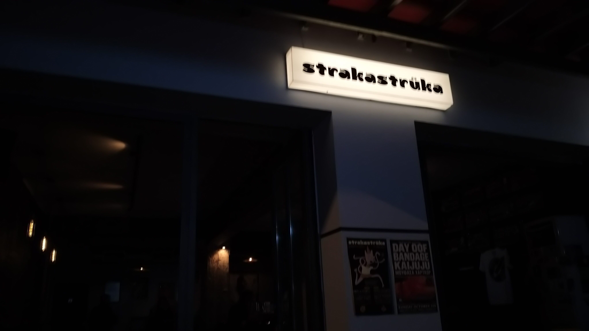
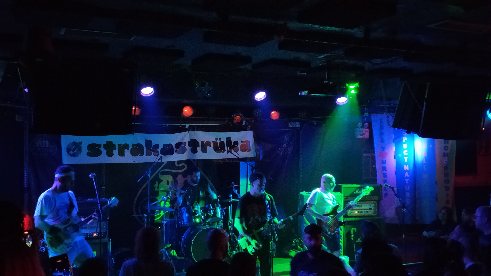
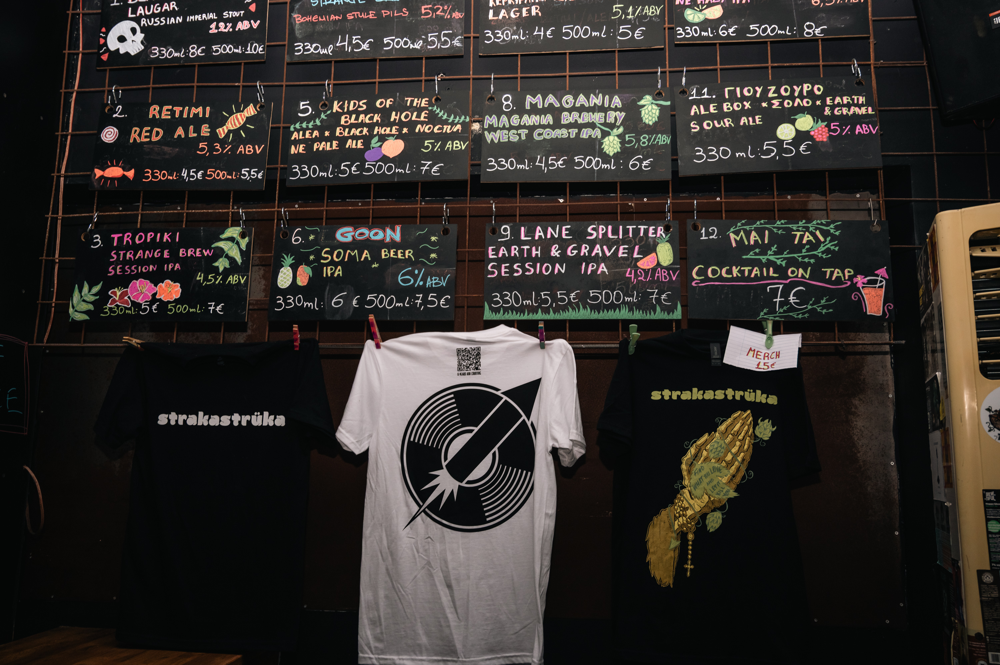
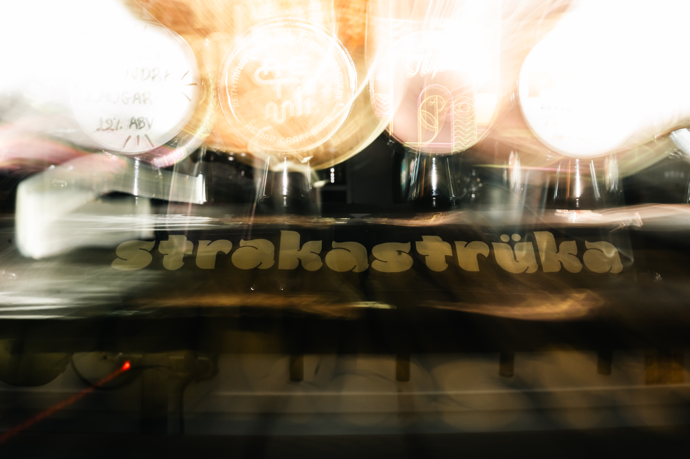
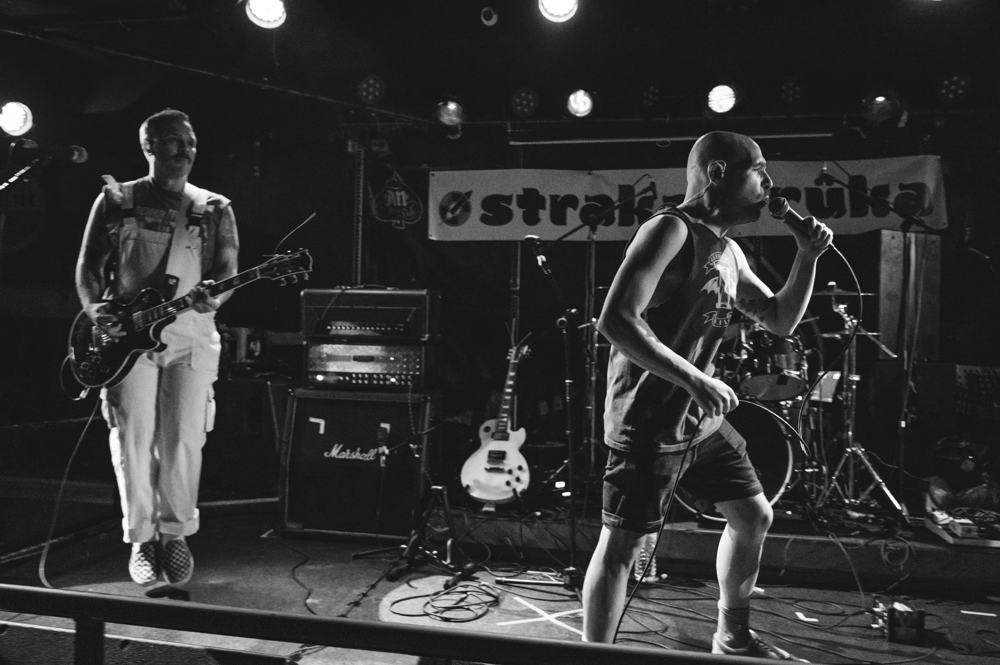

# 📂 DOSSIER #18: strakastrüka — Music Joint & Craft Beer Bar (Andrea Metaxa 19, Exarchia)

- **Kategorie:** Rock-/Alternative-Music-Joint, Craft-Beer-Bar (9 Zapfhähne + 30+ Dosen/Flaschen) & Kiez-Treffpunkt (*„Craft Beer & Raw Sounds — Approved CHAOS“*)
- **Adresse:** **Andrea Metaxa 19 (Ανδρέα Μεταξά 19)**, 106 81 Exarchia, Athen *(direkt an der Ecke zur Fußgängerzone Valtetsiou, nur 60 Meter neben Rozalia)*
- **Google Maps:** [strakastrüka Exarchia](https://www.google.com/maps/search/?api=1&query=strakastruka+Andrea+Metaxa+19+Athens)
- **Kontakt & Live-Taplist:** Tel. `+30 211 0085366` | Web & Live-Untappd-Menü: [strakastruka.gr](https://www.strakastruka.gr/menu) | Instagram: [@strakastruka.music.joint](https://www.instagram.com/strakastruka.music.joint/)
- **Laufweg ab Apartment (Korinnis):** **ca. 1,6–1,8 km / 18–20 Min. zu Fuß** (direkt neben *Rozalia*)
- **Distanzen zu den Nachbar-Spots in Exarchia:**
  - -> **Rozalia Exarchia** (*Valtetsiou 54–59*): **60 m / 1 Min. zu Fuß** (direkt um die Ecke!)
  - -> **Warehouse Exarchia** (*Valtetsiou 21*): **160 m / 2 Min. zu Fuß**
  - -> **Koletti-Kneipenmeile** (*Revolt Street Bar*, *Mavros Gatos / Black Cat*): **180 m / 2 Min. zu Fuß**
  - -> **to Spirto** (*Tzavella 9–13*): **250 m / 3 Min. zu Fuß**
  - -> **Pharaoh** (*Solomou 54*): **300 m / 4 Min. zu Fuß**
  - -> **Ama Lachei** (*Kallidromiou 69*): **400 m / 5 Min. zu Fuß**
  - -> **Tanini Agapi Mou** (*Ippokratous 91*): **450 m / 5 Min. zu Fuß**

---

## 🕒 Voraussichtliche Öffnungszeiten & November-Check
- **Voraussichtliche Öffnungszeiten:**
  - **Di–Do:** **18:00 – 01:00 Uhr**
  - **Fr & Sa:** **16:00 – 03:00 Uhr** *(perfekt für Freitagnachmittag-/Samstagnachmittag-Daydrinking bis tief in die Nacht!)*
  - **So:** **16:00 – 01:00 Uhr** *(Montag geschlossen)*
- **Wetter-Faktor im November:**
  - Kompaktes, dunkel gehaltenes Rock'n'Roll-Lokal mit Band-Stickern, Comic-Mural (von *danistrips*), langer Holzbar **plus überdachten Steh-/Sitzplätzen draußen vor der Front**, wo sich abends die Exarchia-Crowd mit dem Bierglas in der Hand trifft.

## 🍺 Biere (Live-Taplist Oktober/November 2026), Drinks & Barfood
Gegründet von den drei Freunden **Giorgos Giakos, Dimitris Evgenikos und Themos Karanikolas** (ursprünglich in Koukaki gestartet, heute eine feste Institution in Exarchia). Der Name *„Strakastrüka“* bezeichnet auf Griechisch die kleinen Knallerbsen/Kracher — und genau so knallt auch die Musik (Queens of the Stone Age, Joy Division, Wipers, System of a Down, 90s Grunge, Stoner & Punk Rock — laut genug für echtes Kneipengefühl, aber so abgemischt, dass man sich noch super unterhalten kann!).

- **9 rotierende Zapfhähne (aktuell im Herbst 2026 am Hahn, Pint ca. 5,00 – 7,00 € / Beer Flight Probierbrett 9,00 €):**
  1. **Voreia Stout** (6,2 % Foreign Stout, *Siris Microbrewery*, Serres — dunkles Schoko-Kaffee-Stout)
  2. **Gardenia West Coast IPA** (5,8 %, *Four Hand Craft Beer Synergy* mit Columbus, Cascade & Cryo Citra)
  3. **Strange Brew Jasmine IPA** (6,2 %, Athens Kult-IPA)
  4. **Kyria Toula (Κυρία Τούλα) NEIPA** (6,0 %, *Sourmena Brew*, Athen — unfiltriertes Pfirsich-/Citrus-Hazy-IPA)
  5. **3,14 IπA Session Hazy IPA** (3,1 %, *Utopia Grassroots Craft Brewing* x *Magania* — leichtes Daydrinking-IPA)
  6. **Koryfo (Κορυφώ) Helles Lager** (5,0 %, *Corfu Microbrewery*)
  7. **Afterglow Hazy IPA** (6,5 %) & **Waimea Flow Pale Ale** (5,2 %, *Counterpart Brewing*)
- **Dazu:** 30+ Dosen & Flaschen griechischer Mikrobrauereien (*Blame the Sun*, *Dark Crops*, *Noble Men*, *Kykao*), **Aperol Spritz (7,50 €)**, **Negroni / Margarita / Paloma (8,50 €)**, **Straight Drinks (7,00 – 9,00 €)** & **Shots (3,00 €)**.
- **Legendärer Mitternachts-Snack:** **The Straka Hot Dog (ca. 5,50 €)** im Brioche-Bun mit karamellisierten Zwiebeln & Haussauce sowie knusprige Bar-Pizza (**8,50 – 10,00 €**)!

## 📸 Bilder
- 
- 
- 
- 
- 
