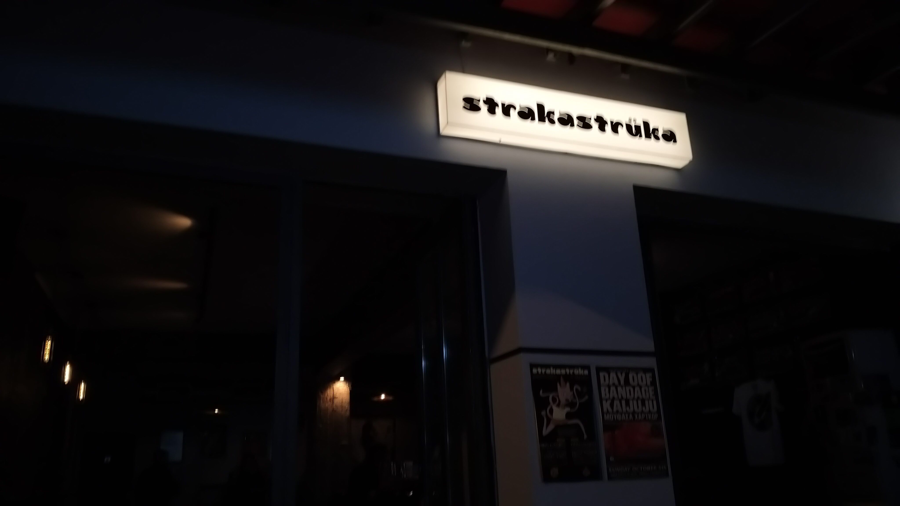
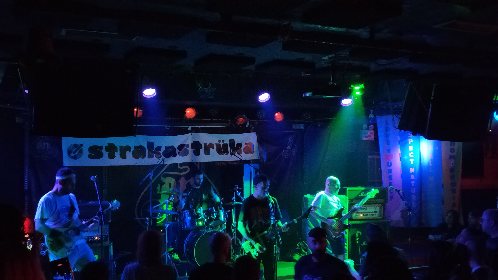
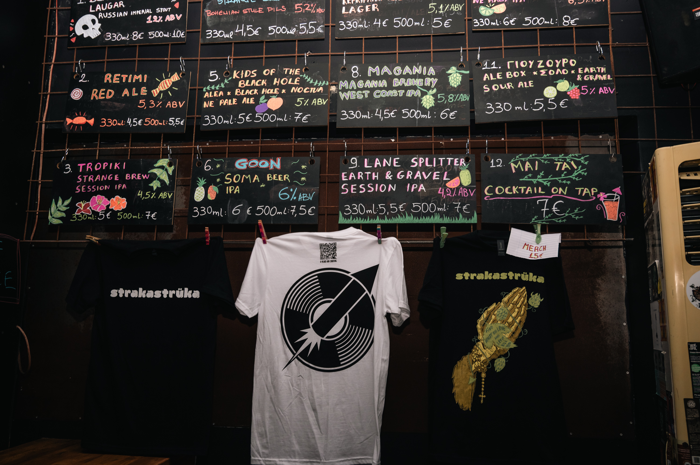
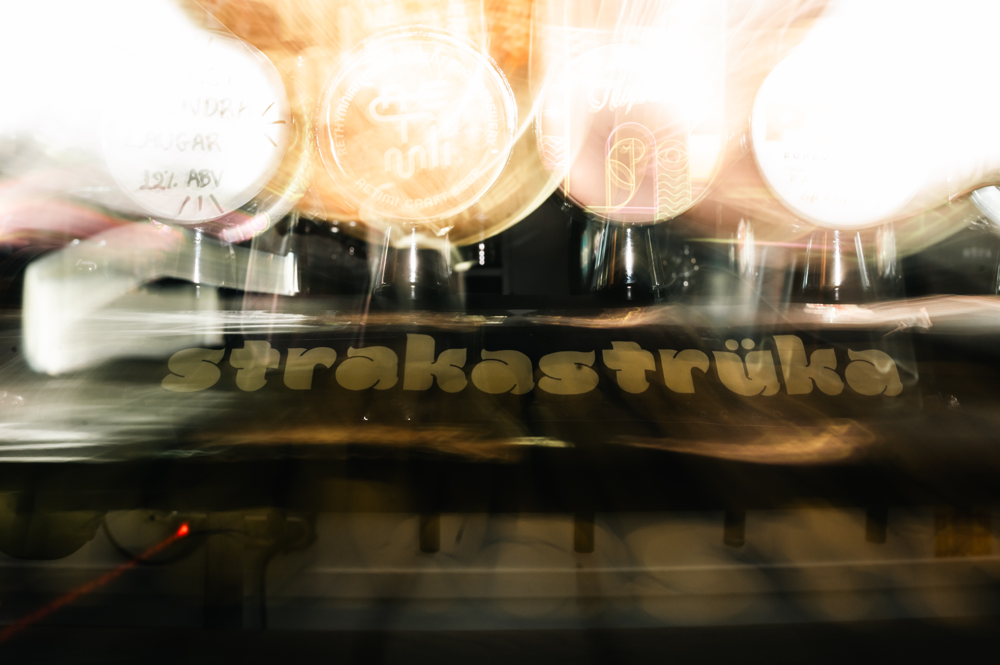
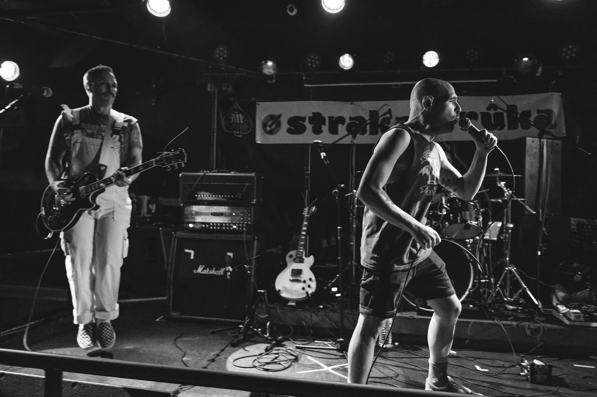

# 📂 DOSSIER #18: STRAKASTRÜKA, SPIRTO & DIE EXARCHIA-SPÄTNACHT-ACHSE

Dieses Dossier bündelt eure **Rock-, Craft-Beer- & Late-Night-Absacker-Spots in Exarchia** rund um die *Andrea Metaxa*, *Koletti* und *Tzavella* — inklusive zweier wichtiger Adress-Korrekturen gegenüber dem ursprünglichen Rohentwurf, damit ihr nachts um 1 Uhr garantiert vor der richtigen Tür steht!

---

## 🎸 HAUPT-SPOT 1: strakastrüka — Music Joint & Craft Beer Bar (Andrea Metaxa 19)

- **Kategorie:** Rock-/Alternative-Music-Joint, Craft-Beer-Bar (9 Zapfhähne + 30+ Dosen/Flaschen) & Kiez-Treffpunkt (*„Craft Beer & Raw Sounds — Approved CHAOS“*)
- **Wichtige Adress-Korrektur:** **Andrea Metaxa 19 (Ανδρέα Μεταξά 19)**, 106 81 Exarchia, Athen *(im alten Rohentwurf stand Hausnummer 2 — der Laden sitzt aber auf der **Andrea Metaxa 19** direkt an der Ecke zur Fußgängerzone Valtetsiou, nur 60 Meter neben Rozalia!)*
- **Google Maps:** [strakastrüka Exarchia](https://www.google.com/maps/search/?api=1&query=strakastruka+Andrea+Metaxa+19+Athens)
- **Kontakt & Live-Taplist:** Tel. `+30 211 0085366` | Web & Live-Untappd-Menü: [strakastruka.gr](https://www.strakastruka.gr/menu) | Instagram: [@strakastruka.music.joint](https://www.instagram.com/strakastruka.music.joint/)
- **Laufweg ab Apartment (Korinnis):** **ca. 1,6–1,8 km / 18–20 Min. zu Fuß** (direkt neben *Rozalia*)
- **Distanzen zu den Nachbar-Spots in Exarchia:**
  - -> **Rozalia Exarchia** (*Valtetsiou 54–59*): **60 m / 1 Min. zu Fuß** (direkt um die Ecke!)
  - -> **Koletti-Kneipenmeile** (*Revolt Street Bar*, *Mavros Gatos / Black Cat*): **180 m / 2 Min. zu Fuß**
  - -> **Pharaoh** (*Solomou 54*): **300 m / 4 Min. zu Fuß**
  - -> **Ama Lachei** (*Kallidromiou 69*): **400 m / 5 Min. zu Fuß**
  - -> **Tanini Agapi Mou** (*Ippokratous 91*): **450 m / 5 Min. zu Fuß**

### 🕒 Öffnungszeiten & November-Check (strakastrüka)
- **Öffnungszeiten:**
  - **Di–Do:** **18:00 – 01:00 Uhr**
  - **Fr & Sa:** **16:00 – 03:00 Uhr** *(perfekt für Freitagnachmittag-/Samstagnachmittag-Daydrinking bis tief in die Nacht!)*
  - **So:** **16:00 – 01:00 Uhr** *(Montag geschlossen)*
- **Wetter-Faktor im November:**
  - Kompaktes, dunkel gehaltenes Rock'n'Roll-Lokal mit Band-Stickern, Comic-Mural (von *danistrips*), langer Holzbar **plus überdachten Steh-/Sitzplätzen draußen vor der Front**, wo sich abends die Exarchia-Crowd mit dem Bierglas in der Hand trifft.

### 🍺 Biere (Live-Taplist Oktober/November 2026), Drinks & Barfood
Gegründet von den drei Freunden **Giorgos Giakos, Dimitris Evgenikos und Themos Karanikolas** (ursprünglich in Koukaki gestartet, heute eine feste Institution in Exarchia). Der Name *„Strakastrüka“* bezeichnet auf Griechisch die kleinen Knallerbsen/Kracher — und genau so knallt auch die Musik (Queens of the Stone Age, Joy Division, Wipers, System of a Down, 90s Grunge, Stoner & Punk Rock — laut genug für echtes Kneipengefühl, aber so abgemischt, dass man sich noch super unterhalten kann!).
- **9 rotierende Zapfhähne (aktuell im Herbst 2026 am Hahn, Pint ca. 5,00 – 7,00 € / Beer Flight Probierbrett 9,00 €):**
  1. **Voreia Stout** (6,2 % Foreign Stout, *Siris Microbrewery*, Serres — dunkles Schoko-Kaffee-Stout)
  2. **Gardenia West Coast IPA** (5,8 %, *Four Hand Craft Beer Synergy* mit Columbus, Cascade & Cryo Citra)
  3. **Strange Brew Jasmine IPA** (6,2 %, Athens Kult-IPA)
  4. **Kyria Toula (Κυρία Τούλα) NEIPA** (6,0 %, *Sourmena Brew*, Athen — unfiltriertes Pfirsich-/Citrus-Hazy-IPA)
  5. **3,14 IπA Session Hazy IPA** (3,1 %, *Utopia Grassroots Craft Brewing* x *Magania* — leichtes Daydrinking-IPA)
  6. **Koryfo (Κορυφώ) Helles Lager** (5,0 %, *Corfu Microbrewery*)
  7. **Afterglow Hazy IPA** (6,5 %) & **Waimea Flow Pale Ale** (5,2 %, *Counterpart Brewing*)
- **Dazu:** 30+ Dosen & Flaschen griechischer Mikrobrauereien (*Blame the Sun*, *Dark Crops*, *Noble Men*, *Kykao*), **Aperol Spritz (7,50 €)**, **Negroni / Margarita / Paloma (8,50 €)**, **Straight Drinks (7,00 – 9,00 €)** & **Shots (3,00 €)**.
- **Legendärer Mitternachts-Snack:** **The Straka Hot Dog (ca. 5,50 €)** im Brioche-Bun mit karamellisierten Zwiebeln & Haussauce sowie knusprige Bar-Pizza (**8,50 – 10,00 €**)!

---

## 🔥 HAUPT-SPOT 2: SPIRTO / DIE KOLETTI-ACHSE & SPIRTOKOUTO (Wichtiger Realitäts-Check!)

Im ursprünglichen Master-Dokument waren unter *„Spirto (Spirtokouto), Koletti 27“* zwei verschiedene Kultläden miteinander verschmolzen. Hier ist die **exakte Aufschlüsselung für eure Spätnacht**:

### Option A (Direkt in Exarchia — 2 Min. neben strakastrüka):
1. **to Spirto (το Σπίρτο) — Tzavella 9–13, Exarchia:**
   - **Lage & Kontakt:** Fußgängerzone **Tzavella 9–13 (Τζαβέλλα 9–13)**, 106 81 Exarchia ([Google Maps](https://www.google.com/maps/search/?api=1&query=Spirto+Tzavella+9+Exarchia+Athens), Tel. `+30 210 3303611`, FB: `facebook.com/SpirtoExarcheia`) — zwischen *Zoodochou Pigis* und *Emmanouil Benaki*, direkt gegenüber vom selbstverwalteten *Navarinou-Park* und nur 3 Gehminuten (250 m) von *strakastrüka* und der *Koletti*!
   - **Öffnungszeiten:** Mo–Do 12:00–03:00 Uhr, **Fr & Sa 13:00–05:00 Uhr (!)**, So 15:00–03:00 Uhr.
   - **Vibe:** Klassische, völlig unprätentiöse Exarchia-Spätnacht-Kneipe mit Rock/Indie/Alternative-Sound und günstigen Drinks (6–7 €) bis zum Morgengrauen.
2. **Die Koletti-Straßenbar-Meile (Koletti 25–42, Exarchia):**
   - Direkt auf der **Koletti 25–27 (Κωλέττη 25–27)** sitzt die **Revolt Street Bar** ([Google Maps](https://www.google.com/maps/search/?api=1&query=Revolt+street+bar+Athens&query_place_id=ChIJ1dw8MDG9oRQR5dH2rmWIA_8), täglich bis 02:00/03:00 Uhr, Streetart-Hof & Straßen-Vibe), und 100 Meter weiter auf der **Koletti 42** liegt die legendäre Rock-/Blues-/80s-Bar **Mavros Gatos (Black Cat)** mit ihrer 12 Meter langen Holztheke!

### Option B (In Petralona — 150 m neben Upupa Epops!):
- **„Spirtokouto“ Bar (Σπιρτόκουτο = Streichholzschachtel) — Keiriadon 15, Petralona:**
  - **Lage:** **Keiriadon 15 (Κειριαδών 15), 118 54 Kato Petralona** ([Google Maps](https://www.google.com/maps/search/?api=1&query=Spirtokouto+Bar+Keiriadon+15+Athens&query_place_id=ChIJVUUv2Ta9oRQRyHaPCG4o7_A), Tel. `+30 210 3462689`) — liegt **nicht** in Exarchia, sondern auf eurer **West-Linie in Petralona, nur 2 Gehminuten (150 m) von Upupa Epops entfernt**!
  - **Öffnungszeiten:** So–Do **18:00 – 02:00 Uhr**, **Fr & Sa 18:00 – 04:00 Uhr**.
  - **Vibe:** Gegründet 2009, benannt nach dem griechischen Kultfilm *Spirtokouto* (2003). Eine herrlich verrückte **80s/90s-Retro-Trash- & Rock-Bar**, tapeziert mit alten Musikkassetten, *Star Wars*-Tapeten, Vintage-Spielzeug und Popkultur-Relikten. Perfekt als wilder Late-Night-Absacker nach *Upupa Epops* und *Line Athens*!

---

## 🍾 BONUS-SPOT IN EXARCHIA: WAREHOUSE / WAREHOUSE CO2 (Valtetsiou 21 & Mavromichali)

Da er im Master-Guide direkt darunter gelistet ist, hier auch die wichtigsten Eckdaten zum **Warehouse**:
- **Adresse (Stammhaus Exarchia):** **Valtetsiou 21 & Mavromichali**, 106 80 Exarchia ([Google Maps](https://www.google.com/maps/search/?api=1&query=Warehouse+Valtetsiou+21+Athens), Tel. `+30 215 5408002`, Web: [warehouseproject.gr](https://www.warehouseproject.gr/)). Nur **200 m / 2 Min. die Fußgängerzone Valtetsiou hinunter ab Rozalia & strakastrüka**!
- **Öffnungszeiten:** **Täglich 09:00 – 02:30 Uhr** (ab morgens Specialty Coffee der eigenen Rösterei *Wisecup*, Brunch, danach **300+ Weine — davon 100(!) offen im Glas** — plus Signature Cocktails & kaltes/warmes Delikatessen-Bistro).
- *(Hinweis: Der kleine Schwesterladen **Warehouse CO2** — spezialisiert auf Champagner, Crémant, Pet-Nat & Schaumweine — liegt im Zentrum in einer Fußgängerpassage nahe Syntagma auf der **Ypereidou 1 / Nikis**, nur 2 Min. neben dem Craft-Beer-Spot **Brew Str**!)*

## 📸 Bilder (strakastrüka Exarchia)
- 
- 
- 
- 
- 
