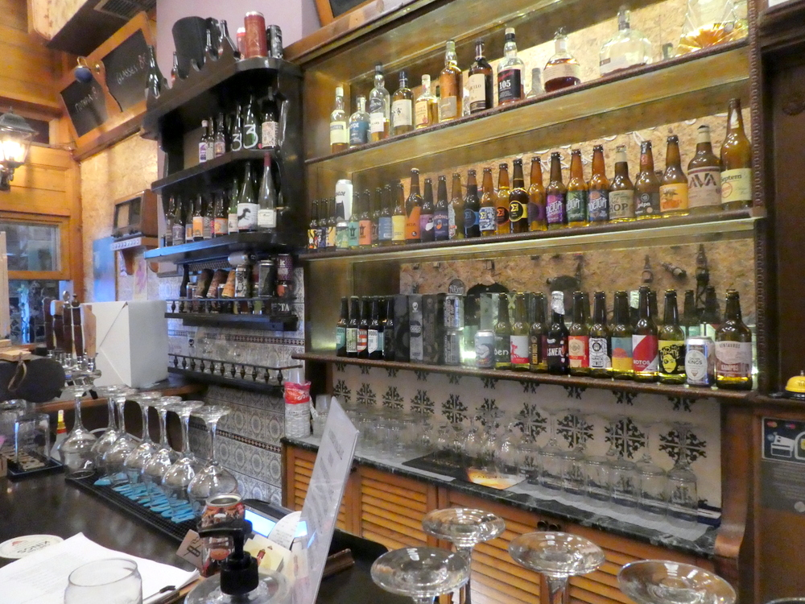

# 📂 DOSSIER #27: BREW STR – ATHENS BEER SHOP & BAR (Nikis 50, Syntagma / Plaka)

- **Kategorie:** Craft-Beer-Bottleshop & Tap-Bar am Übergang zwischen Syntagma und Plaka
- **Adresse:** Nikis 50 (Νίκης 50), 105 58 Syntagma / Plaka, Athen
- **Google Maps:** [Brew Str](https://www.google.com/maps/search/?api=1&query=Brew+Str+Athens+Beer+Shop&query_place_id=ChIJh3iIeze9oRQREExoNv2utBw)
- **Kontakt:** Tel. `+30 210 3220290`
- **Laufweg ab Apartment (`Korinnis 11`):** **ca. 1,35 km / 15 Min. zu Fuß** (oder **5 Min.** südöstlich von *The Bar in Front of the Bar* bzw. **120 m / 1 Min.** neben *Warehouse CO2* am Rand der Plaka).

---

## 🕒 Voraussichtliche Öffnungszeiten
- **Mo–Mi:** 12:00 – 23:30 Uhr
- **Do:** 12:00 – 01:00 Uhr
- **Fr & Sa:** 12:00 – 02:00 Uhr
- **So:** 17:00 – 23:30 Uhr

## 🍺 Vibe, Auswahl & Taktischer Einsatz für die Ochos
- **Auswahl (Flüssige Munition):** Rotierende Zapfhähne mit frisch gezapftem griechischem und internationalem Craft Beer sowie prall gefüllte Kühlschränke mit Dosen und Flaschen der besten griechischen Mikrobrauereien (*Strange Brew*, *Seven Islands*, *Kykao*, *Noctua* u. a.) – perfekt zum direkten Vernichten vor Ort oder zum Einsacken als Kühlschrank-Reserve für unser Apartment in der Korinnis.
- **Wann schlagen wir hier auf?** Wenn wir uns tagsüber von der Akropolis runterrollen oder durch die Plaka Richtung Syntagma marschieren und plötzlich akute Unterhopfung droht. Hier gibt es kein steifes Kellner-Ballett, sondern ein schnelles, eiskalt gezapftes Starkbier direkt im Stehen oder an der frischen Luft auf dem Gehweg. Wer danach noch Durst auf edle Bläschen hat: Das *Warehouse CO2* (`Ypereidou 1 & Nikis 21`) liegt buchstäblich eine Hausnummer weiter (120 m) für den nahtlosen Doppel-Boxenstopp!

## 📸 Bilder
- 
