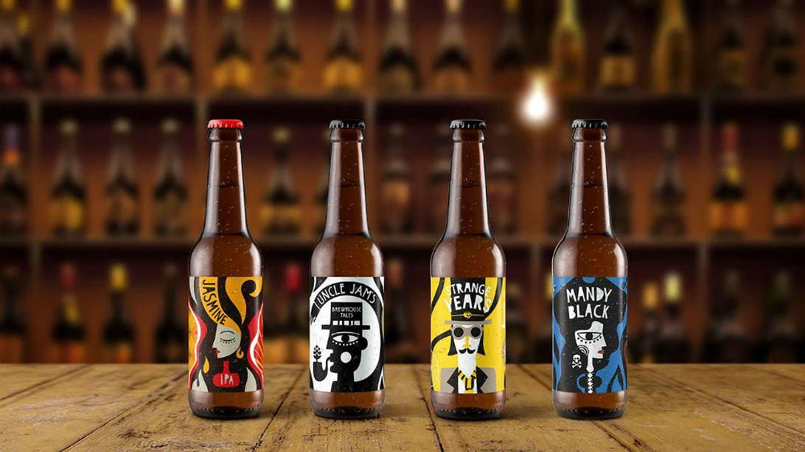

# 📂 DOSSIER #28: STRANGE BREW TAPROOM & BOTTLESHOP (Falirou 86, Koukaki)

- **Kategorie:** Offizieller Taproom & Bottleshop der Athener Kult-Brauerei *Strange Brew* (10 eigene Zapfhähne + Kühlschränke)
- **Adresse:** Falirou 86 (Φαλήρου 86), 117 41 Koukaki, Athen
- **Google Maps:** [Strange Brew Taproom](https://www.google.com/maps/search/?api=1&query=Strange+Brew+Taproom+Bottleshop+Athens&query_place_id=ChIJGQHtryu9oRQRA_5gUpx0ANs)
- **Kontakt:** Tel. `+30 210 9232146`
- **Laufweg ab Apartment (`Korinnis 11`, Psyri-Nord):** **ca. 2,3 km / 26 Min. zu Fuß** (südlich der Akropolis in Koukaki).

---

## 🕒 Voraussichtliche Öffnungszeiten
- **Mo–Do:** 17:30 – 01:00 Uhr
- **Fr:** 17:30 – 02:00 Uhr
- **Sa:** 14:00 – 02:00 Uhr
- **So:** 14:00 – 01:00 Uhr

## 🍺 Biere, Vibe & Taktischer Einsatz für unsere Truppe
- **Das Hauptquartier des Hopfens:** Hier sitzen wir direkt an der Quelle von Athens bekanntester unabhängiger Brauerei. Aus 10 Zapfhähnen fließt das legendäre *Jasmine IPA* (6,2 % – gebraut mit echten Jasminblüten, ballert herrlich rund), das trübe Schwergewicht *Dr. Haze* (Double NEIPA), *Uncle Jam’s* sowie wechselnde Small-Batch-Sude und Gastbiere. Gedrunken wird völlig tiefenentspannt an der Theke oder draußen auf dem Bürgersteig mit den Einheimischen.
- **Wann machen wir den Schlenker?** Ehrlich unter uns: Extra nur für ein einziges Glas von unserem Apartment in der Korinnis die 26 Minuten hier runterzulatschen, wäre unnötige Kalorienverschwendung (zumal wir die *Strange-Brew*-Biere auch 8 Minuten von unserer Haustür bei *Tales of Ales* gezapft kriegen). **Aber:** Wenn wir uns am Freitag oder Samstag die **Akropolis und das Akropolismuseum** gegeben haben und mit staubiger Kehle auf der Südseite durch das geile Nachbarschaftsviertel Koukaki schlendern, ist dieser Taproom mit seinen 10 Hähnen der absolute Pflicht-Boxenstopp zur Elektrolyt-Zufuhr!

## 📸 Bilder
- 
